# Introduction to APIs: Wikipedia {#sec-wikipedia}

::: {.callout-tip}
## Learning Objectives
- Explain what an API is and how it differs from web scraping as a data access method
- Find Wikipedia's less-visible features (talk pages, revision histories, pageviews, links, categories, templates, user contributions) and the API endpoint that reads each one
- Read API documentation to identify endpoints, parameters, and response formats
- Construct parameterized API requests and handle pagination with continuation tokens
- Explain what a pageview counts, and what changed when automated traffic was reclassified
- Move from raw requests to a client library, and say what the library does for you
:::

::: {.callout-tip}
## Companion Notebook
Run this chapter's code as you read: open the [companion notebook](https://github.com/cuinfoscience/Web-Data-Science-Book/blob/main/notebooks/ch-10-wikipedia.ipynb) (see @sec-appendix-notebooks for all of them).
:::


## What Is an API?

An API (Application Programming Interface) is a contract between a client and a server that specifies what data you can request, what parameters you can pass, and in what format you will receive the response. Unlike web scraping, where you reverse-engineer the HTML structure of a page designed for human readers, APIs provide structured, documented, and intentional access to data. They return clean JSON rather than cluttered HTML. They offer stable endpoints rather than fragile CSS selectors. And they come with documentation that tells you exactly what is available and how to ask for it.

The tradeoff is that APIs only expose what their operators choose to expose. You cannot query a field that the API does not provide. You cannot exceed the rate limits the server enforces. And as @sec-post-api describes, APIs can be restricted, repriced, or shut down entirely at the operator's discretion. But when they are available, APIs are almost always preferable to scraping.

This chapter marks the transition from document scraping (Part II) to API-based data access (Part III). The skills you learn here — reading documentation, constructing parameterized URLs, handling pagination, parsing nested JSON responses — transfer directly to every API you will work with in subsequent chapters.

## A Tour of Wikipedia

You have met Wikipedia's article on the University of Colorado Boulder twice already. In @sec-introduction, `requests.get()` fetched its HTML, and the pageviews API counted its readers. In @sec-protocols, DevTools showed the requests a browser makes to draw it, and the Action API's `prop=info` described it. This chapter returns to the same article, and to the city around it, [Boulder, Colorado](https://en.wikipedia.org/wiki/Boulder,_Colorado), to read Wikipedia the way its editors and researchers do.

Most readers see an article and nothing else. Behind every article sits a set of other pages and records that Wikipedia keeps in the open: who changed what and when, what editors argued about, how many people read it each day, what it links to and what links to it, and the same topic in other languages. Research on Wikipedia, including how it covers breaking news [@keegan2013hot; @keegan2020encyclopedia] and how its editors make and change its rules [@keegan2017evolution], is built on these records. Each one has an API endpoint, so anything you can see in the interface, you can count.

::: {.callout-note}
## Public Interest Connection
Wikipedia is the counter-example to the enclosure story of @sec-post-api. While commercial platforms restricted, repriced, or shut down their APIs, Wikipedia kept its API open, licensed its content for free reuse, and published complete database dumps for anyone to download. That combination — open API, open license, public dumps — is why this book uses Wikipedia as its teaching platform for API fundamentals. It is also under pressure, as "Social History and Public Interest" at the end of this chapter describes.
:::

### The Article

The article itself is one page among several. The tabs above it lead to the others (@fig-article-tabs): the **Article** ①, its **Talk** page ②, and **View history** ③. The languages button ④ lists the editions that have an article on the same topic. Inside the text, each blue **wikilink** ⑤ points to another article. The box at the right is an **infobox** ⑥, filled in by a **template**: a reusable piece of wikitext that thousands of university articles share, so their infoboxes have the same fields in the same order.

{#fig-article-tabs .lightbox fig-alt="Screenshot of the English Wikipedia article University of Colorado Boulder. Marker 1: the Article tab. Marker 2: the Talk tab. Marker 3: View history. Marker 4: the languages button at the top right. Marker 5: a blue wikilink in the article's first paragraph. Marker 6: the infobox at the right, with the university's seal and facts such as its founding date."}

### Links In, Links Out, and Languages

A wikilink is a citation of another article, and the set of an article's links is a small map of what its editors think it connects to. The reverse map is **What links here** (@fig-what-links-here): every page whose text links to this one ①, with filters for redirects, links, and transclusions ②. Interlanguage links (@fig-languages-menu) connect the same topic across Wikipedia's editions: the menu's search box ① and its list of editions ②. Each edition is written by its own community, so the articles are not translations of each other.

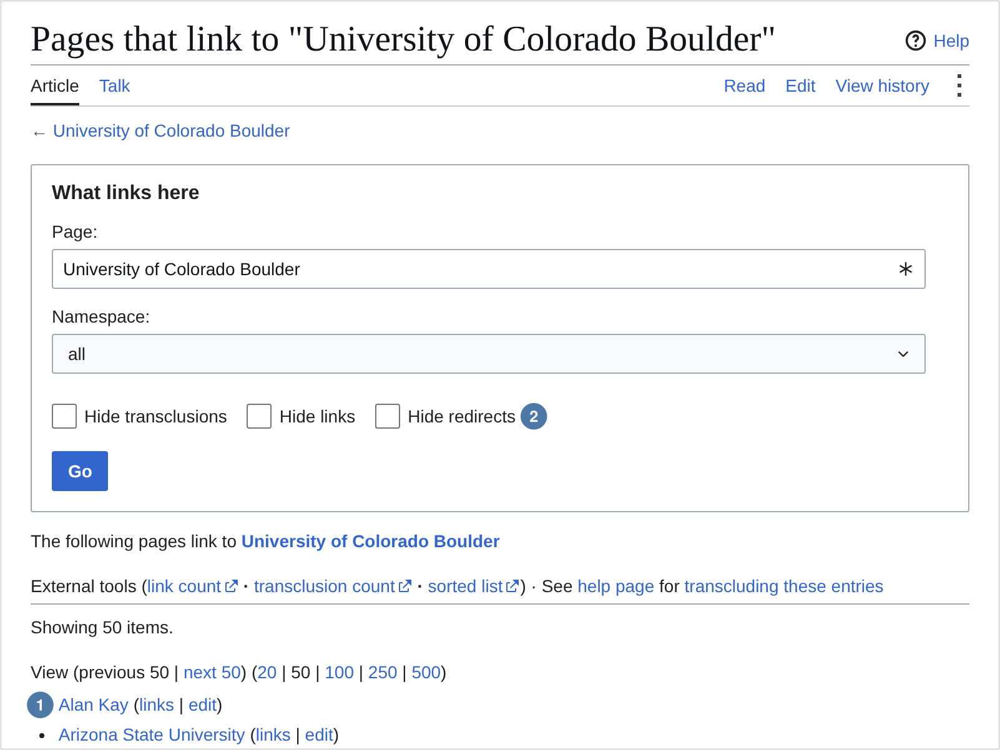{#fig-what-links-here .lightbox fig-alt="Screenshot of Special:WhatLinksHere for University of Colorado Boulder. Marker 1: the first entry of a long list of pages that link to the article. Marker 2: the form at the top with the namespace selector and filters to hide transclusions, links, and redirects."}

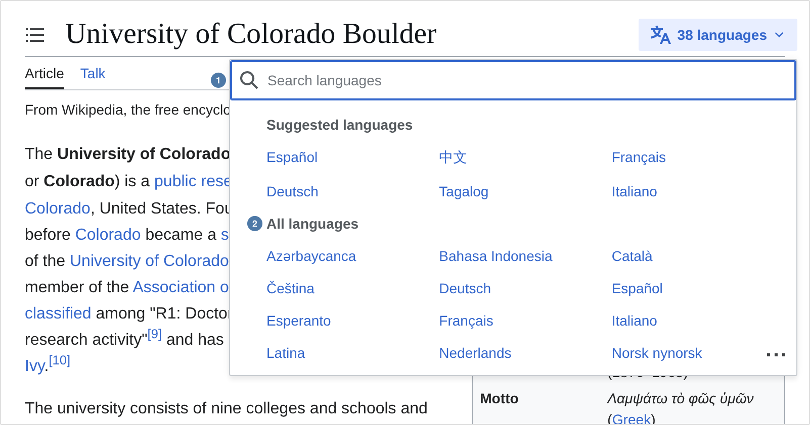{#fig-languages-menu .lightbox fig-alt="Screenshot of the article with the languages menu open. Marker 1: the menu's search box. Marker 2: the first entries in the list of language editions that have an article about the university."}

### References

An article's claims rest on its **references** (@fig-article-references): the References heading ① and the numbered citations under it ②. Each citation names a source, its publisher, and the date an editor retrieved it, and many add a link to an archived copy, the kind of capture @sec-archives taught you to read. Wikipedia's policy is that a claim someone might challenge needs a source a reader can check, so the references are the article's evidence, and the links in them lead out of Wikipedia to the rest of the web.

In the API, the links in an article's references, and anywhere else in its text, are `prop=extlinks`: one entry per external URL.

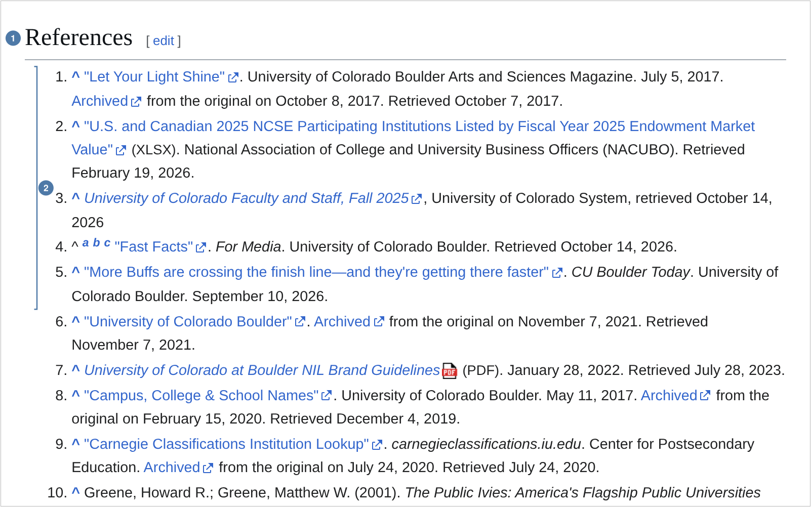{#fig-article-references .lightbox fig-alt="Screenshot of the References section of the article. Marker 1: the heading References. Marker 2: a bracket beside the first five numbered citations, each giving a source's title, publisher, and date, several with links to archived copies."}

### Categories and Templates

At the foot of the article, **categories** (@fig-article-categories) ① file it with other pages: other universities founded in 1876, other flagship universities, other tourist attractions in Boulder. Each category is a page that lists its members, and categories sit inside larger categories, so together they make a rough map of what Wikipedia's editors think belongs together. **Templates** are the reusable boxes you saw in the article: the infobox, the navigation boxes at the foot of the page, and the banners on the talk page below. An article that uses a template has the template's text copied into it each time the page is drawn, which is why What links here can filter out "transclusions". Both are kept by editors, so both are as consistent as the editors who maintain them.

In the API, an article's categories are `prop=categories` and its templates are `prop=templates`. Some categories are hidden from readers, as "Getting Links, Categories, Templates, and Languages" shows.

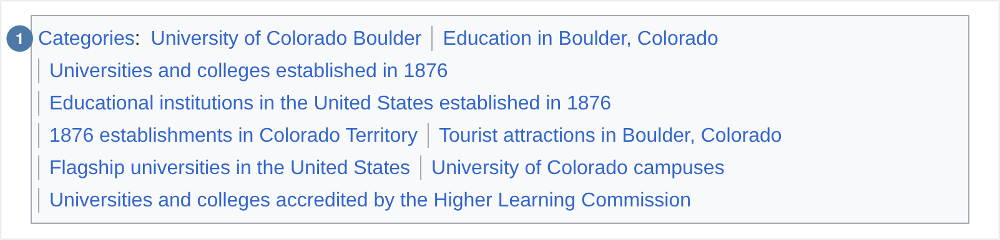{#fig-article-categories .lightbox fig-alt="Screenshot of the box at the foot of the article headed Categories. Marker 1: the first category link in a list of categories the article belongs to."}

### The Talk Page

Every article has a **talk page** (@fig-talk-page) where editors discuss changes before or after they make them. Its header ① says what the page is for and links the rules for discussing, such as assuming good faith, and the banners under it ② record the article's quality rating and the WikiProjects that look after it. Below them are the discussions themselves, signed and dated, and older ones are moved to archives. Where an article's revision history records what changed, its talk page often records why, and what editors disagreed about on the way.

A talk page is a page like any other, in the Talk namespace, so every request in this chapter works on it: ask for `titles=Talk:University of Colorado Boulder`.

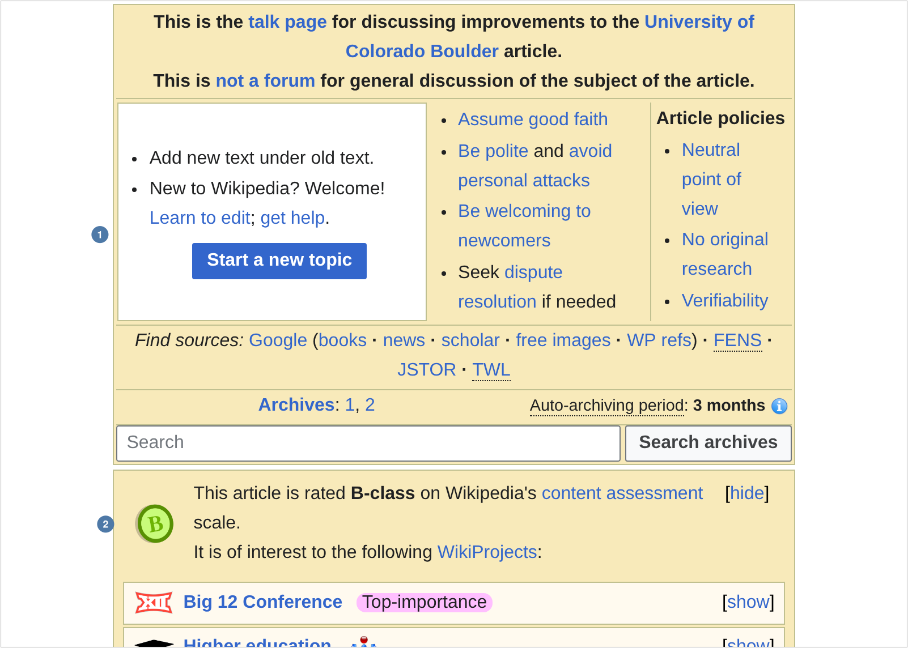{#fig-talk-page .lightbox fig-alt="Screenshot of the top of Talk:University of Colorado Boulder. Marker 1: a box saying This is the talk page for discussing improvements to the University of Colorado Boulder article, with a Start a new topic button, links to policies such as Neutral point of view, and links to archives. Marker 2: a banner saying the article is rated B-class on Wikipedia's content assessment scale and is of interest to WikiProjects, the first of which is Big 12 Conference, Top-importance."}

### The Revision History

The **revision history** (@fig-revision-history) lists every edit ever made to the article, one row each: when ①, by whom ②, how many bytes it added or removed ③, and the editor's summary ④. Editors' usernames are public; many are pseudonyms, and edits without an account are listed under a temporary account name. Any past version can be opened, and any two compared, so the history is a complete record of how the article came to say what it says.

In the API, the history is `prop=revisions`, which "Getting Revisions", below, pages through.

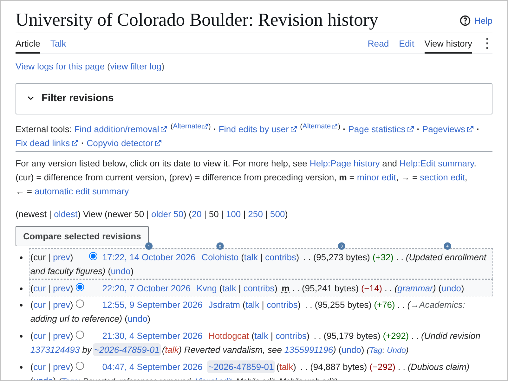{#fig-revision-history .lightbox fig-alt="Screenshot of the revision history of University of Colorado Boulder. Each row is one edit. Marker 1: the date and time of the newest edit. Marker 2: the username of the editor who made it. Marker 3: the number of bytes the edit added or removed. Marker 4: the edit summary."}

### Pageviews

Wikipedia counts its readers, and publishes the counts. The [Pageviews Analysis](https://pageviews.wmcloud.org/) tool, linked from every article's Page information, charts them (@fig-pageviews-tool): daily views ① and the period's totals ②. The same numbers come from the REST pageviews API that "Getting Pageviews", below, calls: the tool's total for the quarter is the sum of the monthly counts for July, August, and September 2026 that the code in "What a Pageview Counts" prints.

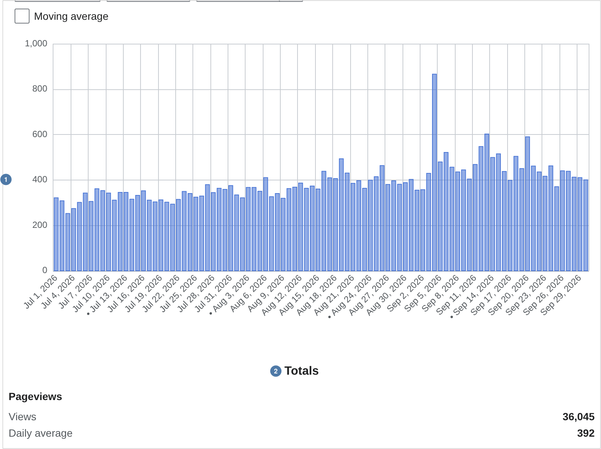{#fig-pageviews-tool .lightbox fig-alt="Screenshot of the Pageviews Analysis tool for University of Colorado Boulder, July 1 to September 30, 2026, with agent set to user. Marker 1: a bar chart of daily views, one bar per day, mostly between 300 and 500 with one spike in early September. Marker 2: the Totals table under the chart, giving the period's views and daily average."}

### User Pages and Contributions

Editors have pages too. A **user page** (@fig-user-page) is where an editor describes themself: here, Jimbo Wales, Wikipedia's co-founder ① ②. Their **contributions** (@fig-user-contributions) list every edit they have made, across all of Wikipedia: when ①, to which page ②, by how many bytes ③, and with what summary ④.

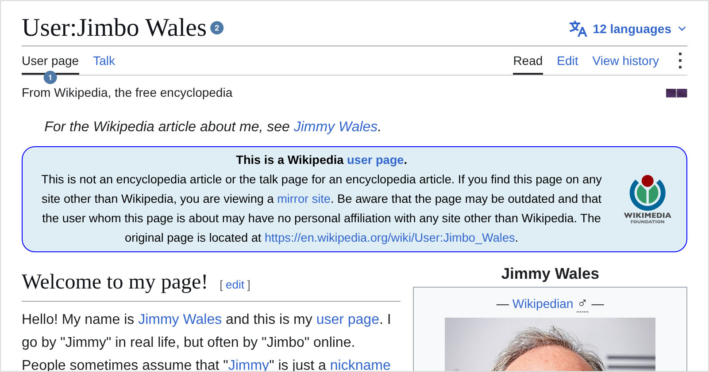{#fig-user-page .lightbox fig-alt="Screenshot of User:Jimbo Wales on English Wikipedia. Marker 1: the User page tab. Marker 2: the page title, User:Jimbo Wales."}

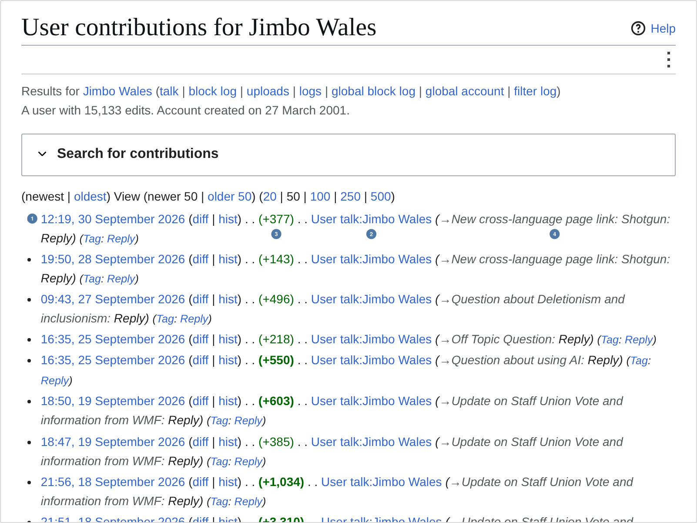{#fig-user-contributions .lightbox fig-alt="Screenshot of Special:Contributions for Jimbo Wales. Each row is one edit. Marker 1: the date and time of the newest edit. Marker 2: the title of the page edited. Marker 3: the change in bytes. Marker 4: the edit summary."}

### From the Interface to the API

Each feature on the tour has an endpoint. Most are in the MediaWiki **[Action API](https://www.mediawiki.org/wiki/API:Action_API)**, at `https://en.wikipedia.org/w/api.php`, and pageviews are in the Wikimedia **REST API**. The rest of the chapter calls them.

| What you see | Where | API request |
|---|---|---|
| The article's basic facts | the article | `action=query&prop=info` |
| Wikilinks out | the article's text | `action=query&prop=links` |
| What links here | Tools → What links here | `action=query&list=backlinks` |
| Templates | the infobox and other boxes | `action=query&prop=templates` |
| Categories | the foot of the article | `action=query&prop=categories` |
| References' links | References | `action=query&prop=extlinks` |
| Other languages | the languages button | `action=query&prop=langlinks` |
| Talk page | the Talk tab | any of the above, for `titles=Talk:…` |
| Revision history | View history | `action=query&prop=revisions` |
| Pageviews | Page information → Page views | REST: `/metrics/pageviews/per-article/…` |
| User contributions | Special:Contributions | `action=query&list=usercontribs` |

## The Anatomy of an API Call

Every request to the MediaWiki [Action API](https://www.mediawiki.org/wiki/API:Action_API) follows the same structure: a base URL, an `action` parameter specifying what you want to do, additional parameters narrowing your request, and a `format` parameter specifying the response format. Here is the request from @sec-protocols again:

```{python}
import requests

url = "https://en.wikipedia.org/w/api.php"

params = {
    "action": "query",                          # we want to query for information
    "titles": "University of Colorado Boulder", # about this article
    "prop": "info",                             # specifically, basic info about the page
    "format": "json",                           # return the response as JSON
}

# Define these once near the top of your script and reuse them everywhere
CLIENT = "WebDataScience/1.0 (your-email@colorado.edu)"
HEADERS = {"User-Agent": f"{CLIENT} python-requests/{requests.__version__}"}

response = requests.get(url, params=params, headers=HEADERS)
data = response.json()

print(data)
# {'batchcomplete': '', 'query': {'pages': {'289672': {'pageid': 289672, 'ns': 0, 'title': 'University of Colorado Boulder', 'contentmodel': 'wikitext', 'pagelanguage': 'en', 'pagelanguagehtmlcode': 'en', 'pagelanguagedir': 'ltr', 'touched': '2026-10-15T21:52:24Z', 'lastrevid': 1380246879, 'length': 95273}}}}
```

The `HEADERS` constant deserves a comment before we go further. The [Wikimedia User-Agent policy](https://foundation.wikimedia.org/wiki/Policy:Wikimedia_Foundation_User-Agent_Policy) asks every client to identify itself with a descriptive User-Agent string that includes contact information. Since 2026, Wikimedia's [rate limits](https://www.mediawiki.org/wiki/Wikimedia_APIs/Rate_limits) also depend on it: a client that identifies itself gets far more requests a minute than one that doesn't. Put your own email address in place of `your-email@colorado.edu`, keeping the policy's form: a name and version, your contact information in parentheses, then the library that sends the request and its version, here `python-requests/` and the number `requests.__version__` gives. `CLIENT` holds the first two parts on their own, because mwclient, later in this chapter, adds its own name and version to whatever you give it.

The same request works in a browser. Paste the address that `requests` builds into the address bar, with `format=jsonfm` in place of `format=json`, and the API lays its JSON out as a web page (@fig-api-response). Under `pages` is one key, the page's ID ①, and under it the facts `prop=info` asks for, such as the article's length in bytes ②. The [API sandbox](https://en.wikipedia.org/wiki/Special:ApiSandbox) goes further: it builds a request from a form, with every module and parameter documented beside it, and shows the request it made, so you can copy it into Python.

{#fig-api-response .lightbox fig-alt="Screenshot of the MediaWiki API's HTML view of a JSON response. A note at the top says this is the HTML representation of the JSON format. Below it, formatted JSON: batchcomplete, then query, pages, and a page ID key. Marker 1: the line pageid with the number 289672. Under it come ns 0, title University of Colorado Boulder, and other fields. Marker 2: the line length with the article's size in bytes."}

The response is a nested JSON structure. You navigate it one level at a time:

```{python}
# The data lives inside data > query > pages > {page_id}
pages = data["query"]["pages"]

# Page IDs are keys; take the first (and only) one
page_id = list(pages.keys())[0]
page_info = pages[page_id]

print(f"Title: {page_info['title']}")
print(f"Page ID: {page_info['pageid']}")
print(f"Length: {page_info['length']:,} bytes")
# Title: University of Colorado Boulder
# Page ID: 289672
# Length: 95,273 bytes
```

This nested navigation pattern — `data["query"]["pages"][page_id]` — is consistent across the MediaWiki API. Once you internalize it, every endpoint feels familiar.

::: {.callout-tip}
## Missing Manual Reference
For strategies on reading and navigating unfamiliar API documentation, see *Missing Manual* Chapter 5: Reading Official Documentation.
:::

## Getting Revisions

Every edit ever made to a Wikipedia article is recorded and accessible through the API. The revisions endpoint returns metadata about each edit: who made it, when, how much the article size changed, and what edit summary they left. One request returns at most 500 revisions, so the function asks again until the API says there are no more:

```{python}
import pandas as pd

def get_revisions(title, until="2026-09-30T23:59:59Z"):
    url = "https://en.wikipedia.org/w/api.php"
    params = {
        "action": "query",
        "titles": title,
        "prop": "revisions",
        "rvprop": "ids|timestamp|user|size|comment",
        "rvlimit": "max",   # 500 per request, the most the API allows
        "rvstart": until,   # newest edit to include, so the result doesn't change tomorrow
        "format": "json",
    }
    all_revisions = []
    while True:
        response = requests.get(url, params=params, headers=HEADERS)
        response.raise_for_status()               # stop on HTTP errors
        data = response.json()
        pages = data["query"]["pages"]
        page_id = list(pages.keys())[0]
        all_revisions.extend(pages[page_id].get("revisions", []))
        if "continue" in data:
            params.update(data["continue"])       # ask for the next batch
        else:
            break
    return pd.DataFrame(all_revisions)

cu_revisions = get_revisions("University of Colorado Boulder")
print(f"Total revisions: {len(cu_revisions):,}")
# Newest first, so the last three rows are the article's first edits
print(cu_revisions[["timestamp", "user", "size"]].tail(3).to_string(index=False))
# Total revisions: 2,988
#            timestamp        user  size
# 2003-12-23T07:08:15Z Dale Arnett  1232
# 2003-08-20T20:03:52Z        Dino  1171
# 2003-08-05T16:42:10Z        Dino  1037
```

The `rvstart` parameter fixes the newest edit the function will return, so running it next week gives the same answer as today. Fixing a time window is a habit worth keeping for any source that keeps changing.

### Understanding Pagination

The MediaWiki API limits the number of results returned per request. When more results are available, the response includes a `"continue"` key with parameters you must add to your next request. This loop — request, extract, check for continuation, update parameters, repeat — is the standard pagination pattern for most APIs. You will see it again in @sec-government and @sec-social.

The critical mistake newcomers make is forgetting to check for continuation. Without the `while True` loop and `"continue"` check, you only get the first batch of results — potentially a small fraction of the total dataset.

Two smaller details in `get_revisions()` are worth adopting as habits. The `response.raise_for_status()` call makes HTTP failures loud: if the server returns an error status, your code stops with an informative exception instead of failing confusingly when you try to parse the JSON. And for bulk jobs, API etiquette suggests adding `"maxlag": 5` to your parameters, which tells overloaded Wikimedia servers to refuse your request with a retryable error so that automated traffic yields to human readers.

### Analyzing Revision History

```{python}
import matplotlib.pyplot as plt

cu_revisions["timestamp"] = pd.to_datetime(cu_revisions["timestamp"])

# Count edits per month
monthly_edits = cu_revisions.set_index("timestamp").resample("ME").size()

fig, ax = plt.subplots(figsize=(8, 4))
monthly_edits.plot(ax=ax)
ax.set_title("Monthly edits to 'University of Colorado Boulder'")
ax.set_ylabel("Edits")
ax.set_xlabel("")
fig.tight_layout()
plt.show()
```

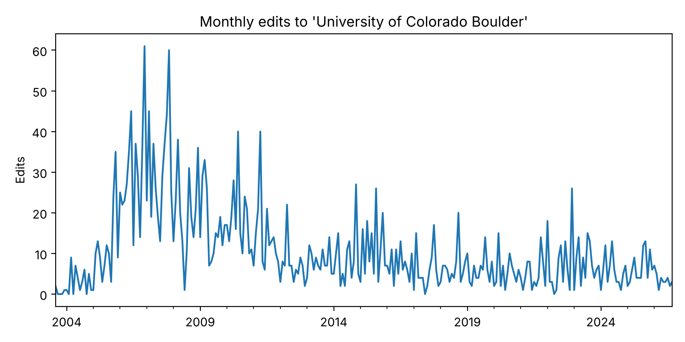{#fig-cu-monthly-edits .lightbox fig-alt="Line chart of monthly edits from 2003 to 2026. Edits rise from near zero in 2003 to peaks of about 60 a month in late 2006 and late 2007, stay mostly between about 10 and 40 a month until 2011, and then mostly run below 15 a month, with occasional spikes to about 25."}

The article's busiest years were 2006 and 2007, about 30 edits a month, when much of it was being written (@fig-cu-monthly-edits). Since 2012 it has averaged fewer than ten edits a month: upkeep, such as new enrollment figures, more than new writing. You can also analyze who edits the article:

```{python}
# Editors with the most revisions
top_editors = cu_revisions["user"].value_counts().head(10)
print(top_editors)

# What share of all edits came from those ten?
top10_share = top_editors.sum() / len(cu_revisions)
print(f"Top 10 editors account for {top10_share:.1%} of all edits")
# user
# Kerowyn              92
# MECU                 82
# ElKevbo              78
# Contributor321       49
# Kvng                 40
# Wordbuilder          37
# Fleminra             27
# Levineps             24
# Corkythehornetfan    23
# Rookkey              22
# Name: count, dtype: int64
# Top 10 editors account for 15.9% of all edits
```

## Getting Pageviews

The Wikimedia REST API, separate from the MediaWiki Action API, counts how many times an article was viewed. Its address is built from parts, like a file path: the project, the access method (desktop, mobile web, mobile app, or all), the **agent** (who is reading), the article, the granularity, and the dates. The function builds the address and returns a DataFrame:

```{python}
def get_pageviews(title, start, end, agent="user", granularity="daily"):
    article = title.replace(" ", "_")
    url = (
        "https://wikimedia.org/api/rest_v1/metrics/pageviews/per-article"
        f"/en.wikipedia/all-access/{agent}/{article}/{granularity}/{start}/{end}"
    )
    response = requests.get(url, headers=HEADERS)
    response.raise_for_status()  # stop on HTTP errors
    views = pd.DataFrame(response.json()["items"])
    views["timestamp"] = pd.to_datetime(views["timestamp"], format="%Y%m%d%H")
    return views[["timestamp", "views"]]
```

With the function defined, retrieving and plotting a series takes a few lines:

```{python}
cu_views = get_pageviews("University of Colorado Boulder", "20210101", "20260930")
print(f"{len(cu_views):,} days, {cu_views['views'].sum():,} views")

fig, ax = plt.subplots(figsize=(8, 4))
ax.plot(cu_views["timestamp"], cu_views["views"], linewidth=0.8)
ax.set_title("Daily pageviews: University of Colorado Boulder")
ax.set_ylabel("Views by human readers")
fig.tight_layout()
plt.show()
# 2,099 days, 1,367,292 views
```

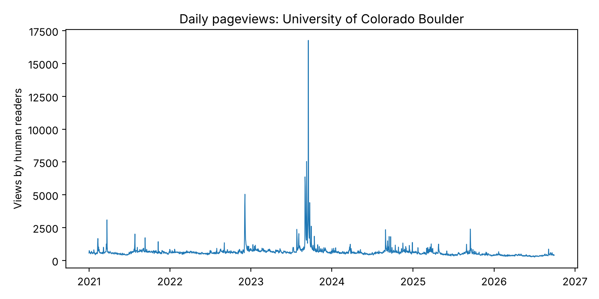{#fig-cu-daily-views .lightbox fig-alt="Line chart of daily views from 2021 to late 2026. Most days are between about 400 and 800 views. Spikes reach about 3,100 in March 2021, about 5,000 in December 2022, and a cluster in September 2023 up to about 16,800. After 2024 the baseline drifts down toward about 400."}

Most days the article has about 600 human readers (@fig-cu-daily-views); the median from 2021 to September 2026 is 590. The spikes are events, and the tallest are football. Deion Sanders was hired as head coach on December 3, 2022, and the article had 5,042 views on December 5. The opening weeks of his first season, in September 2023, brought its busiest days: 16,767 views on September 17, after a double-overtime win over Colorado State that ended late on the night of the 16th in Colorado. That last date is a reminder that the API's days are UTC days, so an evening in Colorado counts toward the next day.

### What a Pageview Counts

A pageview is not a person. Wikimedia's [definition](https://meta.wikimedia.org/wiki/Research:Page_view) counts a request for a page's content that succeeded, and leaves out edits, previews, and most special pages; one reader who reloads an article three times is three pageviews. The definition has also changed over time, and a long series crosses those changes:

- **The REST API's counts begin in July 2015**, under the current definition, drafted in 2014–15.
- **Before that**, the hourly [pagecounts-raw](https://dumps.wikimedia.org/other/pagecounts-raw/) files, from December 2007 to 2016, counted every request for a page, reads and edits alike, including those from crawlers. They are a fallback for older history, and they are not comparable with the API's counts.
- **The agent splits who is reading.** `user` is meant to be people; `spider` is self-identified crawlers, such as search engines; and `automated` is traffic that Wikimedia's analysts judged to be bots that don't say so. The rules for that judgment change, as "Social History and Public Interest" describes, and when they do, past counts can be reclassified.

You can ask the API for each agent separately:

```{python}
agents = []
for agent in ["user", "spider", "automated"]:
    monthly = get_pageviews("University of Colorado Boulder", "20240101", "20260930",
                            agent=agent, granularity="monthly")
    monthly["agent"] = agent
    agents.append(monthly)
by_agent = pd.concat(agents).pivot(index="timestamp", columns="agent", values="views")
print(by_agent.tail(3))

# Human views in the same nine months of 2024 and 2026
human = by_agent["user"]
print(f"January-September 2024: {human.loc['2024-01':'2024-09'].sum():,}")
print(f"January-September 2026: {human.loc['2026-01':'2026-09'].sum():,}")

fig, ax = plt.subplots(figsize=(8, 4))
by_agent.plot(ax=ax)
ax.set_title("Monthly pageviews by agent: University of Colorado Boulder")
ax.set_ylabel("Views")
ax.set_xlabel("")
fig.tight_layout()
plt.show()
# agent       automated  spider   user
# timestamp
# 2026-07-01       2334    2099  10155
# 2026-08-01       1855    9362  11890
# 2026-09-01       2196    2924  14000
# January-September 2024: 173,832
# January-September 2026: 105,264
```

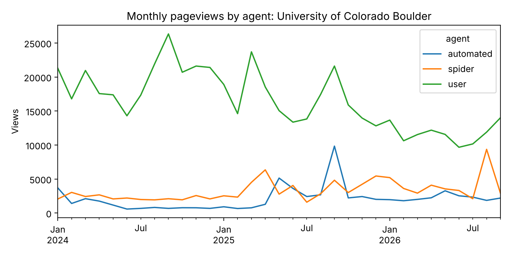{#fig-cu-views-by-agent .lightbox fig-alt="Line chart with three lines. User views run between about 14,000 and 26,000 a month in 2024 and fall to between about 10,000 and 14,000 a month in 2026. Spider views stay between about 2,000 and 6,000 a month, with a spike to about 9,400 in August 2026. Automated views are under 1,000 a month through most of 2024, rise to about 2,000 to 5,000 a month from May 2025, and spike to about 9,800 in September 2025."}

For this one article, human views from January to September 2026 were 39% lower than in the same months of 2024 (@fig-cu-views-by-agent). Automated views, under a thousand a month through most of 2024, have been about two thousand a month or more since May 2025, when the Foundation updated its bot detection. One article can't say how much of the drop is fewer readers and how much is traffic the Foundation now counts as bots; "Social History and Public Interest", below, gives its account for Wikipedia as a whole.

## Getting Links, Categories, Templates, and Languages

The tour's other features all come from the same endpoint, `action=query`, with a different `prop` or `list`, and they all paginate the same way. Rather than write one function per feature, write one function that runs any query and follows its continuation, and collects the pages it returns:

```{python}
def query_all(params):
    url = "https://en.wikipedia.org/w/api.php"
    params = {"action": "query", "format": "json", **params}
    results = []
    while True:
        response = requests.get(url, params=params, headers=HEADERS)
        response.raise_for_status()  # stop on HTTP errors
        data = response.json()
        results.append(data["query"])
        if "continue" in data:
            params.update(data["continue"])
        else:
            break
    return results

def page_list(title, prop, limit_param):
    # One prop (links, categories, templates, extlinks, langlinks) for one page, as a list
    items = []
    for batch in query_all({"titles": title, "prop": prop, limit_param: "max"}):
        for page in batch["pages"].values():
            items.extend(page.get(prop, []))
    return items
```

Each feature on the tour is then one call:

```{python}
title = "University of Colorado Boulder"

links = page_list(title, "links", "pllimit")
categories = page_list(title, "categories", "cllimit")
templates = page_list(title, "templates", "tllimit")
extlinks = page_list(title, "extlinks", "ellimit")
langlinks = page_list(title, "langlinks", "lllimit")

print(f"Wikilinks out: {len(links)}")
print(f"Categories: {len(categories)}")
print(f"Templates used: {len(templates)}")
print(f"External links: {len(extlinks)}")
print(f"Language editions: {len(langlinks)}")
print("First categories:", [c["title"] for c in categories[:3]])
# Wikilinks out: 650
# Categories: 40
# Templates used: 230
# External links: 217
# Language editions: 38
# First categories: ['Category:1876 establishments in Colorado Territory', 'Category:All Wikipedia articles written in American English', 'Category:All articles containing potentially dated statements']
```

The API counts 40 categories, more than the box at the foot of the article shows (@fig-article-categories). The first ones it returns are why: "All Wikipedia articles written in American English" and "All articles containing potentially dated statements" are **hidden categories**, which editors use to track maintenance work and which readers don't see. To leave them out, add `"clshow": "!hidden"` to the query.

What links here is a `list`, not a `prop`: it asks about all of Wikipedia rather than one page. Its results come under `backlinks`:

```{python}
backlinks = []
for batch in query_all({"list": "backlinks", "bltitle": title, "bllimit": "max",
                        "blnamespace": 0}):    # namespace 0: articles only
    backlinks.extend(batch["backlinks"])
print(f"Articles that link to {title}: {len(backlinks)}")
# Articles that link to University of Colorado Boulder: 3294
```

### Interlanguage Links

Which editions have an article on a topic is itself a measurement. Each `langlinks` entry gives the edition's language code and the article's title there:

```{python}
langs = pd.DataFrame(langlinks)
print(f"{len(langs)} other editions")
print(langs[["lang", "*"]].head(8).to_string(index=False))
# 38 other editions
# lang                                 *
#   ar              جامعة كولورادو بولدر
#  arz              جامعة كولورادو بولدر
#   az     Boulder Kolorado Universiteti
#  azb        کولورادو بولدر بیلیم‌یوردو
#   be Каларадскі ўніверсітэт у Боўлдэры
#   bn    কলোরাডো বোল্ডার বিশ্ববিদ্যালয়
#   ca Universitat de Colorado a Boulder
#   cs University of Colorado at Boulder
```

The number of language editions an article appears in is a measure of global interest as perceived by Wikipedia's volunteer editors. Articles about Western political leaders, major cities, and scientific concepts tend to appear in 100 or more language editions. Articles about topics primarily relevant to the Global South — local politicians, regional cultural practices, indigenous languages — may exist in only a handful. This asymmetry reflects the demographic composition of Wikipedia's editor community, which skews heavily toward the Global North and toward speakers of European languages. When you use Wikipedia data for cross-cultural analysis, interlanguage link counts are a useful but imperfect proxy for a topic's global visibility.

## Getting User Contributions

`list=usercontribs` returns an editor's edits across all of Wikipedia, newest first. Here are the latest edits by Jimbo Wales, whose user page and contributions were on the tour:

```{python}
contribs = []
for batch in query_all({"list": "usercontribs", "ucuser": "Jimbo Wales",
                        "uclimit": "max", "ucend": "2026-01-01T00:00:00Z",
                        "ucstart": "2026-09-30T23:59:59Z",
                        "ucprop": "title|timestamp|sizediff|comment"}):
    contribs.extend(batch["usercontribs"])
contribs = pd.DataFrame(contribs)
print(f"Edits from January to September 2026: {len(contribs)}")
print(contribs[["timestamp", "title", "sizediff"]].head().to_string(index=False))
# Edits from January to September 2026: 351
#            timestamp                 title  sizediff
# 2026-09-30T12:19:46Z User talk:Jimbo Wales       377
# 2026-09-28T19:50:09Z User talk:Jimbo Wales       143
# 2026-09-27T09:43:50Z User talk:Jimbo Wales       496
# 2026-09-25T16:35:53Z User talk:Jimbo Wales       218
# 2026-09-25T16:35:13Z User talk:Jimbo Wales       550
```

`ucstart` and `ucend` bound the window, newest first, as `rvstart` did for the revisions.

## From Raw Requests to a Client: mwclient

This chapter has written its requests by hand, so that you can see every parameter and every continuation. In practice, most people who use the MediaWiki API from Python use a client library that does those parts for them. [mwclient](https://github.com/mwclient/mwclient) ([documentation](https://mwclient.readthedocs.io/)) is one of the simplest. It isn't in `webdata`, so install it once, from the same conda-forge channel as the rest of the environment:

```{python}
%conda install -y -c conda-forge mwclient
```

Then check that Python can import it, and which version you have:

```{python}
import mwclient
print(mwclient.__version__)
# 0.10.1
```

conda-forge has version 0.10.1. The [Python Package Index](https://pypi.org/project/mwclient/) has a newer one, 0.11, which renames one argument used below: `limit`, the number of results to ask for in each request, becomes `api_chunk_size`. With 0.11, write `api_chunk_size=500` where the code says `limit=500`.

```{python}

site = mwclient.Site("en.wikipedia.org",
                     clients_useragent=CLIENT)
page = site.pages["University of Colorado Boulder"]

print(page.name, page.pageid, page.length)
print("Categories:", len(list(page.categories())))
print("Language editions:", len(list(page.langlinks())))

# Revisions, newest first, from the same moment get_revisions() started,
# 500 to a request (in mwclient 0.11, api_chunk_size=500)
revisions = list(page.revisions(start="2026-09-30T23:59:59Z", limit=500,
                                prop="ids|timestamp|user|size"))
print("Revisions:", len(revisions))
# University of Colorado Boulder 289672 95273
# Categories: 40
# Language editions: 38
# Revisions: 2988
```

Each line replaces one of this chapter's functions. `page.categories()` and `page.langlinks()` are `page_list()`; `page.revisions()` is `get_revisions()`, continuation included; and `site.usercontributions("Jimbo Wales")` is the `usercontribs` query. mwclient also waits and retries when the servers ask it to (`maxlag`), and it can sign in, for scripts that edit. Its [user guide](https://mwclient.readthedocs.io/en/latest/user/index.html) has more examples, and [Pywikibot](https://www.mediawiki.org/wiki/Manual:Pywikibot) is the larger library that Wikipedia's bot operators use.

One thing mwclient doesn't do, in version 0.10.1 or 0.11, is wait out a 429. When Wikimedia's rate limit answers with status 429, mwclient raises an `HTTPError`, and the loop over `page.revisions()` stops partway. Wait for the number of seconds in the response's `retry-after` header, then run it again; "Common Issues to Debug", below, has more on the limits.

Two things stay raw. mwclient talks to the Action API only, so pageviews still come from `get_pageviews()`. And a client is a convenience, not a substitute for the documentation: when you need a parameter the library doesn't expose, you are back to the [Action API's documentation](https://www.mediawiki.org/wiki/API:Action_API) and a request you write yourself.

## A Second Case Study: Boulder, Colorado

The same functions work on any article. [Boulder, Colorado](https://en.wikipedia.org/wiki/Boulder,_Colorado) is the city around the university, and its article answers to different events:

```{python}
boulder = "Boulder, Colorado"
boulder_revisions = get_revisions(boulder)
boulder_views = get_pageviews(boulder, "20210101", "20260930")
boulder_langs = page_list(boulder, "langlinks", "lllimit")

print(f"{'':32}{'revisions':>10}{'views':>12}{'editions':>10}")
for name, revs, views, langs_ in [(title, cu_revisions, cu_views, langlinks),
                                  (boulder, boulder_revisions, boulder_views, boulder_langs)]:
    print(f"{name:32}{len(revs):>10,}{views['views'].sum():>12,}{len(langs_):>10}")
#                                  revisions       views  editions
# University of Colorado Boulder       2,988   1,367,292        38
# Boulder, Colorado                    4,304   1,818,309        78
```

### Combining Endpoints

The real analytical power of the API emerges when you combine endpoints. A natural question is whether editing and reading move together: do articles get edited more when more people are reading them?

```{python}
boulder_revisions["timestamp"] = pd.to_datetime(boulder_revisions["timestamp"])

fig, axes = plt.subplots(2, 1, figsize=(8, 5), sharex=True)
for name, revs, views in [(title, cu_revisions, cu_views),
                          (boulder, boulder_revisions, boulder_views)]:
    # Revision timestamps are in UTC; drop the time zone to match the pageviews.
    # Revisions arrive newest first, so count by month before keeping 2021 on
    edits = (revs.set_index(revs["timestamp"].dt.tz_localize(None))
                 .resample("ME").size().loc["2021":])
    monthly_views = views.set_index("timestamp")["views"].resample("ME").sum()
    axes[0].plot(monthly_views.index, monthly_views.values, label=name)
    axes[1].plot(edits.index, edits.values, label=name)
    print(f"{name}: monthly views and edits correlate at {monthly_views.corr(edits):.2f}")
axes[0].set_ylabel("Monthly views")
axes[1].set_ylabel("Monthly edits")
axes[0].legend()
fig.tight_layout()
plt.show()
# University of Colorado Boulder: monthly views and edits correlate at 0.21
# Boulder, Colorado: monthly views and edits correlate at 0.38
```

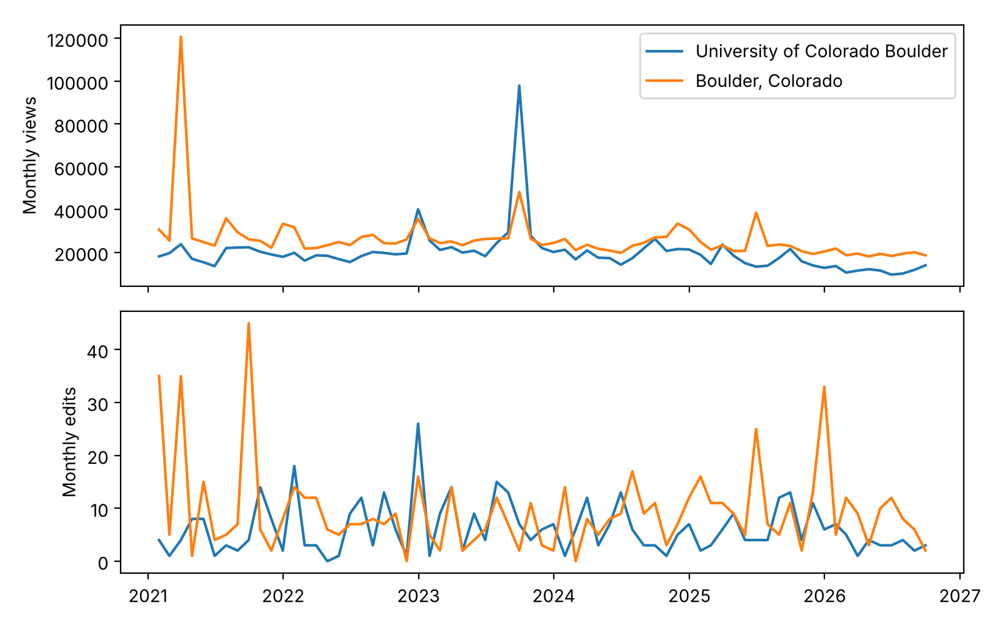{#fig-cu-boulder-combined .lightbox fig-alt="Two line charts sharing a time axis, each with a line for the university and one for the city. Top, monthly views: the city's line spikes to about 121,000 in March 2021 and the university's to about 98,000 in September 2023; both otherwise run between about 10,000 and 40,000. Bottom, monthly edits: both lines move between 0 and about 45 a month, with the city's highest in early and late 2021 and in 2025, and the university's highest in December 2022."}

The two articles answer to different events (@fig-cu-boulder-combined). The city's busiest month, March 2021, had 120,790 views, five times its usual month: on March 22, a gunman killed ten people at a King Soopers grocery store in Boulder, and the article had 63,327 views the next day. Its edits rose too, to 35 that month. The university's busiest month, September 2023, had 97,904 views, from football, but only seven edits. December 2022, when Sanders was hired, brought both: 40,174 views and 26 edits, the article's most edited month since 2021. The city's article also marks the Marshall Fire, which burned more than a thousand homes in Boulder County on December 30, 2021, and an attack on a demonstration in downtown Boulder on June 1, 2025.

Reading and editing move together only loosely: over the 69 months, monthly views and edits correlate at 0.21 for the university and 0.38 for the city. When news breaks, a burst of readers brings editors with it [@keegan2013hot]. But many edits keep their own schedule, such as cleanups, reorganizations, and arguments no reader set off. The city's most edited month, September 2021, with 45 edits, had an ordinary number of readers.

## Recommended Exercises

This guided exercise is the chapter's take-home assignment. Work through it in the companion notebook, filling in each empty code cell, and submit the completed notebook. The steps build on one another, so do them in order — everything you need appears in this chapter or an earlier one.

You will build a complete profile of one Wikipedia article: who reads it, who writes it, and what it connects to.

**Step 1 — Choose an article and get its pageviews.** Pick an article about a place, institution, or event you know, with at least one newsworthy moment since 2021. Define your `HEADERS` (@sec-ethics), then use the chapter's `get_pageviews()` to retrieve daily views by human readers for a fixed period that ends before today. Build the DataFrame and plot the series.

```{python}
# Step 1: Retrieve daily pageviews for your article, build the DataFrame, and plot it.
# Your code here
```

**Step 2 — Find the spike.** Identify the highest-traffic day with `idxmax()` (@sec-introduction showed you this) and print the date and view count. Note in a comment what real-world event you think explains it, and check the article's revision history around that date for edits that mention it.

```{python}
# Step 2: Find the peak day and connect it to an event.
# Your code here
```

**Step 3 — Get the revision history.** Use the chapter's `get_revisions()`, following continuation tokens so you page through the full history up to a fixed date. Print the total count and the date range.

```{python}
# Step 3: Retrieve the full revision history, handling pagination, and build a revisions DataFrame.
# Your code here
```

**Step 4 — Profile the editors.** How many unique editors does the article have? Use `value_counts()` on the user column to see edits per editor, and print the top ten. Is the editing concentrated in a few hands or spread out?

```{python}
# Step 4: Count unique editors and show the top ten by revision count.
# Your code here
```

**Step 5 — Align edits with attention.** Resample the revisions by month, and plot monthly edits alongside the monthly pageview totals from Step 1. Do the two series move together around your spike?

```{python}
# Step 5: Plot monthly edits and monthly pageviews for comparison.
# Your code here
```

**Step 6 — Map the neighborhood.** Use `page_list()` for the article's wikilinks, categories, and language editions, and `query_all()` for what links here. Print each count and five examples of each.

```{python}
# Step 6: Retrieve the article's links, categories, language editions, and backlinks.
# Your code here
```

**Step 7 — Interpret.** In four to six sentences: What does the alignment (or misalignment) of edits and views around your spike suggest about how Wikipedia responds to events? Is your article maintained by a dedicated few or a broad crowd, and why might that matter for how much you trust it? What kind of article do its links and categories suggest it is?

```{python}
# Step 7: Write your answer here as comments, or convert this cell to Markdown.
```

## Additional Exercises

These are open-ended extensions — no scaffold, no fixed path. Use them for further practice or deeper exploration.

1. **Comparative revision analysis.** Retrieve the revision histories for two related Wikipedia articles (e.g., "Boulder, Colorado" and "Fort Collins, Colorado"). Compare the number of unique editors, the distribution of edits per editor (is editing concentrated or distributed?), and the pattern of monthly editing activity. Are there periods where editing spikes simultaneously on both articles?

2. **Event detection with pageviews.** Use the pageviews API to retrieve daily data for five related articles over a full year. Identify spikes in each article and map them to real-world events. Did all articles spike together (suggesting a common cause), or were there article-specific events? Create a multi-line plot with labeled annotations for the key events.

3. **Link network.** Retrieve the outgoing wikilinks from three articles on related topics. How much do their link sets overlap? What articles appear in all three link sets? This overlap analysis is a simple form of the network analysis described in @sec-appendix-further.

4. **Raw API practice.** Using only the MediaWiki API documentation at <https://www.mediawiki.org/wiki/API:Main_page>, construct a working request for an endpoint not covered in this chapter. Good candidates include `list=search` (full-text search), `list=recentchanges` (the most recent edits across all of Wikipedia), `prop=redirects` (which alternative titles redirect to an article), or `prop=pageviews` (the Action API's own view counts for the last 60 days — compare them against the REST endpoint you used earlier). Document your process: what parameters did you choose and why? Then make the same request with mwclient, if it has a method for it.

5. **Editor network.** For a single article, identify the top 20 editors by revision count. Then use `list=usercontribs` to find what other articles these editors work on. Do they share other editing interests, or is this article their only point of overlap?

6. **Graduate extension (INFO 5617).** Read @mesgari2015sum, a systematic review of the first decade of scholarly research on Wikipedia. Choose one research stream from the review — collaboration inequality, for instance — and reproduce a miniature version of its core measurement using this chapter's functions, such as computing a Gini coefficient of edits per editor across three articles of your choosing. Then write a short reflection on how your measurement choices (which articles, what time window, whether anonymous editors count, which pageview agent) would change your conclusions, and how the original studies in that stream handled the same choices.

## Social History and Public Interest

Wikipedia is the largest collaboratively-authored reference work in human history, maintained by tens of thousands of volunteer editors working in over 300 languages. Its commitment to open APIs reflects its broader mission: anyone can read, edit, and computationally access Wikipedia's content. The Wikimedia Foundation explicitly positions API access as part of its commitment to free knowledge [@ford2022writing]. Its open records have made it one of the most studied sites on the web: of how strangers coordinate when news breaks [@keegan2013hot; @keegan2020encyclopedia], and of how a community writes and rewrites its own rules [@keegan2017evolution].

But openness does not mean representativeness. Research has documented significant demographic skew in who edits Wikipedia — editors are disproportionately male, from the Global North, and technically fluent. This translates into content gaps: articles about women, people of color, and the Global South are systematically shorter, less detailed, and less well-referenced than articles about men and Western topics [@mesgari2015sum]. WikiProject Women in Red has worked systematically on the gender gap, organizing edit-a-thons and maintaining lists of missing biographies. Data retrieved from the API reflects these structural patterns: any Wikipedia-based analysis inherits the biases of its volunteer editor community.

Since 2024, a newer pressure has come from the same openness that makes Wikipedia useful. Its free content is training data and source material for generative AI, and three changes followed.

**Crawlers.** In April 2025, the Foundation reported that the bandwidth used to download images and other media had grown 50% since January 2024, and that the growth came from crawlers rather than human readers. Bots made up about 35% of pageviews but at least 65% of the traffic that was most expensive to serve. The Foundation's summary: "our content is free, our infrastructure is not" ([Mueller, Danis, and Lavagetto, 2025](https://diff.wikimedia.org/2025/04/01/how-crawlers-impact-the-operations-of-the-wikimedia-projects/)). A year later it reported that it was blocking or throttling about 30% of automated requests from crawlers that ignore its policies, and that it had begun rolling out the API rate limits in "Common Issues to Debug", below, which reward a client that identifies itself ([2026](https://diff.wikimedia.org/2026/03/26/quo-vadis-crawlers-progress-and-whats-next-on-safeguarding-our-infrastructure/)).

**Readers.** In 2025 the Foundation found that much of an unusual rise in apparent human traffic was bots built to evade detection. It updated its bot detection, reclassified its traffic data for March to August 2025, and reported that human pageviews over those months were roughly 8% lower than in the same months of 2024. It attributed the decline to "the impact of generative AI and social media on how people seek information": answers that draw on Wikipedia without a visit ([Miller, 2025](https://diff.wikimedia.org/2025/10/17/new-user-trends-on-wikipedia/)). That reclassification is why "What a Pageview Counts", above, warns that past counts can change. Fewer visits also means fewer readers who become editors or donors.

**Writing.** Editors have had to decide what to do with text that language models write. WikiProject AI Cleanup, formed in December 2023, works "to identify text written by AI, and scrutinize such text to make sure it follows Wikipedia's policies" ([WikiProject AI Cleanup](https://en.wikipedia.org/wiki/Wikipedia:WikiProject_AI_Cleanup)). A speedy-deletion criterion, G15, lets administrators delete pages that could only plausibly have been generated by a language model without review. In March 2026, after a community request for comment, a new guideline, [Writing articles with large language models](https://en.wikipedia.org/wiki/Wikipedia:Writing_articles_with_large_language_models), prohibited using them to generate or rewrite article content, with exceptions for basic copyediting of one's own writing and for translation. The Foundation's own AI strategy, published in April 2025, put its investment in tools for the volunteers, such as help for moderators and translation, rather than in machine-written articles ([Albon and Zia, 2025](https://diff.wikimedia.org/2025/04/30/our-new-ai-strategy-puts-wikipedias-humans-first/)).

For a data scientist, these changes are both a subject and a responsibility. The pageview series you retrieve now carries a definition that changed in 2025. The articles you read may have been written, in part, under new rules about machines. And your own code is part of the automated traffic the Foundation is managing: identify yourself, make requests one at a time, fix your time windows so you don't fetch the same data twice, and use the database dumps for anything large.

## Common Issues to Debug

- **Pagination**: The single most common mistake. Always check for `"continue"` in the response. Without it, you get only the first batch (often 500 or fewer results out of thousands).
- **Nested JSON navigation**: The MediaWiki API nests data several levels deep. Print `data.keys()`, then `data["query"].keys()`, then `data["query"]["pages"].keys()` to navigate step by step.
- **Titles**: The Action API accepts titles with spaces; the REST pageviews API wants underscores, which is why `get_pageviews()` swaps them. For titles with other special characters (slashes, question marks), encode them with `urllib.parse.quote(title, safe="")`.
- **Rate limiting (status 429)**: Wikimedia counts requests per minute across the Action API and the REST APIs, pageviews included: 200 a minute for a client whose User-Agent follows the policy, and 10 a minute for one that doesn't, shared with everyone else on its network address ([Wikimedia APIs/Rate limits](https://www.mediawiki.org/wiki/Wikimedia_APIs/Rate_limits); the limits are new in 2026 and may change). Past the limit, the answer is status 429, with a `retry-after` header that says how many seconds to wait; wait that long before trying again. The practical rule: serial requests, follow `continue` tokens, `maxlag` for bulk work, and always an informative User-Agent.
- **Missing pages**: If you request an article that does not exist, the page ID will be negative (e.g., `-1`). Always check for this before trying to access revision data.

## Key Takeaways

APIs provide structured, documented, intentional access to web data. Every feature Wikipedia shows a reader — talk pages, revision histories, pageviews, links, categories, templates, languages, user contributions — has an endpoint, so what you can see you can count. Learning one API well gives you a transferable skill: read the documentation, construct parameterized requests, handle pagination with continuation tokens, and parse nested JSON one level at a time. A client library such as mwclient does the repetitive parts once you know what they are. Know what your numbers count: a pageview's definition has changed, and so has the traffic behind it. Wikipedia remains a model of open, mission-driven data access, and one now under pressure from the automated traffic that open access invites.

## Further Reading

- MediaWiki API documentation: <https://www.mediawiki.org/wiki/API:Main_page>
- Wikimedia REST API (pageviews): <https://wikimedia.org/api/rest_v1/>
- Research:Page view, Wikimedia's definition of a pageview: <https://meta.wikimedia.org/wiki/Research:Page_view>
- The MediaWiki Action API, every module and parameter: <https://www.mediawiki.org/wiki/API:Action_API>
- mwclient documentation: <https://mwclient.readthedocs.io/>
- @keegan2013hot and @keegan2020encyclopedia — how Wikipedia covers breaking news
- @keegan2017evolution — how Wikipedia's rules are written and rewritten
- @ford2022writing — Wikipedia's role in the survival of facts in the digital age
- @mesgari2015sum — systematic review of scholarly research on Wikipedia content
- @salganik2018bit — Chapter 2: Observing Behavior, on using digital trace data for research
