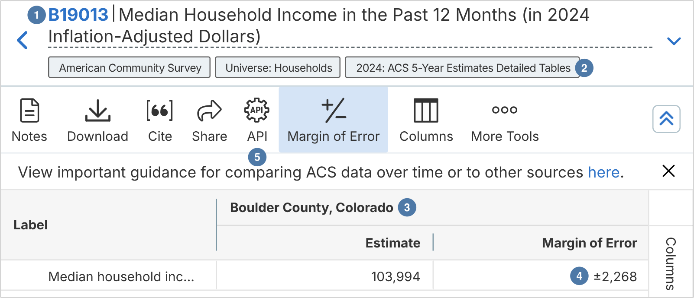
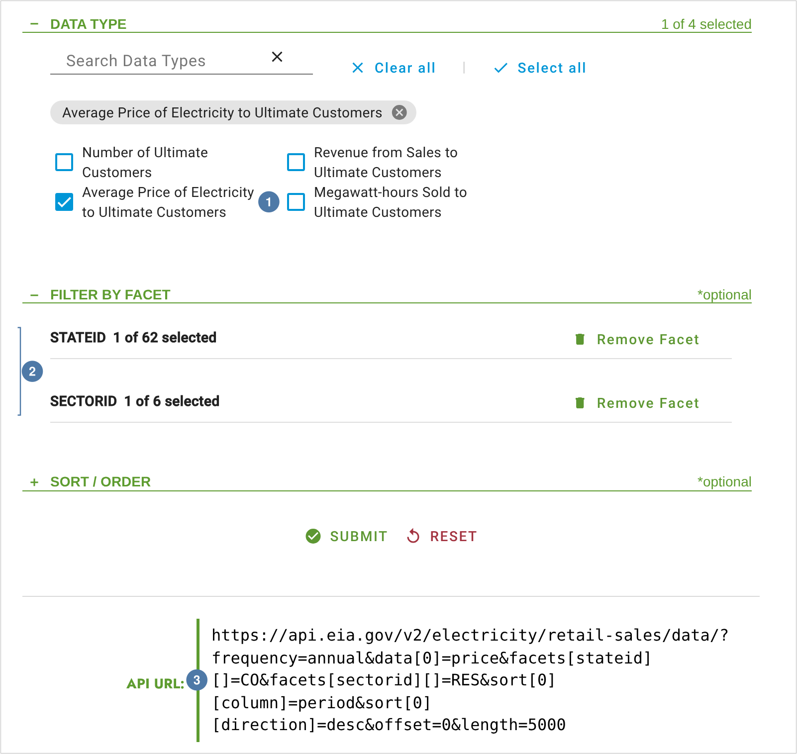
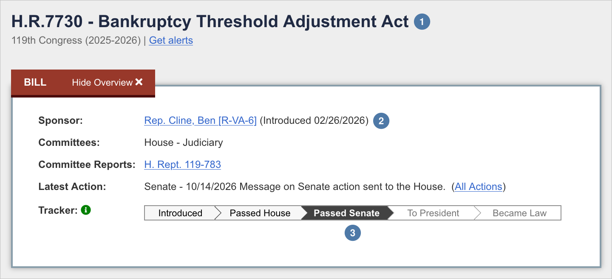
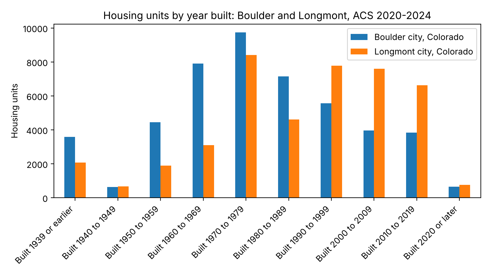
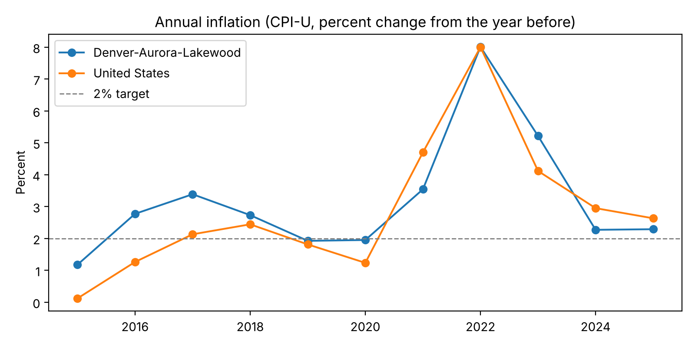
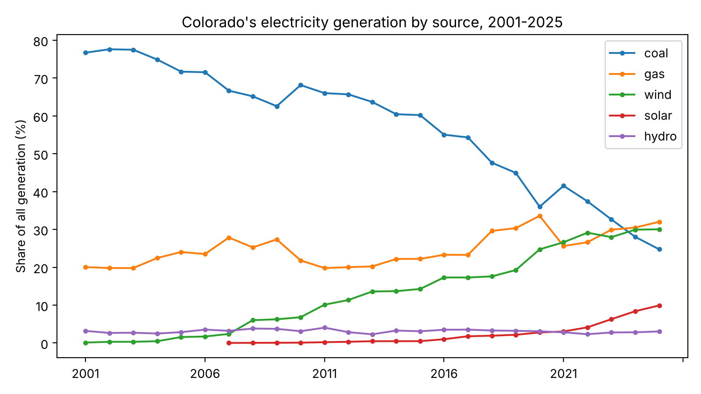

# Government Data APIs {#sec-government}

::: {.callout-tip}
## Learning Objectives
- Keep API keys out of your notebooks, in environment variables, and check that each one is set without printing it
- Find what an API offers before you ask for it: the Census Bureau's catalogs of variables and geographies, and its FIPS codes for places
- Ask FRED to transform a series before it sends it: percent changes, annual averages, and other units and frequencies
- Ask the EIA to filter its data before it sends it, with routes, facets, data columns, and sorting, and page through a large result with `offset` and `length`
- Follow the links from one Congress.gov record to the records about it
- Trace a number on an agency's website to the API request that returns it
:::

::: {.callout-tip}
## Companion Notebook
Run this chapter's code as you read: open the [companion notebook](https://github.com/cuinfoscience/Web-Data-Science-Book/blob/main/notebooks/ch-11-government.ipynb) (see @sec-appendix-notebooks for all of them).
:::


## Public Data by Mandate

Government APIs exist because a law or a public charter says the data must be published, not because publishing it suits a business plan. This chapter uses four of them:

- **The U.S. Census Bureau.** The Constitution requires a count of the population every ten years, and the Bureau's American Community Survey (ACS) asks a sample of households about income, housing, work, and much else every year.
- **FRED** (Federal Reserve Economic Data), from the Federal Reserve Bank of St. Louis. FRED collects more than 800,000 time series from the agencies that produce them, among them the Bureau of Labor Statistics, the Bureau of Economic Analysis, and the Census Bureau, and serves them in one format.
- **The U.S. Energy Information Administration (EIA).** The Department of Energy Organization Act of 1977 made the EIA the department's statistical agency, and it publishes what the country produces, buys, and pays for energy, state by state.
- **Congress.gov**, from the Library of Congress: every bill, its sponsors, what happened to it, and its text.

As a result, these APIs embody the **openness** value described in @sec-post-api: public data, freely accessible, maintained by public mandate rather than platform goodwill. They also tend to be more *stable* than commercial offerings, since an agency doesn't pivot its business model or get acquired. But they are often less *polished*: the documentation can be dense, variable names cryptic, and error messages unhelpful.

Each of the four teaches one general idea about APIs, which you will meet again in every API you use:

| API | The idea | What you'll do |
|---|---|---|
| Census | *What can I ask for?* | Read the catalogs of variables and geographies before asking for data |
| FRED | *Let the server compute* | Ask for percent changes and annual averages instead of computing them |
| EIA | *Let the server filter* | Narrow a route to one state, one sector, and one column, and page through the rest |
| Congress.gov | *Follow the links* | Go from a bill to its actions, cosponsors, and text, one link at a time |

## API Key Management

Each of these APIs asks for an API key: a unique string that identifies your application, tracks your usage, and enforces rate limits. Proper key management is a professional practice that applies to every authenticated API in this book and beyond.

::: {.callout-important}
## Get Your Keys First
This chapter uses four keys, all free. Request them now: most arrive in minutes, but the Census key works only after you click the link in its email.

- **Census Bureau**: <https://api.census.gov/data/key_signup.html> (store it as `CENSUS_KEY`)
- **FRED**: <https://fred.stlouisfed.org/docs/api/api_key.html>, after you create a free FRED account (`FRED_KEY`)
- **EIA**: <https://www.eia.gov/opendata/register.php> (`EIA_KEY`)
- **api.data.gov**, for Congress.gov: <https://api.data.gov/signup/> (`DATAGOV_KEY`). One api.data.gov key works for many federal APIs, Congress.gov's among them.

Store each key as an environment variable under the name in parentheses, as shown below. For the mechanics of setting environment variables on your operating system, see *Missing Manual* Chapter 34: Environment Variables and Secrets.
:::

**Never hardcode API keys in your notebooks.** If you share your notebook (on GitHub, in a class submission, with a collaborator), your key goes with it. Instead, store your keys as environment variables and read them at the top of your notebook:

### Environment Variables

```{python}
import os
import requests

# Set each key in your terminal before launching Jupyter:
#   export CENSUS_KEY="your-key-here"     (macOS/Linux)
#   set CENSUS_KEY=your-key-here          (Windows)
# ...and likewise for FRED_KEY, EIA_KEY, and DATAGOV_KEY

# Say whether each key is set, without ever printing the key itself
for name in ["CENSUS_KEY", "FRED_KEY", "EIA_KEY", "DATAGOV_KEY"]:
    print(f"{name}: {'set' if os.environ.get(name) else 'MISSING'}")

census_key = os.environ.get("CENSUS_KEY")
fred_key = os.environ.get("FRED_KEY")
eia_key = os.environ.get("EIA_KEY")
datagov_key = os.environ.get("DATAGOV_KEY")

# Every request in this chapter says who is asking, as chapter 1's did; put your own address here
HEADERS = {"User-Agent": "WebDataScience/1.0 (your-email@colorado.edu)"}
# CENSUS_KEY: set
# FRED_KEY: set
# EIA_KEY: set
# DATAGOV_KEY: set
```

If a line says `MISSING`, close Jupyter, set the variable, and start Jupyter again from the same terminal: a program sees only the environment variables that were set before it started. Every code block in the rest of this chapter assumes `census_key`, `fred_key`, `eia_key`, `datagov_key`, and `HEADERS` are defined.

The Census Bureau, FRED, and the EIA all take the key as a parameter in the URL, so the address `requests` sends, `response.url`, contains your key. Print a response's JSON, never its URL, and never paste a URL from an error message into a forum or a pull request without deleting the key first.

::: {.callout-tip}
## Alternative: A JSON Configuration File
Some projects keep keys in a local configuration file instead of environment variables. Create a file called `api_keys.json` containing `{"census": "your-key", "fred": "your-key", "eia": "your-key", "datagov": "your-key"}`, add it to your `.gitignore` **before your first commit**, and load it into the same variable names:

```{python}
import json

with open("api_keys.json") as f:
    keys = json.load(f)

census_key = keys["census"]
fred_key = keys["fred"]
eia_key = keys["eia"]
datagov_key = keys["datagov"]
```

Because both approaches end with the same four variables, every downstream code block in this chapter works unchanged either way.
:::

::: {.callout-tip}
## Missing Manual Reference
For a comprehensive guide to API keys, environment variables, `.env` files, and secrets management, see *Missing Manual* Chapter 34: Environment Variables and Secrets.
:::

## A Tour: From an Agency's Website to Its API

Every number this chapter's code retrieves is also on a web page, built for people to read. Start there. The page tells you what the agency calls the thing you want, which table or series it belongs to, and what place or period it covers, and those are the words the API wants. Two of the four sites go further, and show you the request itself.

### A Census Table

[data.census.gov](https://data.census.gov/) is the Census Bureau's site for browsing its tables. @fig-census-table is table B19013, median household income, for Boulder County. The table's ID ① is the start of every variable in it: the estimate is `B19013_001E`. The product ② is the survey and its years, the ACS 5-year estimates for 2020–2024, which is `2024/acs/acs5` in the API's address. The column ③ is the geography, and the page's own address names it with the code `050XX00US08013`, whose last five digits are the county's FIPS code, `08013`: state `08`, county `013`. The estimate ④ comes with a margin of error, and the **API** button ⑤ opens the request that returns the table.

{#fig-census-table .lightbox fig-alt="Screenshot of data.census.gov showing table B19013, Median Household Income in the Past 12 Months (in 2024 Inflation-Adjusted Dollars). Marker 1: the table ID B19013. Marker 2: the label 2024: ACS 5-Year Estimates Detailed Tables. Marker 3: the column heading Boulder County, Colorado. Marker 4: the row Median household income in the past 12 months, with Estimate 103,994 and Margin of Error ±2,268. Marker 5: the API button in the toolbar."}

### A FRED Series

Every FRED series has a page (@fig-fred-series). Its ID ① is what the API asks for: `MHICO08013A052NCEN`, which embeds Colorado's postal code and Boulder County's FIPS code, `08013`. The line under **Observations** ② gives the latest value, then the units and the frequency, which are what the API returns unless you ask for something else. **Edit Graph** ③ opens the site's controls for changing both, to percent change or to a lower frequency, and those controls are the API's `units` and `frequency` parameters.

{#fig-fred-series .lightbox fig-alt="Screenshot of the FRED page Estimate of Median Household Income for Boulder County, CO. Marker 1: the series ID MHICO08013A052NCEN under the title. Marker 2: the line 2024: 103,293, Dollars, Not Seasonally Adjusted, Annual, under Observations. Below it: Updated Feb 9, 2026, and buttons for 1Y, 5Y, 10Y, and Max. Marker 3: the Edit Graph button, beside Download and View Map."}

### The EIA's API Dashboard

The EIA builds its requests in the open. Its [API Dashboard](https://www.eia.gov/opendata/browser/) is a form: choose a route, a frequency, the data you want, and filters, and the page writes out the request it will send (@fig-eia-browser). Here the data type ① is the average price of electricity, and the filters ② keep one state of 62 and one sector of 6. Under them, the API URL ③ is the request, with each choice as a parameter: `data[0]=price`, `facets[stateid][]=CO`, `facets[sectorid][]=RES`. Add your key, and it returns the table under the form.

{#fig-eia-browser .lightbox fig-alt="Screenshot of the EIA API Dashboard. Marker 1: the Data Type section, with Average Price of Electricity to Ultimate Customers checked among four choices. Marker 2: Filter by Facet, with STATEID 1 of 62 selected and SECTORID 1 of 6 selected. Marker 3: the API URL, https://api.eia.gov/v2/electricity/retail-sales/data/?frequency=annual&data[0]=price&facets[stateid][]=CO&facets[sectorid][]=RES with sort, offset, and length parameters."}

### A Bill on Congress.gov

A bill's page on Congress.gov (@fig-congress-bill) is the hub of a set of records. This one is H.R. 2316 ① of the 119th Congress, sponsored by Rep. Jeff Hurd of Colorado's 3rd district ②, which became Public Law 119-40 on November 25, 2025 ③. Tabs under the box lead to the bill's text (6 versions), its 21 actions, and its 3 cosponsors, each a page of its own; in a window narrower than about 1,000 pixels, as here, they move into the **Bill Details** menu further down. In the API, the bill's record is `/v3/bill/119/hr/2316`, and it holds a link to each of those records.

{#fig-congress-bill .lightbox fig-alt="Screenshot of the Congress.gov page H.R.2316, Wetlands Conservation and Access Improvement Act of 2025, 119th Congress. Marker 1: the bill's number and title. Marker 2: Sponsor, Rep. Hurd, Jeff R-CO-3, introduced 03/25/2025, above its committees, meetings, and report. Marker 3: a tracker from Introduced through Passed House, Passed Senate, and To President to Became Law, under Latest Action, 11/25/2025 Became Public Law No: 119-40."}

### From the Website to the API

| What you see | Where | API request |
|---|---|---|
| A Census table for a county | data.census.gov | `api.census.gov/data/2024/acs/acs5?get=B19013_001E&for=county:013&in=state:08` |
| The variables a table holds | the table's rows | `api.census.gov/data/2024/acs/acs5/variables.json` |
| A FRED series | its page | `api.stlouisfed.org/fred/series/observations?series_id=…` |
| A series in percent change, or at a lower frequency | Edit Graph | the same request, with `units=` or `frequency=` |
| The EIA's data for one state and sector | the API Dashboard | `api.eia.gov/v2/electricity/retail-sales/data/?facets[stateid][]=CO&…` |
| A bill | its page | `api.congress.gov/v3/bill/119/hr/2316` |
| Its actions, cosponsors, and text | the bill's tabs, or its Bill Details menu | the links in the bill's record: `…/actions`, `…/cosponsors`, `…/text` |

## U.S. Census Bureau API

The Census Bureau provides access to an enormous range of demographic, economic, and housing data. Its home page is [census.gov](https://www.census.gov/). The American Community Survey alone contains more than 28,000 variables. The challenge is not access but navigation: knowing what you can ask for. The API answers that question itself, through two catalogs that come with every dataset, and reading them first is the habit this section teaches.

### What Can I Ask For? Variables

Each Census dataset has an address. This chapter uses the ACS 5-year estimates for 2020–2024, at `https://api.census.gov/data/2024/acs/acs5`. Add `/variables.json` to that address, and you get every variable the dataset offers, with its label:

```{python}
import pandas as pd

census_base = "https://api.census.gov/data/2024/acs/acs5"   # ACS 5-year estimates, 2020-2024

# Every variable in the dataset, with its label: about 10 MB, so fetch it once and keep it
response = requests.get(f"{census_base}/variables.json", headers=HEADERS, timeout=60)
response.raise_for_status()
variables = response.json()["variables"]
print(f"{len(variables):,} variables")

# Search the descriptions for the words you would use yourself, and show each table's first line
for var_id, info in sorted(variables.items()):
    concept = info.get("concept", "")
    if concept.lower().startswith("median household income") and var_id.endswith("_001E"):
        print(var_id, "|", concept)
# 28,475 variables
# B19013A_001E | Median Household Income in the Past 12 Months (in 2024 Inflation-Adjusted Dollars) (White Alone Householder)
# B19013B_001E | Median Household Income in the Past 12 Months (in 2024 Inflation-Adjusted Dollars) (Black or African American Alone Householder)
# B19013C_001E | Median Household Income in the Past 12 Months (in 2024 Inflation-Adjusted Dollars) (American Indian and Alaska Native Alone Householder)
# B19013D_001E | Median Household Income in the Past 12 Months (in 2024 Inflation-Adjusted Dollars) (Asian Alone Householder)
# B19013E_001E | Median Household Income in the Past 12 Months (in 2024 Inflation-Adjusted Dollars) (Native Hawaiian and Other Pacific Islander Alone Householder)
# B19013F_001E | Median Household Income in the Past 12 Months (in 2024 Inflation-Adjusted Dollars) (Some Other Race Alone Householder)
# B19013G_001E | Median Household Income in the Past 12 Months (in 2024 Inflation-Adjusted Dollars) (Two or More Races Householder)
# B19013H_001E | Median Household Income in the Past 12 Months (in 2024 Inflation-Adjusted Dollars) (White Alone, Not Hispanic or Latino Householder)
# B19013I_001E | Median Household Income in the Past 12 Months (in 2024 Inflation-Adjusted Dollars) (Hispanic or Latino Householder)
# B19013_001E | Median Household Income in the Past 12 Months (in 2024 Inflation-Adjusted Dollars)
# B19019_001E | Median Household Income in the Past 12 Months (in 2024 Inflation-Adjusted Dollars) by Household Size
# B19049_001E | Median Household Income in the Past 12 Months (in 2024 Inflation-Adjusted Dollars) by Age of Householder
# B22008_001E | Median Household Income in the Past 12 Months (in 2024 Inflation-Adjusted Dollars) by Receipt of Food Stamps/SNAP in the Past 12 Months
# B25119_001E | Median Household Income in the Past 12 Months (in 2024 Inflation-Adjusted Dollars) by Tenure
# B29004_001E | Median Household Income for Households With a Citizen, Voting-Age Householder (in 2024 Inflation-Adjusted Dollars)
```

Each hit is the first line of a table about median household income. `B19013_001E` is the one for all households, the figure in @fig-census-table. The tables before it break the same measure down by the householder's race and ethnicity, and those after it by household size, the householder's age, receipt of SNAP benefits, and whether the household owns or rents; the last is for households whose householder is a citizen of voting age. Look up `B19013_001E`, and the catalog tells you more:

```{python}
print(variables["B19013_001E"])
# {'label': 'Estimate!!Median household income in the past 12 months (in 2024 inflation-adjusted dollars)', 'concept': 'Median Household Income in the Past 12 Months (in 2024 Inflation-Adjusted Dollars)', 'predicateType': 'int', 'group': 'B19013', 'limit': 0, 'attributes': 'B19013_001EA,B19013_001M,B19013_001MA'}
```

The variable naming convention follows a pattern. `B19013` is the **group**, or table: the same code as on data.census.gov. `_001` is the line in that table, and `E` means estimate. Its `attributes` name its partners, among them `B19013_001M`, the margin of error. The ACS is a survey of a sample, so every estimate comes with a margin of error, and a difference between two places smaller than their margins may be no difference at all. The groups index at <https://api.census.gov/data/2024/acs/acs5/groups.html> lists every group, which helps when you know the topic but not the words its labels use.

### What Can I Ask For? Geographies

The second catalog, `geography.json`, lists the geographies the dataset can be asked about, and what each one has to sit inside:

```{python}
response = requests.get(f"{census_base}/geography.json", headers=HEADERS, timeout=60)
response.raise_for_status()
levels = response.json()["fips"]
print(f"{len(levels)} kinds of geography")

# Summary levels: 040 is a state, 050 a county, 140 a census tract, 160 a place
for level in levels:
    if level["geoLevelDisplay"] in ("040", "050", "140", "160"):
        print(f"{level['name']:7} requires: {level.get('requires', [])}")
# 65 kinds of geography
# state   requires: []
# county  requires: ['state']
# tract   requires: ['state', 'county']
# place   requires: ['state']
```

Read `requires` as the request's grammar. A county is asked for `for=county:…` and `in=state:…`; a census tract needs both a state and a county in `in`. Places are identified by **FIPS codes**, numbers the federal government assigns: Colorado is state `08`, Boulder County is county `013` in it, and the city of Boulder is place `07850`. They are strings, not numbers: `08` without its zero is a different code. The Census Bureau lists them at [census.gov/library/reference/code-lists](https://www.census.gov/library/reference/code-lists/ansi.html).

### Querying for a Place

With a variable and a geography, the request is a few parameters. Here is the figure from @fig-census-table, with its margin of error:

```{python}
params = {
    "get": "NAME,B19013_001E,B19013_001M",   # the place's name, the estimate, and its margin of error
    "for": "county:013",                     # Boulder County...
    "in": "state:08",                        # ...in Colorado
    "key": census_key,
}
response = requests.get(census_base, params=params, headers=HEADERS, timeout=30)
response.raise_for_status()
rows = response.json()
print(rows)
# [['NAME', 'B19013_001E', 'B19013_001M', 'state', 'county'], ['Boulder County, Colorado', '103994', '2268', '08', '013']]
```

The response is a list of lists: the first row is the column names, and each row after it is one place. Every value is a string, the numbers included, and the geography's codes come back as columns of their own. The estimate matches the website's, and the margin of error is the website's "±2,268".

### Comparing Places

Ask for several places at once by listing their codes. This request gets the age of the housing stock, group `B25034`, Year Structure Built, for the cities of Boulder and Longmont, and labels each column with the words from the catalog:

```{python}
# Lines 002 to 011: built 2020 or later, 2010 to 2019, ..., 1939 or earlier
housing_vars = [f"B25034_{line:03d}E" for line in range(2, 12)]

params = {
    "get": "NAME," + ",".join(housing_vars),
    "for": "place:07850,45970",   # Boulder and Longmont
    "in": "state:08",
    "key": census_key,
}
response = requests.get(census_base, params=params, headers=HEADERS, timeout=30)
response.raise_for_status()
rows = response.json()

# First row is column names, the rest are data; every value arrives as a string
df = pd.DataFrame(rows[1:], columns=rows[0])
df[housing_vars] = df[housing_vars].apply(pd.to_numeric)

# The last part of each label is the decade, such as "Built 2010 to 2019"
labels = {var: variables[var]["label"].split("!!")[-1] for var in housing_vars}
housing = df.set_index("NAME")[housing_vars].rename(columns=labels).T
print(housing)
# NAME                   Boulder city, Colorado  Longmont city, Colorado
# Built 2020 or later                       646                      761
# Built 2010 to 2019                       3836                     6631
# Built 2000 to 2009                       3968                     7597
# Built 1990 to 1999                       5561                     7781
# Built 1980 to 1989                       7141                     4616
# Built 1970 to 1979                       9739                     8402
# Built 1960 to 1969                       7904                     3099
# Built 1950 to 1959                       4453                     1899
# Built 1940 to 1949                        641                      671
# Built 1939 or earlier                    3576                     2071
```

```{python}
import matplotlib.pyplot as plt

# Oldest decade at the left, newest at the right
ax = housing.iloc[::-1].plot(kind="bar", figsize=(8, 4.5))
ax.set_title("Housing units by year built: Boulder and Longmont, ACS 2020-2024")
ax.set_ylabel("Housing units")
ax.set_xlabel("")
ax.legend(title="")
plt.xticks(rotation=45, ha="right")
plt.tight_layout()
plt.show()
```

{#fig-housing-boulder-longmont .lightbox fig-alt="Grouped bar chart of housing units by decade built, from 1939 or earlier to 2020 or later, for Boulder in blue and Longmont in orange. Boulder's bars peak at about 9,700 units built in the 1970s, with about 7,900 from the 1960s and 7,100 from the 1980s. Longmont's are highest from the 1970s to the 2000s, about 7,600 to 8,400 a decade, and it has more than Boulder for every decade since 1990. Each city has fewer than 800 units built in 2020 or later."}

Boulder's housing is older than Longmont's (@fig-housing-boulder-longmont). Its biggest decade was the 1970s, with 9,739 of the units standing today, and each decade since has added fewer. Longmont has more units than Boulder from every decade since the 1990s. Boulder's limits on growth, beginning with the Danish Plan's cap on residential building permits in 1976, are one likely reason, though these numbers alone can't show it. Read the table for what it is, too: it counts the units standing in 2020–2024 by the year they were built, so a decade's count leaves out whatever has since been torn down.

### Every Place in a State, and a Number That Isn't

A wildcard asks for every place of a kind: `for=place:*` with `in=state:08` returns all of Colorado's cities, towns, and census-designated places. Here is median household income for each of them:

```{python}
params = {"get": "NAME,B19013_001E", "for": "place:*", "in": "state:08", "key": census_key}
response = requests.get(census_base, params=params, headers=HEADERS, timeout=30)
response.raise_for_status()
rows = response.json()

places = pd.DataFrame(rows[1:], columns=rows[0])
places["income"] = pd.to_numeric(places["B19013_001E"])
print(f"{len(places)} places")
print(places["income"].describe().round())
# 482 places
# count          482.0
# mean    -114723934.0
# std      251998296.0
# min     -666666666.0
# 25%          43678.0
# 50%          72168.0
# 75%         106214.0
# max         250001.0
# Name: income, dtype: float64
```

A median household income of minus 666 million dollars is not a number: it is a **sentinel**, a code that stands for "no estimate". The Census Bureau's [notes on ACS estimate values](https://www.census.gov/data/developers/data-sets/acs-1year/notes-on-acs-estimate-and-annotation-values.html) list several, and `-666666666` means that the estimate could not be computed, because the survey had too few sample observations there. In a small town, that is common. Left in, the sentinels drag every average far below zero. Replace them with a missing value before you compute anything:

```{python}
no_estimate = places["income"] == -666666666
print(f"{no_estimate.sum()} of {len(places)} places have no estimate")

places.loc[no_estimate, "income"] = float("nan")   # pandas skips NaN in medians and means
print(f"Median of the rest: ${places['income'].median():,.0f}")
# 83 of 482 places have no estimate
# Median of the rest: $81,250
```

Eighty-three of Colorado's 482 places have no estimate in the 2020–2024 survey; in the 2018–2022 survey, 72 did. The count changes with every release, so count the sentinels in the data you have rather than assuming a number. Left in, they put the mean income of Colorado's places at minus \$114,723,934. The top of the range is coded too: 250,001 means "\$250,000 or more", the highest value the ACS reports for a median. Look at `describe()`'s minimum and maximum before you trust any Census column.

## FRED API

The Federal Reserve Bank of St. Louis maintains FRED, one of the world's largest free collections of economic time series: more than 800,000 of them, covering macroeconomics, banking, labor markets, prices, and more. A series in FRED is a list of dates and values, and FRED will transform that list for you before it sends it: into percent changes, into annual averages, into logarithms. Asking the server to do that work is this section's idea. It saves code, and it gives everyone who asks the same way the same answer.

### Finding Series IDs

FRED organizes data by "series", each with a unique ID. The easiest way to find one is to search the [FRED website](https://fred.stlouisfed.org/) and read the ID off the series' page, as in @fig-fred-series. The `series` endpoint then describes a series before you download it:

```{python}
fred_base = "https://api.stlouisfed.org/fred"

def fred_get(endpoint, **params):
    """Call one FRED endpoint, such as "series", with its own parameters, and return the JSON."""
    params.update(api_key=fred_key, file_type="json")
    response = requests.get(f"{fred_base}/{endpoint}", params=params, headers=HEADERS, timeout=30)
    response.raise_for_status()
    return response.json()

info = fred_get("series", series_id="MHICO08013A052NCEN")["seriess"][0]
for field in ["title", "frequency", "units", "seasonal_adjustment", "observation_start", "observation_end"]:
    print(f"{field}: {info[field]}")
# title: Estimate of Median Household Income for Boulder County, CO
# frequency: Annual
# units: Dollars
# seasonal_adjustment: Not Seasonally Adjusted
# observation_start: 1989-01-01
# observation_end: 2024-01-01
```

The series is an annual estimate from the Census Bureau's Small Area Income and Poverty Estimates (SAIPE) program, from 1989 to 2024. Its observations come from the `series/observations` endpoint. This function returns them as a DataFrame with real dates and numbers; FRED writes a missing value as `"."`, which `errors="coerce"` turns into `NaN`:

```{python}
def fred_observations(series_id, **params):
    """Return a FRED series' observations as a DataFrame of dates and values."""
    data = fred_get("series/observations", series_id=series_id, **params)
    df = pd.DataFrame(data["observations"])[["date", "value"]]
    df["date"] = pd.to_datetime(df["date"])
    df["value"] = pd.to_numeric(df["value"], errors="coerce")
    return df

# A fixed end date, so the answer doesn't change when FRED adds next year's estimate
income = fred_observations("MHICO08013A052NCEN", observation_end="2024-12-31")
print(len(income), "years")
print(income.tail(3).to_string(index=False))
# 36 years
#       date    value
# 2022-01-01  96584.0
# 2023-01-01  97170.0
# 2024-01-01 103293.0
```

FRED's 2024 figure for Boulder County, \$103,293, isn't the Census API's \$103,994. Both come from the Census Bureau, but from different programs: SAIPE models a single year's income from the ACS together with tax and benefit records, while the ACS 5-year estimate pools five years of survey responses. Name the program and the years whenever you cite one of them.

### Let the Server Compute: `units`

The `units` parameter asks FRED to transform the values before it sends them. Ask for the same series with `units="pch"`, percent change from the previous observation, and the dollars become growth rates:

```{python}
growth = fred_observations("MHICO08013A052NCEN", units="pch", observation_end="2024-12-31")
print(growth.tail(3).to_string(index=False, float_format="%.1f"))
#       date  value
# 2022-01-01    6.9
# 2023-01-01    0.6
# 2024-01-01    6.3
```

The values FRED can compute for any series:

| `units=` | Returns |
|---|---|
| `lin` | the values as published (the default) |
| `chg` | change from the previous observation |
| `ch1` | change from a year before |
| `pch` | percent change from the previous observation |
| `pc1` | percent change from a year before |
| `pca` | compounded annual rate of change |
| `log` | natural logarithm |

### Let the Server Compute: `frequency` and `aggregation_method`

Comparing two series is harder when they're measured at different intervals. The Bureau of Labor Statistics publishes a Consumer Price Index (CPI) for the Denver area, and FRED carries it as `CUUSA433SA0`. Ask FRED what it is before you compare it with the nation's:

```{python}
for series_id in ["CUUSA433SA0", "CPIAUCNS"]:
    info = fred_get("series", series_id=series_id)["seriess"][0]
    print(f"{series_id}: {info['title']} | {info['frequency']} | {info['seasonal_adjustment_short']}")
# CUUSA433SA0: Consumer Price Index for All Urban Consumers: All items in Denver-Aurora-Lakewood, CO (CBSA) | Annual | NSA
# CPIAUCNS: Consumer Price Index for All Urban Consumers: All Items in U.S. City Average | Monthly | NSA
```

Denver's is annual; the nation's is monthly. Both are not seasonally adjusted (`NSA`), so they are measured the same way, but a monthly series and an annual one can't be lined up row by row. You could download 132 months of national CPI and average each year in pandas. Or you can ask FRED to: `frequency="a"` converts the series to annual, `aggregation_method="avg"` says how (the mean of each year's months; `sum` and `eop`, the end of the period, are the others), and `units="pc1"` then gives each year's percent change from the year before. FRED applies the frequency first, then the units:

```{python}
# Annual inflation for each, 2015-2025, computed by FRED
years = {"observation_start": "2015-01-01", "observation_end": "2025-12-31"}
denver = fred_observations("CUUSA433SA0", units="pc1", **years)
national = fred_observations("CPIAUCNS", frequency="a", aggregation_method="avg", units="pc1", **years)

cpi = denver.merge(national, on="date", suffixes=("_denver", "_national"))
cpi["year"] = cpi["date"].dt.year
print(cpi[["year", "value_denver", "value_national"]].round(1).to_string(index=False))
#  year  value_denver  value_national
#  2015           1.2             0.1
#  2016           2.8             1.3
#  2017           3.4             2.1
#  2018           2.7             2.4
#  2019           1.9             1.8
#  2020           2.0             1.2
#  2021           3.5             4.7
#  2022           8.0             8.0
#  2023           5.2             4.1
#  2024           2.3             2.9
#  2025           2.3             2.6
```

Trust, but check once. The same annual change computed in pandas from the monthly values should match FRED's:

```{python}
monthly = fred_observations("CPIAUCNS", observation_start="2023-01-01", observation_end="2025-12-31")
annual_mean = monthly.groupby(monthly["date"].dt.year)["value"].mean()
print((annual_mean.pct_change() * 100).round(1).dropna())
# date
# 2024    2.9
# 2025    2.6
# Name: value, dtype: float64
```

The pandas results, 2.9 and 2.6, match FRED's for 2024 and 2025. So `aggregation_method="avg"` followed by `units="pc1"` is the percent change in the yearly mean of the monthly index, and you can describe it that way when you write up the numbers.

```{python}
fig, ax = plt.subplots(figsize=(8, 4))
ax.plot(cpi["year"], cpi["value_denver"], marker="o", label="Denver-Aurora-Lakewood")
ax.plot(cpi["year"], cpi["value_national"], marker="o", label="United States")
ax.axhline(y=2, color="gray", linestyle="--", linewidth=1, label="2% target")
ax.set_title("Annual inflation (CPI-U, percent change from the year before)")
ax.set_ylabel("Percent")
ax.legend()
plt.tight_layout()
plt.show()
```

{#fig-cpi-denver-national .lightbox fig-alt="Line chart of annual inflation from 2015 to 2025 for the Denver area and the United States, with a dashed line at the 2 percent target. Denver runs above the nation from 2015 to 2018: 1.2 against 0.1 percent in 2015, and 3.4 against 2.1 in 2017. The nation is higher in 2021, 4.7 against 3.5. Both reach 8.0 percent in 2022. In 2024 and 2025, Denver is lower, 2.3 against 2.9 and 2.6."}

Prices in the Denver area rose faster than the nation's from 2015 to 2018 (@fig-cpi-denver-national): 3.4 percent in 2017 against 2.1. Both reached 8.0 percent in 2022, and since 2024 Denver's inflation has run below the nation's, 2.3 percent in 2025 against 2.6. Housing is the largest part of the CPI, so a natural next question is whether rent explains the gap; FRED's Denver series for rent of primary residence, `CUUSA433SEHA`, is a place to start. The same three parameters work on it unchanged.

## EIA API v2

The EIA's API holds a great deal: every state's electricity prices and sales, every power plant's monthly generation, coal, oil, gas, and the agency's forecasts. You will never want all of it. Its design assumes that, and lets you name exactly the slice you want before the server sends anything: one state, one sector, one column, one span of years, in the order you choose. Narrowing a request on the server, instead of downloading everything and filtering in pandas, is this section's idea.

### Routes That Describe Themselves

The API is a tree of **routes**, paths such as `electricity/retail-sales/`. Ask for a route without asking for its data, and it describes itself. At the top, it lists the routes under it:

```{python}
eia_base = "https://api.eia.gov/v2"

def eia_get(route, params=None):
    """GET one EIA route, such as "electricity/", and return the "response" part of its JSON."""
    params = dict(params or {}, api_key=eia_key)
    response = requests.get(f"{eia_base}/{route}", params=params, headers=HEADERS, timeout=60)
    response.raise_for_status()
    return response.json()["response"]

electricity = eia_get("electricity/")
for child in electricity["routes"]:
    print(f"{child['id']:32} {child['name']}")
# retail-sales                     Electricity Sales to Ultimate Customers
# electric-power-operational-data  Electric Power Operations (Annual and Monthly)
# rto                              Electric Power Operations (Daily and Hourly)
# state-electricity-profiles       State Specific Data
# operating-generator-capacity     Inventory of Operable Generators
# facility-fuel                    Electric Power Operations for Individual Power Plants (Annual and Monthly)
```

A route with data under it describes that data instead: how often it is measured, the **facets** it can be filtered by, the **data columns** it holds, with their units, and the span it covers:

```{python}
meta = eia_get("electricity/retail-sales/")
print("Frequencies:", [f["id"] for f in meta["frequency"]])
print("Facets:", [f["id"] for f in meta["facets"]])
for column, about in meta["data"].items():
    print(f"  {column:10} {about['units']}")
print("From", meta["startPeriod"], "to", meta["endPeriod"])
# Frequencies: ['monthly', 'quarterly', 'annual']
# Facets: ['stateid', 'sectorid']
#   revenue    million dollars
#   sales      million kilowatt hours
#   price      cents per kilowatt-hour
#   customers  number of customers
# From 2001-01 to 2026-08
```

Each facet lists its own values, at `facet/` and the facet's name:

```{python}
sectors = eia_get("electricity/retail-sales/facet/sectorid/")
for facet in sectors["facets"]:
    print(facet["id"], facet["name"])
# OTH other
# COM commercial
# RES residential
# TRA transportation
# IND industrial
# ALL all sectors
```

These are the same lists the API Dashboard's menus show in @fig-eia-browser: the dashboard reads them from these routes.

### Let the Server Filter

Add `data/` to the route, and it returns rows. Each parameter narrows them: `data[]` names the columns, `facets[stateid][]` and `facets[sectorid][]` keep only the values you list, `start` and `end` fix the span, and `sort` orders the rows. The square brackets are part of the parameters' names, and `requests` encodes them for you:

```{python}
params = {
    "frequency": "annual",
    "data[]": "price",              # one column: the average price
    "facets[stateid][]": "CO",      # only Colorado...
    "facets[sectorid][]": "RES",    # ...and only homes
    "start": "2001",
    "end": "2025",                  # fixed years, so the answer doesn't change next year
    "sort[0][column]": "period",
    "sort[0][direction]": "asc",
}
prices = eia_get("electricity/retail-sales/data/", params)
print("Rows:", prices["total"])
co_price = pd.DataFrame(prices["data"])
print(co_price[["period", "stateid", "sectorName", "price", "price-units"]].tail(3).to_string(index=False))
# Rows: 25
# period stateid  sectorName price             price-units
#   2023      CO residential  14.3 cents per kilowatt-hour
#   2024      CO residential 14.92 cents per kilowatt-hour
#   2025      CO residential 15.69 cents per kilowatt-hour
```

Colorado's households paid 15.69 cents a kilowatt-hour on average in 2025. The request returned 25 rows, one a year, from a route that holds every state and sector by month, quarter, and year, and nothing else crossed the network. The prices arrive as strings, as the Census Bureau's numbers do, so convert them with `pd.to_numeric()` before computing with them; `total` is a string too.

A facet can take several values: give `requests` a list, and it repeats the parameter once for each. This request asks the route for power plants' operations for Colorado's generation from five sources, plus all sources together:

```{python}
params = {
    "frequency": "annual",
    "data[]": "generation",
    "facets[location][]": "CO",
    "facets[sectorid][]": "99",                                         # all sectors
    "facets[fueltypeid][]": ["ALL", "COW", "NG", "WND", "SUN", "HYC"],  # all, coal, gas, wind, solar, hydro
    "start": "2001",
    "end": "2025",
}
gen = pd.DataFrame(eia_get("electricity/electric-power-operational-data/data/", params)["data"])
gen["generation"] = pd.to_numeric(gen["generation"])

# One row per year, one column per source, each source as a share of all generation
mix = gen.pivot(index="period", columns="fueltypeid", values="generation")
mix = mix.rename(columns={"COW": "coal", "NG": "gas", "WND": "wind", "SUN": "solar", "HYC": "hydro"})
shares = mix[["coal", "gas", "wind", "solar", "hydro"]].div(mix["ALL"], axis=0) * 100
print(shares.loc[["2001", "2015", "2025"]].round(1))
# fueltypeid  coal   gas  wind  solar  hydro
# period
# 2001        76.7  20.0   0.1    NaN    3.2
# 2015        60.2  22.2  14.3    0.5    3.1
# 2025        24.7  32.0  30.0    9.9    3.0
```

```{python}
ax = shares.plot(figsize=(8, 4.5), marker=".")
ax.set_title("Colorado's electricity generation by source, 2001-2025")
ax.set_ylabel("Share of all generation (%)")
ax.set_xlabel("")
ax.legend(title="")
plt.tight_layout()
plt.show()
```

{#fig-co-generation-mix .lightbox fig-alt="Line chart of the shares of Colorado's electricity generation from five sources, 2001 to 2025. Coal falls from about 77 percent to about 25. Gas moves between about 20 and 34 percent and ends at 32. Wind rises from near zero to 30 percent. Solar begins in 2007 near zero and reaches about 10 percent by 2025. Hydroelectric stays near 3 percent throughout."}

Coal made 76.7 percent of Colorado's electricity in 2001 and 24.7 percent in 2025 (@fig-co-generation-mix). Wind grew from almost nothing to 30.0 percent, and 2024 was the first year in which coal wasn't the state's largest source: gas made 30.5 percent, wind 29.9, and coal 28.0. `SUN` counts power plants only, and its line starts in 2007, the first year with any; rooftop panels are in a separate estimate, `TSN`, estimated total solar, which puts solar at 13.9 percent of 2025's generation.

### Paging with `offset` and `length`

The EIA returns at most 5,000 rows a request. Ask for more, and you get the first 5,000 and a warning, `"incomplete return"`. Colorado's monthly generation from every source, 2001 to 2025, is 9,289 rows. The response says how many rows match in `total`, and you ask for the next page with `offset`, the number of rows to skip, and `length`, the number to return:

```{python}
def eia_get_all(route, params, page_size=5000):
    """Page through every row of an EIA data route, page_size rows at a time."""
    rows = []
    while True:
        page = eia_get(route, dict(params, offset=len(rows), length=page_size))
        print(f"offset {len(rows):>5}: {len(page['data'])} rows of {page['total']}")
        rows.extend(page["data"])
        if len(rows) >= int(page["total"]) or not page["data"]:
            break
    return pd.DataFrame(rows)

params = {
    "frequency": "monthly",
    "data[]": "generation",
    "facets[location][]": "CO",
    "facets[sectorid][]": "99",
    "start": "2001-01",
    "end": "2025-12",
    "sort[0][column]": "period",        # a fixed order, so no row moves between pages
    "sort[0][direction]": "asc",
    "sort[1][column]": "fueltypeid",
    "sort[1][direction]": "asc",
}
monthly_gen = eia_get_all("electricity/electric-power-operational-data/data/", params)
print(len(monthly_gen), "rows;", monthly_gen["fueltypeid"].nunique(), "energy sources")
# offset     0: 5000 rows of 9289
# offset  5000: 4289 rows of 9289
# 9289 rows; 36 energy sources
```

Compare this loop with @sec-wikipedia's. Wikipedia's API hands you a `continue` token, and you send it back without knowing what it means; the server keeps track of where you are. The EIA tells you the total, and you keep track: the next offset is the number of rows you already have. Three details follow from that:

- **Stop on the count, not the warning.** The `"incomplete return"` warning comes with every page that isn't the whole result, the last page included, so it can't tell you when to stop. `total` can; it arrives as a string, hence `int()`.
- **Sort when you page.** Without a fixed order, nothing promises that the rows come back in the same order on the second request as on the first, and a row could appear on both pages or on neither.
- **Filter first.** Paging is for results that are large after you have narrowed them. Before writing a loop, ask whether a facet, a shorter span, or a lower frequency would fit the request in one page.

## FEC API

The Federal Election Commission provides campaign finance data through a free API. This data enables accountability journalism and research on the influence of money in politics:

```{python}
# Search for a candidate
fec_search_url = "https://api.open.fec.gov/v1/candidates/search/"
params = {
    "q": "Biden",
    "office": "P",
    "election_year": 2024,
    "api_key": datagov_key,   # FEC accepts api.data.gov keys
    "per_page": 5
}

response = requests.get(fec_search_url, params=params, headers=HEADERS, timeout=30)
data = response.json()

for candidate in data["results"]:
    print(f"{candidate['name']} ({candidate['party_full']})")
    print(f"  ID: {candidate['candidate_id']}")
    print(f"  State: {candidate['state']}")
    print()
```

### Getting Campaign Finance Data

FEC identifiers follow a convention worth learning: candidate IDs begin with a letter for the office sought (`P` for president, `S` for Senate, `H` for House), while committee IDs begin with `C`. The ID below is therefore a *candidate* ID, and this endpoint returns that candidate's financial totals, aggregated across their authorized committees.

```{python}
# Get financial totals for a candidate
candidate_id = "P80000722"  # Biden's candidate ID ("P" = presidential)

fec_totals_url = f"https://api.open.fec.gov/v1/candidate/{candidate_id}/totals/"
params = {
    "api_key": datagov_key,   # FEC accepts api.data.gov keys
    "election_year": 2024
}

response = requests.get(fec_totals_url, params=params, headers=HEADERS, timeout=30)
data = response.json()

for result in data["results"]:
    print(f"Cycle: {result.get('cycle')}")
    print(f"  Receipts: ${result.get('receipts', 0):,.0f}")
    print(f"  Disbursements: ${result.get('disbursements', 0):,.0f}")
```

## Combining Census and FRED Data

The most compelling analyses often integrate data from multiple government sources to tell a story that no single dataset can tell alone. Census data provides snapshots of demographic and housing characteristics; FRED provides economic time series that capture the conditions under which those characteristics formed. Combining them reveals the relationship between macro-level economic forces and community-level outcomes.

```{python}
# Define each endpoint explicitly so this block stands on its own -- reusing a leftover `url` variable from an earlier section is a classic source of silent bugs in long notebooks
census_url = "https://api.census.gov/data/2022/acs/acs5"
fred_url = "https://api.stlouisfed.org/fred/series/observations"

# Census: housing vintage by decade for Boulder
housing_params = {
    "get": "NAME,B25034_001E,B25034_002E,B25034_003E,B25034_004E,"
           "B25034_005E,B25034_006E,B25034_007E",
    "for": "place:07850",
    "in": "state:08",
    "key": census_key
}
response = requests.get(census_url, params=housing_params, headers=HEADERS, timeout=30)
housing_data = response.json()

def census_int(value):
    """Convert a Census API value to int, or None if unavailable.

    The Census API reports suppressed or unavailable values with
    sentinel codes such as -666666666 rather than nulls, so never
    trust a bare int() conversion.
    """
    if value is None or str(value).startswith("-6666"):
        return None
    return int(value)

decades = ["2020+", "2010s", "2000s", "1990s", "1980s", "1970s"]
counts = [census_int(housing_data[1][i]) for i in range(2, 8)]

# FRED: 30-year mortgage rates (annual average)
mortgage_params = {
    "series_id": "MORTGAGE30US",
    "api_key": fred_key,
    "file_type": "json",
    "frequency": "a",
    "observation_start": "1970-01-01"
}
df_mortgage = pd.DataFrame(
    requests.get(fred_url, params=mortgage_params, headers=HEADERS, timeout=30).json()["observations"]
)
df_mortgage["date"] = pd.to_datetime(df_mortgage["date"])
df_mortgage["rate"] = pd.to_numeric(df_mortgage["value"], errors="coerce")

# Multi-panel figure
fig, (ax1, ax2) = plt.subplots(1, 2, figsize=(14, 5))

ax1.bar(decades, counts, color="steelblue")
ax1.set_title("Boulder Housing Stock by Decade Built")
ax1.set_ylabel("Housing Units")
ax1.set_xlabel("Decade")

ax2.plot(df_mortgage["date"], df_mortgage["rate"], color="darkred")
ax2.set_title("30-Year Mortgage Rate (Annual Average)")
ax2.set_ylabel("Interest Rate (%)")
plt.tight_layout()
plt.show()
```

The juxtaposition is revealing. Decades with low mortgage rates tend to correspond to more construction activity, while high-rate periods see building slow down. Boulder's housing stock tells a specific story: significant construction in the 1970s and 1990s, with constraints imposed by the city's growth management policies limiting new development regardless of interest rate conditions. This is the value of integrating multiple government data sources — economic trends provide context that makes local patterns interpretable. The Census tells you *what* the housing stock looks like today; FRED tells you *why* it looks that way, by revealing the economic conditions that shaped building decisions over decades. Neither dataset alone answers the question as well as both together.

## Recommended Exercises

This guided exercise is the chapter's take-home assignment. Work through it in the companion notebook, filling in each empty code cell, and submit the completed notebook. The steps build on one another, so do them in order — everything you need appears in this chapter or an earlier one. You will need your Census and FRED keys from the start of this chapter.

You will answer one comparative question about Colorado with two federal data sources: how does a Census measure vary across the state's counties, and what has a related economic indicator done over time?

**Step 1 — Load your keys safely.** Load your Census and FRED API keys from environment variables or your `api_keys.json`, exactly as the chapter shows. Confirm both loaded by printing only their lengths — never the keys themselves, since the notebook is what you submit.

```{python}
# Step 1: Load your Census and FRED keys and confirm they are present
# WITHOUT printing them.
# Your code here
```

**Step 2 — Query every Colorado county.** Choose one ACS variable you care about (browse the groups catalog to pick it; median household income is `B19013_001E`). Query the Census API with `for=county:*` and `in=state:08` to get all Colorado counties in one call.

```{python}
# Step 2: Retrieve your chosen ACS variable for every Colorado county.
# Your code here
```

**Step 3 — Build and clean the DataFrame.** First row is headers, the rest is data — the same shape you handled in @sec-archives. Convert your variable to numeric, sort by it, and print the top and bottom five counties.

```{python}
# Step 3: Build the DataFrame, convert to numeric, sort, and print the extremes.
# Your code here
```

**Step 4 — Visualize the geography.** Make a horizontal bar chart of the top 20 counties by your variable, labeled with county names.

```{python}
# Step 4: Bar chart of the top 20 counties.
# Your code here
```

**Step 5 — Add the time dimension with FRED.** Find one FRED series related to your Census variable for Colorado (unemployment rate, home price index, per-capita income — the chapter shows how to search for series IDs). Retrieve it, build a DataFrame with real dates, and plot the series over the last two decades.

```{python}
# Step 5: Retrieve a related FRED series for Colorado and plot it over time.
# Your code here
```

**Step 6 — Interpret.** In four to six sentences: What geographic pattern did the county ranking reveal, and does it match what you know about Colorado? How does the FRED trend contextualize the Census snapshot — is the cross-sectional picture stable or a moment in a moving series? What would you need to be careful about before combining these two sources in one analysis (different geographies, different definitions, different vintages)?

```{python}
# Step 6: Write your answer here as comments, or convert this cell to Markdown.
```

## Additional Exercises

These are open-ended extensions — no scaffold, no fixed path. Use them for further practice or deeper exploration.

1. **Census exploration.** Using the Census API, retrieve a variable group of your choice (browse at `api.census.gov/data/2022/acs/acs5/groups.html`) for at least five geographic areas. Create a comparative visualization and write a brief analytical narrative explaining what the data reveals.

2. **FRED time series.** Retrieve two related economic time series for your local area or state using the FRED API. Plot them on the same or side-by-side axes. What story does the data tell? Common pairings include housing prices and mortgage rates, unemployment and job creation, or income and cost of living.

3. **Campaign finance.** Using the FEC API, retrieve contribution data for a local congressional race. How much did each major candidate raise? Can you find differences in the geographic distribution or size distribution of contributions?

4. **Multi-source integration.** Combine data from at least two different government APIs (Census + FRED, Census + FEC, or FRED + FEC) into a single analysis. For example, compare median household income (Census) with campaign contributions (FEC) across congressional districts, or compare housing construction rates (Census) with interest rates (FRED).


5. **Graduate extension (INFO 5617).** Read @lazer2020computational on the obstacles and opportunities facing computational social science. Then design and execute a small study that combines data from at least two of this chapter's government APIs to examine one obstacle or opportunity the paper raises — for example, the promise and difficulty of linking administrative data across agencies and geographic units. Write a formal limitations section that addresses measurement (what your variables actually capture) and coverage (which people, places, or time periods your linked data misses). The goal is not a definitive finding but a defensible design that takes the paper's warnings seriously.

::: {.callout-note}
## Public Interest Connection
Government data APIs embody the value of **openness** from @sec-post-api — they exist because of democratic commitments to transparency. But government data infrastructure is not immune to erosion. Datasets are occasionally withdrawn, APIs deprecated, and political pressure on statistical agencies can affect what data is collected and how it is presented. The fragility of government data infrastructure is itself a public interest concern.
:::

## Social History and Public Interest

The Census Bureau has been counting the American population since 1790, making the decennial census one of the oldest continuous data collection programs in the world. The American Community Survey, launched in 2005, replaced the census long form with continuous measurement, providing annual estimates of demographic, social, economic, and housing characteristics. The decision to make this data freely accessible through APIs reflects a commitment to the idea that public data should be accessible to all, not just to researchers with institutional subscriptions or specialized software.

FRED was created by the Federal Reserve Bank of St. Louis with a similar philosophy: economic data should be freely accessible to anyone who wants it. Before FRED, accessing Federal Reserve data required specialized terminals or institutional subscriptions. By making the data freely available and well-documented, FRED democratized access to economic information that was previously the province of Wall Street and government insiders.

The FEC's public disclosure requirements enable some of the most important accountability journalism in American democracy. News organizations, research groups, and citizens use FEC data to track the flow of money in politics, identify potential conflicts of interest, and hold elected officials accountable. This data exists because of the Federal Election Campaign Act (1971) and subsequent legislation mandating transparency in campaign finance.

## Common Issues to Debug

- **Census variable codes**: The naming convention is opaque. Bookmark the variable catalog and use it as a reference. Variables ending in `E` are estimates; those ending in `M` are margins of error.
- **FIPS codes**: Geographic identifiers like `08` (Colorado) and `07850` (Boulder) are strings, not integers. Do not strip leading zeros.
- **FRED series IDs**: These are alphanumeric strings; some families follow a pattern (like the SAIPE income series earlier in this chapter), but many do not. Use the FRED website search to find them, then copy the ID into your code exactly.
- **API key exposure**: The most common mistake. Environment variables never enter your repository; if you use the JSON-file alternative, add `api_keys.json` to `.gitignore` *before* your first commit, or the key will persist in your git history even after deletion.
- **Rate limiting**: Limits vary by agency. As of mid-2026, the Census API publishes no hard limit for keyed users (but expects polite use), FRED allows roughly 120 requests per minute, and the FEC allows 1,000 requests per hour with an upgraded key available on request. Check each API's documentation for current figures, and stay well within them, especially during automated collection.

## Key Takeaways

Government APIs provide access to some of the most valuable, reliable, and stable data sources available. The Census Bureau, Federal Reserve, and FEC each serve a specific transparency mandate, and their APIs reflect this mission. The key skills — navigating complex variable catalogs, managing API keys securely, combining data from multiple sources, and understanding the institutional context behind the data — apply to every authenticated API you will encounter. These APIs exist because of public interest mandates, and using them effectively is itself a form of civic engagement.

## Further Reading

- U.S. Census Bureau API: <https://www.census.gov/data/developers.html>
- FRED API documentation: <https://fred.stlouisfed.org/docs/api/fred/>
- FEC API documentation: <https://api.open.fec.gov/developers/>
- @salganik2018bit — Chapter 2: Observing Behavior
- @munzert2014automated — Chapter on working with web APIs
