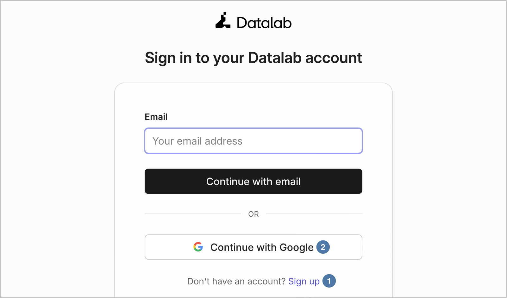
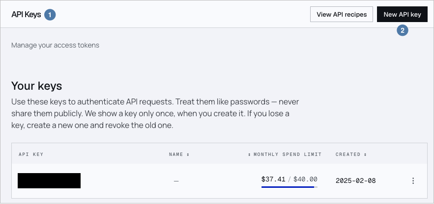
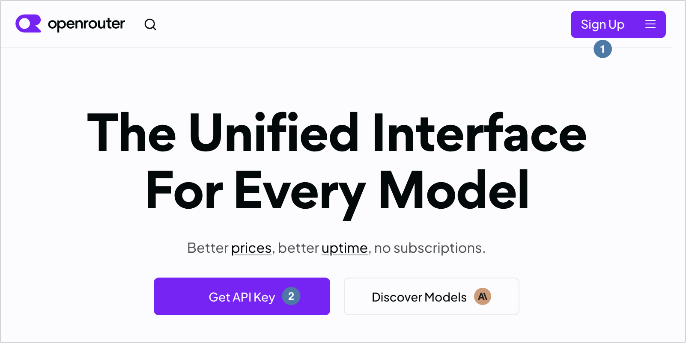
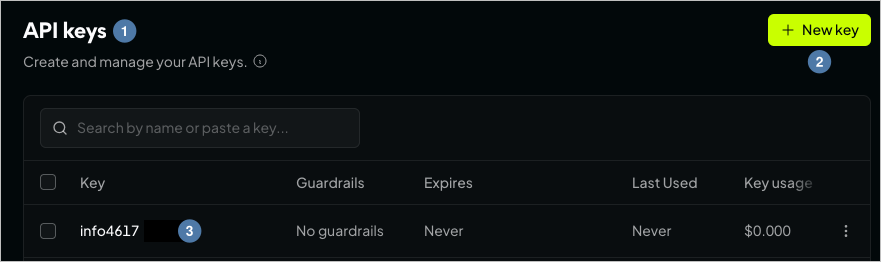
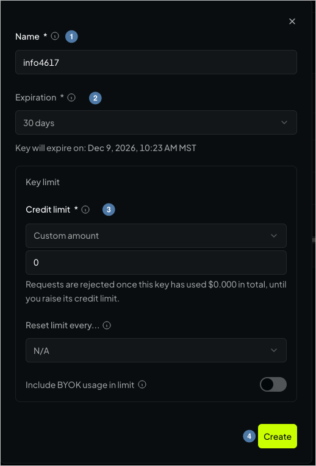

# AI APIs as Data Tools {#sec-ai-apis}

::: {.callout-tip}
## Learning Objectives
- Call a model the way you call any other API: one request in, one JSON answer out, checked before you use it
- Turn a PDF, pictures of tables included, into Markdown with a document-understanding API, and wait for a job that answers with a ticket
- Tell what a document parser read from what its model wrote, and check what it read with chapter 9's sums
- Ask a language model for JSON in a shape you define with a JSON Schema, and compare its answers with a ground truth
- Collect the lead section of a Wikipedia article as it stood on given dates, and turn its HTML into text
- Embed passages, compare them with cosine similarity, and say what a change in similarity does and doesn't show
- Answer a question from retrieved passages as JSON with the IDs of its sources, or null, and check the answer against every version of the text
- Give a model the tools of an MCP server, the Census Bureau's, and check and run the tool call it writes against the Census Data API yourself
- Read how a skill describes a task to a model, and record the costs, limits, and model IDs a run depends on
:::

::: {.callout-tip}
## Companion Notebook
Run this chapter's code as you read: open the [companion notebook](https://github.com/cuinfoscience/Web-Data-Science-Book/blob/main/notebooks/ch-13-ai-apis.ipynb) (see @sec-appendix-notebooks for all of them).
:::


## Models as Functions

@sec-pdfs ended at a picture. The last page of the City of Boulder's December 2024 revenue report, Exhibit 3, is an image of a table, and beside it the city printed a note: "Please contact sales tax staff … for a screen readable version." pdfplumber had read every other table in the report exactly, from the text layer, and stopped at Exhibit 3, because a picture has no text layer. Tesseract's OCR read the picture, with a few stray marks that you then had to find and set aside. Chapter 9's last section, "Document Understanding," described what people try next: a hosted service, where you upload the whole document and a company's model reads it on the company's computers, for a fee per page. This chapter uses one of them, Datalab, on the same seven year-end reports, 2018 to 2024, along with a language model reached through OpenRouter, and checks what both return against chapter 9's figures.

You may know language models as chatbots: you type, it answers, you type again. A **language model** is a program trained on a large amount of text to predict the text that comes next, and a chatbot is one way to use it. A chat leaves you with paragraphs that change from one try to the next, and the only way to tell whether a paragraph is right is to read it. This chapter calls a model the way @sec-government called the Census Bureau. Your code builds one request, and the model sends back one answer in a shape your code can read: JSON, whose fields you can put in a DataFrame and compare with a figure you already know. Every model call below is followed by that comparison.

The chapter uses three kinds of API. The first two work on Boulder's reports. The third moves to Wikipedia, for reasons that "Embeddings and Retrieval" explains:

| Kind of API | Service in this chapter | In | Out | The check |
|---|---|---|---|---|
| Document understanding | [Datalab](https://www.datalab.to)'s Convert API | A PDF | Markdown, one page at a time | A table's sums (chapter 9) |
| Structured generation | A free language model, through [OpenRouter](https://openrouter.ai) | An instruction and one page | JSON in a shape you define | Chapter 9's figures from pdfplumber |
| Embeddings | A free embedding model, through OpenRouter | Versions of a Wikipedia article's lead, and a question | A list of numbers for each | Reading the versions it ranks highest |

The last two combine in **retrieval-augmented extraction**: find the passages closest to a question, then ask a model for the answer and the IDs of the passages it came from. In each kind, one step's output is the next step's input, so a mistake made early reaches the end unless a check catches it on the way.

### What You Send, and to Whom

Every request in this chapter sends a document, or part of one, to a company, and each company has its own rules for what it keeps. Datalab receives the whole PDF. It keeps a result until "the output bucket's one-day lifecycle rule removes" it, unless you delete it sooner ([Delete Result](https://documentation.datalab.to/api-reference/delete-result), checked 2026-11-07), and a team's data-retention setting decides whether Datalab writes "an extra copy for QA and training" (QA is quality assurance). OpenRouter receives each page or passage you send and passes it to the company that runs the model, its *provider*, which for this chapter's free models is mostly NVIDIA. OpenRouter says it does not store your prompts, the text you send a model, or the responses, unless you opt in, and its account settings decide whether your requests may go to providers that train on them, with "separate settings for paid and free models" ([Data Collection](https://openrouter.ai/docs/guides/privacy/data-collection) and [Provider Logging](https://openrouter.ai/docs/guides/privacy/provider-logging), checked 2026-11-07). NVIDIA's free endpoints carry a notice of their own, on each model's page on OpenRouter: "please do not upload any confidential information or personal data … Your use is logged for security purposes and to improve NVIDIA products and services" (checked 2026-11-07).

NVIDIA's free endpoints log what you send, and Datalab keeps each result for a day, so send these services only what you would publish: public records that name no private individuals. Boulder's revenue reports qualify. The city publishes them on its records portal, and they report taxes by category, with no taxpayer named. The Wikipedia articles in this chapter are public too, and they are about public officials. One page of each report needs care even so. Page 1, the cover, gives a city staff member's work email and phone number, so no output in this chapter prints it, and none of yours should either.

::: {.callout-tip}
## Missing Manual Reference
For what a language model does with the text you send it, from tokens to sampling, see *Missing Manual* [Chapter 36: How Language Models Work](https://cuinfoscience.github.io/INFO-Missing-Manual/chapters/llm-internals.html). For ways to check a model's output before you trust it, see [Chapter 38: Evaluating and Auditing AI Outputs](https://cuinfoscience.github.io/INFO-Missing-Manual/chapters/evaluating-ai.html).
:::

## A Tour: From a Playground to the API

@sec-government and @sec-social started each API with the pages a person reads, because those pages show what a service can do before you spend any requests on it. Both services in this chapter have such pages.

Datalab's [quickstart](https://documentation.datalab.to/docs/welcome/quickstart) points to [Forge](https://www.datalab.to/app/playground), a playground where you upload a document and see the result, with "no API key required" (checked 2026-11-07). Upload a page of your own PDF there before you write any code. If the Markdown that comes back has your table's rows and columns, the API will give you the same. If it doesn't, no code you write will change what the service can read, and you will have found that out without spending any of your allowance. Datalab's [pricing page](https://www.datalab.to/pricing) is the other page to read first, because each of the API's modes has its own rate.

On OpenRouter, every model has a page, such as [nvidia/nemotron-3.5-super-vl:free](https://openrouter.ai/nvidia/nemotron-3.5-super-vl:free). On 2026-11-07 that page gave the model's name, its ID, its price ("Free"), its context ("1.0M", a million tokens), the date it was released (October 15, 2026), and the notice about logging quoted above. A **token** is a piece of a word, the unit a model reads and writes, and a model's **context**, or context window, is how many tokens one request can carry. The ID is the one thing your code needs from the page. Its ending, `:free`, names a free *variant* of a model, served without charge and under its own *rate limits*, caps on how many requests you may send in a given time (@sec-wikipedia).

| On the page | What it tells you | Where it goes in your code |
|---|---|---|
| Forge's result for your document | Whether the service can read your tables at all | Nothing yet: it decides whether to write the code |
| Datalab's rate for each mode | What a page costs: `lite`, `fast`, `balanced`, `accurate` | The `mode` field of the request |
| The model's ID on OpenRouter | Which model answers | The `model` field, or a `models` list |
| `:free` and the price | What each request costs | The ID itself: only `:free` IDs are free |
| The context length | How much text one request can carry | How many pages you send at once |
| The notice on a free endpoint | Who logs what you send | What you send at all |
| The supported parameters (in the API's list of models) | Whether the model accepts a JSON Schema (a description of the JSON you want back), or tools | `response_format`, `tools` |

## Two Keys

Everything this chapter sends goes to one of two companies, and each wants to know who is asking before it does any work. The Census Bureau in @sec-government asked for the same thing, for a different reason: it wanted to count your requests. These two services also bill for work, and a key is how they know whose free allowance to charge. So the first job is an account and a key at each, about ten minutes in all. Get both before you start: a key that turns out to be missing halfway through a section stops the code at its first request. One section near the end, "Tools, MCP, and Skills," also sends a request to the Census Bureau, with the `CENSUS_KEY` you made for @sec-government.

### A Datalab Key

1. **Open the sign-in page.** Go to [datalab.to/app/keys](https://www.datalab.to/app/keys). Without an account, Datalab sends you to its sign-in page (@fig-datalab-signin). Choose **Sign up** ①, or sign up in one step with a Google account ②. A personal account is fine: the free allowance comes with any account, and needs no credit card ([quickstart](https://documentation.datalab.to/docs/welcome/quickstart), checked 2026-11-07).

{#fig-datalab-signin .lightbox fig-alt="Screenshot of Datalab's sign-in page, headed Sign in to your Datalab account, under the Datalab logo. It has an Email field reading Your email address, a black Continue with email button, the word OR, and a Continue with Google button, marked 2. Below them is the line Don't have an account? Sign up, with Sign up marked 1."}

2. **Create a key.** Once you are signed in, the same address opens the **API Keys** page ① (@fig-datalab-keys). Click **New API key** ②, and give the key a name you'll recognize later, such as `info4617`. The table lists each key with a monthly spend limit, which is how Datalab's free allowance shows up.

{#fig-datalab-keys .lightbox fig-alt="Screenshot of Datalab's API Keys page, signed in. Marker 1: the page title, API Keys, under which it says Manage your access tokens. Marker 2: the black New API key button, beside View API recipes. Below, under Your keys, the text says to treat keys like passwords and that Datalab shows a key only once, when you create it. A table lists one key, blacked out, with columns for name, monthly spend limit and created date."}

3. **Copy it once, and store it.** Datalab shows a key only once, when you create it, so copy it as soon as it appears and store it as `DATALAB_KEY` (below). If you lose it, the page's own advice is the right one: create a new key and revoke the old one. Datalab's own documentation and its Python library call the variable `DATALAB_API_KEY`. This book calls it `DATALAB_KEY`, as it called the others `CENSUS_KEY` and `YOUTUBE_KEY`; if you later use Datalab's library, set both.

### An OpenRouter Key

1. **Sign up.** Go to [openrouter.ai](https://openrouter.ai) and choose **Sign Up** ① (@fig-openrouter-home). **Get API Key** ② leads to the same sign-up if you aren't signed in yet.

{#fig-openrouter-home .lightbox fig-alt="Screenshot of the top of OpenRouter's home page. The header has the openrouter logo, a search icon, and a purple Sign Up button, marked 1. Below it the headline reads The Unified Interface For Every Model, with the line Better prices, better uptime, no subscriptions. Under that are two buttons, a purple Get API Key, marked 2, and Discover Models."}

2. **Open the API keys page.** Once you're signed in, open [openrouter.ai/settings/keys](https://openrouter.ai/settings/keys), the **API keys** page ① (@fig-openrouter-keys), and click **New key** ②. The table below lists your keys by name, with when each expires and what it has cost ③.

{#fig-openrouter-keys .lightbox fig-alt="Screenshot of OpenRouter's API keys page in its dark theme. Marker 1: the title API keys, with the line Create and manage your API keys. Marker 2: the bright green New key button at the right. Below is a search box and a table with columns Key, Guardrails, Expires, Last Used and Key usage. Its one row, marker 3, is a key named info4617, with No guardrails, Never, Never and 0.000 dollars."}

3. **Fill in the form.** The form asks for a **Name** ① (@fig-openrouter-create-key): type `info4617`. **Expiration** ② defaults to 30 days; choose a date after the semester ends, so the key doesn't stop working in the middle of your project. Under **Credit limit** ③, a custom amount of 0 is a safe choice: requests to `:free` models cost nothing, and with a limit of 0 any request that would cost money is refused instead of billed. Then click **Create** ④.

{#fig-openrouter-create-key .lightbox fig-alt="Screenshot of OpenRouter's dark form for a new key. Marker 1: the Name field, filled in as info4617. Marker 2: Expiration, set to 30 days, with the line Key will expire on Dec 9, 2026. Marker 3: Credit limit, set to Custom amount, 0, with the note that requests are rejected once the key has used 0.000 dollars in total. Below are Reset limit every, N/A, and a switch for Include BYOK usage in limit. Marker 4: the green Create button."}

4. **Copy it once, and store it** as `OPENROUTER_KEY`. OpenRouter shows a new key's full value only once, right after you create it; if you lose it, delete it on the API keys page and make another.

### Storing Both Keys

Store each key as an environment variable, by one of the ways in @sec-government ("Setting Environment Variables"). Treat each key like a password: never paste it into a notebook cell, a code file, or a message. If one leaks, delete it on its service's keys page and make another. Set the variables, quit Jupyter, open a new terminal, and start Jupyter from it. A Jupyter that was running before you set a variable never receives it (@sec-government, "When a Key Says `MISSING`"). Then check both:

```{python}
import os
import re
import io
import json
import time
import requests
import numpy as np
import pandas as pd
import pdfplumber

# Say whether each key is set, without ever printing the key itself
for name in ["DATALAB_KEY", "OPENROUTER_KEY"]:
    # Inside the f-string's double quotes, single quotes mark the two strings it chooses between
    print(f"{name}: {'set' if os.environ.get(name) else 'MISSING'}")
# Keep each key in a variable; os.environ.get() gives None for a key that isn't set
datalab_key = os.environ.get("DATALAB_KEY")
openrouter_key = os.environ.get("OPENROUTER_KEY")

# Every request in this chapter says who is asking, as chapter 1's did; put your own address here
HEADERS = {"User-Agent": "WebDataScience/1.0 (your-email@colorado.edu)"}
# DATALAB_KEY: set
# OPENROUTER_KEY: set
```

If either says `MISSING` and you can't restart Jupyter now, chapter 11's `getpass()` cell asks for a missing key without saving it in the notebook. Then set the two services' addresses, and the book's copies of the files:

```{python}
# Each service's API address; each request below adds an endpoint's path to the end
datalab_base = "https://www.datalab.to/api/v1"
openrouter_base = "https://openrouter.ai/api/v1"
# Chapter 9's copies of the city's PDFs, and this chapter's copies of Datalab's Markdown of them
book = "https://raw.githubusercontent.com/cuinfoscience/Web-Data-Science-Book/main/data/ch-09/"
saved = "https://raw.githubusercontent.com/cuinfoscience/Web-Data-Science-Book/main/data/ch-13/"

# Each service reads its key from its own header; **HEADERS adds the User-Agent to each
# Datalab wants the bare key in X-API-Key; OpenRouter wants "Bearer ", then the key, in Authorization
datalab_headers = {"X-API-Key": datalab_key, **HEADERS}
openrouter_headers = {"Authorization": f"Bearer {openrouter_key}", **HEADERS}
```

Chapter 11 sent the Census Bureau's key in the URL, where a printed `response.url` showed it. These two keys travel in headers, so `response.url` is safe to print, and a printed `datalab_headers` would show the key. Print responses, and never the headers you sent.

## Document Understanding with Datalab

Chapter 9's parsers ran on your own computer, and the picture of Exhibit 3 was where they struggled: Tesseract left stray marks, and Docling merged and emptied rows. Datalab makes [Marker](https://github.com/datalab-to/marker) and [Chandra](https://github.com/datalab-to/chandra), two other parsers from chapter 9's table of tools, and it also runs its models as a hosted service, so the reading happens on its computers and you pay by the page. Its [Convert API](https://documentation.datalab.to/docs/recipes/conversion/conversion-api-overview) takes a document and returns Markdown, HTML, JSON, or the document cut into pieces, called chunks. Send it the December 2024 report, the one whose Exhibit 3 stopped pdfplumber, and see what a hosted model makes of the picture.

### Submitting a Document

A request to `/convert` is a `POST` with form fields, named values sent the way a web form sends them. There are two ways to name the document:

- **`file`**: upload the PDF from your computer, as `files=` in `requests`. Use this for a document that isn't on the web.
- **`file_url`**: give the address of a PDF on the web, and Datalab downloads it. The address must be public: Datalab's quickstart lists "using `file_url` with a private/authenticated URL" among the common mistakes. This chapter uses the book's copies on GitHub, so a class doesn't send the city's server a request each.

The other fields say what to make. `output_format` is `markdown`. `mode` chooses how hard Datalab works, and what it costs. `lite` reads a born-digital page from its text layer with fast OCR and makes no passes with a language model; `fast` and `balanced` run its models; and `accurate` runs its strongest ([Convert Document](https://documentation.datalab.to/api-reference/convert-document), checked 2026-11-07). `paginate` marks where each page starts, which the next steps need. Form fields are text, so `"true"` is a string.

```{python}
# The December 2024 report, by its address; Datalab downloads it from there
# The form fields: the PDF's address, Markdown back, the balanced mode, and a marker at each page
data = {"file_url": book + "revenue-report-2024-12.pdf", "output_format": "markdown",
        "mode": "balanced", "paginate": "true"}
# 1. Send the fields to /convert; data= sends them as a form, the way a web page's form does
response = requests.post(f"{datalab_base}/convert", data=data, headers=datalab_headers, timeout=60)
response.raise_for_status()
# 2. Datalab answers at once with a ticket, not the document
job = response.json()
print(job)
# {'success': True, 'error': None, 'request_id': 'W2Bdj6Blyn7oO0ZDUgBbUQ', 'request_check_url': 'https://www.datalab.to/api/v1/convert/W2Bdj6Blyn7oO0ZDUgBbUQ', 'versions': None, 'checkpoint_reused': None}
```

The answer isn't the document. Converting takes seconds for a report like this one and can take minutes for a long document, so instead of keeping the connection open, Datalab answers at once with a **ticket**: a `request_id`, and `request_check_url`, the address where the result will be. Every API in chapters 10 to 12 answered with the data itself, and your code could read it from the response. This one tells you where to ask again.

### Waiting for the Result

Ask the ticket's address whether the job is done. The [result check](https://documentation.datalab.to/api-reference/convert-result-check) answers with a `status`, `processing` until the job is `complete`:

```{python}
# Ask the ticket's address how the job is going
response = requests.get(job["request_check_url"], headers=datalab_headers, timeout=60)
response.raise_for_status()
check = response.json()
print(check["status"])  # "processing" until the job is done, then "complete"
# processing
```

Asking again by hand gets tedious, so let a loop ask, every two seconds. Chapter 12's loop followed a `cursor` until there wasn't one; this one follows the status until the job is complete. Give it a limit, so that a job that never finishes doesn't stop your notebook forever:

```{python}
# Ask again every two seconds, at most 60 times: two minutes
for attempt in range(60):
    # Leave the loop as soon as the job is done; the check from the cell above may already say so
    if check["status"] == "complete":
        break
    time.sleep(2)  # wait two seconds before asking again
    # Ask again, and keep the newest answer in check
    response = requests.get(job["request_check_url"], headers=datalab_headers, timeout=60)
    response.raise_for_status()
    check = response.json()
# The finished answer's account of the work: pages read, cost in cents, and seconds spent
print(check["page_count"], "pages,", check["total_cost"], "cents,", round(check["runtime"], 1), "seconds")
# 15 pages, 4.5 cents, 10.5 seconds
```

The finished answer holds the document, in `check["markdown"]`, and an account of the work: `page_count`, the pages it read; `runtime`, the seconds it spent; and the cost, in cents. Datalab's reference marks `total_cost` as *deprecated*: still sent, but on its way out, in favor of `cost_breakdown`, which here was `{'final_cost_cents': 4.5}`. When a result is too large to send directly, the answer gives a signed `result_url` instead: an address that carries its own permission to download the result. For these reports it was `None`.

Fifteen pages cost 4.5 cents, 0.3 cents a page. Datalab's [pricing page](https://www.datalab.to/pricing) listed, on 2026-11-07, \$4 per 1,000 pages for `fast` and `balanced`, \$0.50 for `lite`, and \$10 for `accurate`. This bill was three-quarters of the list rate. The same page offers 25% off for opting into data retention, which lets Datalab keep copies of what you send. Check your account's setting, and what it allows, before you send anything. The free allowance was \$10 a month on a personal email (\$20 on a work email), about 2,500 pages at the list rate for `balanced`, with at most 25 requests a minute. All seven year-end reports, converted the same way on 2026-11-07 for `data/ch-13/`, came to 106 pages and 31.8 cents.

The output above comes from this chapter's second try. The first time it sent the request, the job was complete at the first check, for 0 cents, in 0.1 seconds. The same file had been converted from the same account earlier that day, and Datalab answered from its **cache**, the store of results it had already made. The second request added `"skip_cache": "true"` to `data`, which forces a new conversion and bills for it. A model's output can also differ from one conversion to the next, as "What the Model Wrote" shows.

Each conversion takes the same two steps, so gather them into a function for the rest of the chapter:

```{python}
def convert(data):
    """Submit a document to Datalab's Convert API, wait for it, and return the finished result.

    Parameters
    ----------
    data : dict
        The request's form fields, such as file_url, output_format, mode, and paginate

    Returns
    -------
    dict
        The result check's answer, with the document in "markdown"
    """
    # 1. Submit the document; Datalab answers with a ticket, not the document
    response = requests.post(f"{datalab_base}/convert", data=data, headers=datalab_headers, timeout=60)
    response.raise_for_status()
    ticket = response.json()["request_check_url"]  # the address where the result will be
    # 2. Ask that address every two seconds until the job is complete
    for attempt in range(60):  # at most two minutes
        time.sleep(2)
        response = requests.get(ticket, headers=datalab_headers, timeout=60)
        response.raise_for_status()
        result = response.json()
        if result["status"] == "complete":
            return result  # return leaves the loop and the function at once
    # 3. Reached only if all 60 checks said the job wasn't complete
    raise TimeoutError(f"Not complete after two minutes; the result will be at {ticket}")
```

### Reading the Markdown

With `paginate`, each page of the Markdown starts with its number in braces, counting from 0, and a line of dashes, such as `{14}------------------------------------------------`. [`re.split()`](https://docs.python.org/3/library/re.html#re.split) on that marker gives a list of pages. The text before the first marker is empty, so `[1:]` drops it, and `pages[0]` is page 1:

```{python}
markdown = check["markdown"]  # the whole document, as one string
# Split at each page marker; the pattern, piece by piece: \n* any newlines before it,
# \{\d+\} a number in braces, -{10,} ten or more dashes, and \n* any newlines after it
pages = re.split(r"\n*\{\d+\}-{10,}\n*", markdown)[1:]  # [1:] drops the empty text before page 1
print(len(pages), "pages")
# 15 pages
```

Fifteen pages, as many as `page_count` reported. Page 2 is the summary; print the lines of its table that hold a total:

```{python}
# Page 2, the summary: the rows of its table that hold a total; " ".join(line.split()) squeezes out the padding
for line in pages[1].splitlines():
    if "Total" in line:
        print(" ".join(line.split()))
# | <b>Total Sales &amp; Use Tax based on current economic activity</b> | <b>\$172,401,668</b> | <b>\$171,006,199</b> | <b>-\$1,395,469</b> | <b>-0.81%</b> | <b>-0.81%</b> |
# | <b>Total Sales and Use Tax</b> | <b>\$175,517,129</b> | <b>\$173,908,431</b> | <b>-\$1,608,698</b> | <b>-0.92%</b> | <b>-0.92%</b> |
```

These are the rows chapter 9 read with pdfplumber, and the figures agree: \$175,517,129 for 2023 and \$173,908,431 for 2024. A Markdown table writes each row on one line, with `|` between cells. Datalab's Markdown also carries some HTML: `<b>` for bold, `&amp;` for an ampersand, and `\$`, a dollar sign escaped so that Markdown doesn't read it as the start of mathematics. Any code that turns a cell into a number has to remove all three, along with the commas.

Remember the cover: `pages[0]` holds a staff member's email and phone number. The code in this chapter starts at `pages[1]`, and yours should too.

Now page 15, Exhibit 3, the picture of a table:

```{python}
# Page 15, Exhibit 3: only the lines of its table, not the note above it
# A Markdown table's lines start with "|"; the list comprehension keeps those lines and no others
exhibit_lines = [line for line in pages[14].splitlines() if line.startswith("|")]
print(len(exhibit_lines), "lines of table")
# Two of them, the first and the fourth, each with its padding squeezed out and cut to 100 characters
for line in [exhibit_lines[0], exhibit_lines[3]]:
    print(" ".join(line.split())[:100])
# 43 lines of table
# | REVENUE<br>CATEGORY | YEAR | JAN | FEB | MAR | APR | MAY | JUN | JUL | AUG | SEP | OCT | NOV | DEC
# | <b>Retail Sales Tax</b> | 2019 | 8,590,452 | 7,489,624 | 9,606,398 | 8,214,047 | 8,832,480 | 10,73
```

Datalab read the picture as a Markdown table, with the column headings and the categories in place. The second figure in the 2021 row, which Tesseract read as "7,608.759" in chapter 9, is "7,608,759" here. Whether the other nearly 400 figures are right is a question for "Checking What It Read," below.

### What the Model Wrote

A document-understanding model does more than read. Where a page has a chart, Datalab's `balanced` mode writes a caption and a description of it, so that a reader of the Markdown learns what the picture shows. So does a screen reader, the software that reads a page aloud to someone who can't see it. Chart 8, on page 9, is a pie chart of the city's marijuana revenue, with each slice's figure printed beside it:

```{python}
# Page 9: from Chart 8's title to Chart 9's, leaving out the line that links the image
# find() gives the position where each title starts; the slice [start:end] keeps the text between
chart_8 = pages[8][pages[8].find("**Chart 8"):pages[8].find("**Chart 9")]
for line in chart_8.splitlines():
    # Skip blank lines, and the image's own line, which starts with "![" in Markdown
    if line.strip() and not line.startswith("!["):
        print(" ".join(line.split()))
# **Chart 8: Distribution of YTD Marijuana Revenues**
# | Category | Amount |
# |---------------------------------------------------------|-------------|
# | State Share-Back | \$529,220 |
# | Medical Marijuana (3.86% Base) | \$52,937 |
# | Recreational Marijuana (3.86% Base) | \$1,262,688 |
# | Recreational Marijuana (3.5% Additional + 5.0% Excise)* | \$1,341,007 |
# A pie chart showing the distribution of marijuana revenue. The largest slice is Recreational Marijuana (3.86% Base) at \$1,262,688, followed by Recreational Marijuana (3.5% Additional + 5.0% Excise)\* at \$1,341,007. State Share-Back is \$529,220, and Medical Marijuana (3.86% Base) is \$52,937.
# Pie chart: Breakdown of marijuana revenue by category and amount.
# \*Dedicated to the General Fund.
```

The table is a reading: its four figures are printed on the chart, and pdfplumber finds each of them in the page's text layer. The paragraph under it is writing, text the model composed and the page doesn't print. It calls \$1,262,688 the largest slice, then says the next is \$1,341,007, which is larger. Each figure in the sentence matches the chart, and the order it puts them in is backward.

Page 10 goes further. Its bar chart of sugar-sweetened beverage tax by month has no figures on it, only an axis. Datalab wrote a description and a table of the values it estimated from the bars:

```{python}
# Page 10: the description, the table's heading, and its December row
for line in pages[9].splitlines():
    # Given a tuple, startswith() is true when the line starts with any one of the three
    if line.startswith(("A bar chart", "| Month", "| December")):
        print(" ".join(line.split()))
# A bar chart showing monthly values from January to December for the years 2019 through 2024. The y-axis represents values in dollars, ranging from \$- to \$600,000. The x-axis shows the months. 2019 is the highest in November, while 2024 is the highest in March and November.
# | Month | 2019 | 2020 | 2021 | 2022 | 2023 | 2024 |
# | December | ~\$370,000 | ~\$225,000 | ~\$335,000 | ~\$355,000 | ~\$325,000 | ~\$285,000 |
```

The table has 72 estimates, each marked with a `~`, and none of them is printed in the report. The description contradicts the table beside it, too: the table puts November 2024 at about \$250,000, the lowest November of the six years, while the description calls November one of 2024's highest months. The PDF's own text layer shows what the page prints. Read it with pdfplumber, as in chapter 9, from the book's copy:

```{python}
# Chapter 9's copy of the PDF itself, not Datalab's Markdown of it
response = requests.get(book + "revenue-report-2024-12.pdf", headers=HEADERS, timeout=60)
response.raise_for_status()
# The text layer of every page, from the PDF's bytes in memory
text_layer = []
# io.BytesIO() lets pdfplumber open the downloaded bytes as if they were a file on disk
with pdfplumber.open(io.BytesIO(response.content)) as pdf:
    for page in pdf.pages:
        # extract_text() gives None for a page without text; "or" puts an empty string in its place
        text_layer.append(page.extract_text() or "")
# Page 10's lines with a dollar sign: everything it prints in dollars
print([line for line in text_layer[9].splitlines() if "$" in line])
# ['$600,000', '$500,000', '$400,000', '$300,000', '$200,000', '$100,000', '$-']
```

The page prints the axis and nothing else, so each of the 72 estimates came from the model.

The writing also changes from one conversion to the next. This chapter's conversion and the one that made `data/ch-13/`, about twenty minutes apart on 2026-11-07, differ on six of the fifteen pages. On four of them the model wrote differently. Chart 1's table headed its first column "Department" instead of "Category," and estimates moved on pages 5 and 10 (on page 10, one went from about \$415,000 to about \$410,000). Descriptions changed on pages 4, 5, and 8. On the other two pages only the formatting changed, such as bold tags in a header. Every figure Datalab read from the text layer or from the picture of Exhibit 3 was the same both times.

If the writing is the problem, a mode that doesn't write may be the answer. `lite`, the cheapest mode, makes no passes with a language model:

```{python}
lite = convert({**data, "mode": "lite"})  # the same fields, with the mode changed
print(lite["page_count"], "pages,", lite["total_cost"], "cents,", round(lite["runtime"], 1), "seconds")
# 15 pages, 0.5625 cents, 1.9 seconds
```

Fifteen pages again, for 0.5625 cents in 1.9 seconds; `balanced` took 4.5 cents and 10.5 seconds. What did the cheaper mode give up? Look at Chart 9, the line chart under Chart 8:

```{python}
# Split lite's Markdown into pages, with the same pattern as before
lite_pages = re.split(r"\n*\{\d+\}-{10,}\n*", lite["markdown"])[1:]
# Chart 9, the line chart under Chart 8, as lite mode read it
chart_9 = lite_pages[8][lite_pages[8].find("Chart 9"):]  # from Chart 9's title to the end of the page
# Its first seven lines, skipping the blank ones
for line in chart_9.splitlines()[:7]:
    if line.strip():
        print(" ".join(line.split()))
# Chart 9: Historical Trends for YTD Marijuana Revenues3
# | | | | | |
# |-------------|-------------|-------------------|---------------|-------------|
# | \$6,000,000 | \$5,638,279 | | | |
# | \$5,000,000 | \$5,429,87 | | | |
# | \$4,000,000 | | \$4,372,65 8,918 | | |
```

(This chapter's run added `"skip_cache": "true"` here too.) `lite` cost an eighth as much and took a fifth of the time. Its Markdown has no descriptions and not one `~`, where `balanced` has 124. It read Exhibit 3 too, and all 30 of its rows pass the check below. But it read Chart 9, whose figures are printed around the lines, as a grid: the axis labels in one column, "\$5,429,87" with its last digit lost, and "\$4,372,65 8,918," two figures run together. `balanced` read the same chart's figures into a clean table. So the mode to choose depends on the pages: `lite` handles text and plain tables, `balanced` handles charts with their figures printed on them, and the output of either one needs the checks in the next section.

Datalab's reference lists two fields for the writing. `disable_image_captions` turns off "synthetic image captions/descriptions," the ones a model writes, and `fence_synthetic_captions` wraps them in HTML comment markers "for easy identification/removal." This chapter didn't test whether either one covers the tables of estimates. If you try them, check the beverage page.

### Checking What It Read

Reading a few rows can't tell you whether nearly 400 figures are right. Chapter 9's first check on Exhibit 3 was a sum: each row's twelve months should add up to its total, give or take the rounding of each figure to the dollar. The same check works on Datalab's table. In each line of the table, the cells sit between `|` characters, so `line.split("|")` gives `['', label, year, twelve months, total, ...]`. Two small functions do the work, because the 2018 report, and the exercises, need them again:

```{python}
def table_cells(line):
    """Split one line of a Markdown table into its cells, without bold tags, commas, or spaces."""
    cells = []
    # Each piece between two "|" characters is one cell; clean it and keep it
    for cell in line.split("|"):
        cells.append(cell.replace("<b>", "").replace("</b>", "").replace(",", "").strip())
    return cells

def figure_rows(page):
    """Return the rows of an Exhibit 3 table, as lists of cells: the lines whose third cell is a year."""
    rows = []
    for line in page.splitlines():
        cells = table_cells(line)
        # Keep a line with more than 16 cells, as a row with twelve months has, and a year as its third
        # re.fullmatch() is true only when the whole cell matches: "20", then two digits (\d\d)
        if len(cells) > 16 and re.fullmatch(r"20\d\d", cells[2]):
            rows.append(cells)
    return rows

exhibit = figure_rows(pages[14])  # page 15, Exhibit 3
print(len(exhibit), "rows of figures")
# Each category's name starts its first row
labels = []
for cells in exhibit:
    if cells[1]:  # an empty label cell counts as false, so rows without a name are skipped
        labels.append(cells[1])
print(labels)
# 30 rows of figures
# ['Retail Sales Tax', 'Business Use Tax', 'Construction Use Tax', 'Motor Vehicle Use Tax', 'TOTAL']
```

Thirty rows: four taxes and their total, each for the six years from 2019 to 2024, with the labels in the order the picture prints them. Now the sums:

```{python}
def largest_gap(rows):
    """Return the largest difference, in dollars, between a row's twelve months and its printed total."""
    largest = 0
    for cells in rows:
        # Cells 3 to 14 hold the twelve months; cell 15 holds the printed total
        months = []
        for cell in cells[3:15]:
            months.append(int(cell))  # each cell is text; int() makes it a whole number
        gap = abs(sum(months) - int(cells[15]))  # abs(): the size of the gap, whichever is larger
        # Keep the largest gap seen so far
        if gap > largest:
            largest = gap
    return largest

print("largest gap between the months and the total:", largest_gap(exhibit), "dollars")
# largest gap between the months and the total: 2 dollars
```

Every row adds up within \$2, as Tesseract's rows did in chapter 9. A digit misread anywhere but the last place would miss by \$10 or more. Datalab's table also passes a second check from chapter 9, two printings of the same figure. Exhibit 3's Retail Sales Tax total for 2024, 142,513,015, is the Sales Tax figure in page 13's Exhibit 1, which comes from the text layer.

The 2018 report is older, and its Exhibit 3 is a table of text, not a picture. Its Markdown is in the book's saved copy, so checking it costs nothing:

```{python}
# The book's saved Markdown of the 2018 report: no request to Datalab, so no cost
response = requests.get(saved + "revenue-report-2018.md", headers=HEADERS, timeout=60)
response.raise_for_status()
# Split it into pages, and keep the rows of figures on page 15, as for 2024
pages_2018 = re.split(r"\n*\{\d+\}-{10,}\n*", response.text)[1:]
rows_2018 = figure_rows(pages_2018[14])
print(len(pages_2018), "pages;", len(rows_2018), "rows of figures; largest gap:", largest_gap(rows_2018), "dollars")
# 15 pages; 28 rows of figures; largest gap: 0 dollars
```

Four categories for the seven years from 2012 to 2018, and every row exact to the dollar. Put the tools side by side on the 2024 picture of a table, with the same check:

| Tool | Rows of 30 read whole | Every whole row adds up | Cost |
|---|---|---|---|
| Tesseract, with chapter 9's pattern | 28; 2 set aside for stray marks | Yes, within \$2 | Free, on your computer |
| Docling 2.139.0 (chapter 9) | 21; rows merged or emptied | Yes, but two with the wrong label | Free, about a minute on a laptop |
| Datalab, `lite` | 30 | Yes, within \$2 | 0.5625 cents for the report |
| Datalab, `balanced` | 30 | Yes, within \$2 | 4.5 cents for the report |

Sums catch a misread digit. They can't catch a right row with the wrong label, which is how Docling failed in chapter 9, or a description that contradicts its figures. Datalab's labels are in the right order here, and the only way to know that was to read them.

## A Model as a Function: Structured Output

Datalab's Markdown is text, and you still have to find the figures in it. Chapter 9 found them with code written for one layout: a row's label, and a column's position. A language model can read the page and return the figures you name wherever they sit, and it can return them as JSON in a shape you define, which is called **structured output**. This section asks for four fields from each report's summary page: the month and year the report covers, and the totals row's two figures, the year before and the report's own year. Chapter 9 read those same figures with pdfplumber, and checked every one, so its numbers are the **ground truth**: answers known to be right, which you compare the model's answers with.

From here on, the chapter reads the book's saved copies of the seven reports' Markdown, made with `convert()` as above on 2026-11-07, so it needs no Datalab key and costs nothing to re-run.

### One Request, One JSON Object

OpenRouter accepts one kind of request, OpenAI's chat-completions format, and passes it to models from many companies ([quickstart](https://openrouter.ai/docs/quickstart)). Which models are free, and what each accepts, is in its list of models, which needs no key:

```{python}
# OpenRouter's list of every model it offers; HEADERS has no key, and this request needs none
response = requests.get(f"{openrouter_base}/models", headers=HEADERS, timeout=60)
response.raise_for_status()
models = response.json()["data"]  # a list of dictionaries, one for each model
# Keep the models whose ID ends in ":free"
free = [model for model in models if model["id"].endswith(":free")]
print(len(models), "models;", len(free), "free")
# 460 models; 12 free
```

Of the 460 models listed, 12 are free. Which of those accept a JSON Schema? Each model's entry lists its `supported_parameters`:

```{python}
# The free models whose list of supported parameters includes structured outputs
print([model["id"] for model in free if "structured_outputs" in model["supported_parameters"]])
# ['liquid/lfm-3-1.7b:free', 'recursive/flint-v1.0:free', 'xingchen-agi/xing4.0-29b-a4b:free', 'nvidia/nemotron-3.5-super-vl:free', 'dots-studio/dots-3-note-preview:free']
```

The list changes from week to week; this is 2026-11-07's. This chapter uses three free models, checked that day, in order of preference: NVIDIA's Nemotron 3.5 Super VL, Google's Gemma 4 31B, and Dots Studio's Dots3-Note Preview. Gemma's entry lists `response_format` but not `structured_outputs`, so OpenRouter doesn't count it among the models that enforce a *schema*, the shape you define for the answer. The first and third models are on that list.

Read the summary page of the December 2024 report, the first page whose text holds the table's last row:

```{python}
# The book's saved Markdown of the December 2024 report, split into pages as before
response = requests.get(saved + "revenue-report-2024-12.md", headers=HEADERS, timeout=60)
response.raise_for_status()
pages = re.split(r"\n*\{\d+\}-{10,}\n*", response.text)[1:]
# Every page whose text holds the totals row; [0] takes the first of them
summary = [page for page in pages if "Total Sales and Use Tax" in page][0]
# index() gives the page's place in the list, counting from 0, so add 1 for its page number
print("page", pages.index(summary) + 1, "|", len(summary), "characters")
# page 2 | 4902 characters
```

Now the shape of the answer. Asked only for "the totals," a model might return them as text with dollar signs, as a list, or under names it makes up, and your code would need a new way to read each answer. A **JSON Schema** fixes the shape in advance. It describes JSON the way a form describes what goes in each box: an object with these four properties, each of this type, all of them required, and no others. `month` must be one of twelve strings (`enum`), the years and totals whole numbers (`integer`). Each property's `description` says what belongs in it, in words:

```{python}
# The twelve months, so that "month" can only be one of them
MONTHS = ["January", "February", "March", "April", "May", "June", "July",
          "August", "September", "October", "November", "December"]
SCHEMA = {
    "type": "object",  # the answer is a JSON object: a dictionary, in Python
    "properties": {  # its fields, each with a type and a description
        "month": {"type": "string", "enum": MONTHS,  # enum: only these values are allowed
                  "description": "The month the year-to-date figures run through"},
        "year": {"type": "integer",
                 "description": "The report's current year: the later of the two years the table compares"},
        "total_prior": {"type": "integer",
                        "description": "The table's last row, Total Sales and Use Tax, for the earlier year, in dollars"},
        "total_current": {"type": "integer",
                          "description": "The table's last row, Total Sales and Use Tax, for the report's current year, in dollars"},
    },
    "required": ["month", "year", "total_prior", "total_current"],  # every field must be there
    "additionalProperties": False,  # and no other; requests sends Python's False as JSON's false
}
# The system message; two strings side by side inside parentheses join into one
INSTRUCTION = ("You extract figures from one page of a City of Boulder revenue report. "
               "Copy numbers exactly as printed, without $ or commas. Use only the page.")
```

The request's body has four parts, and the key goes in `openrouter_headers`:

- **`messages`**: a list with two items. The `system` message is the instruction; the `user` message is the page. That is the whole conversation, and no request in this chapter adds a third.
- **`response_format`**: `type` `json_schema`, with the schema, a `name` for it, and `strict` set to `True`, which asks the model to follow the schema exactly ([Structured Outputs](https://openrouter.ai/docs/guides/features/structured-outputs)). OpenRouter's page adds that enforcement "varies by provider," so "exact compliance is not guaranteed on every endpoint."
- **`temperature`**: how much chance goes into the model's choice of each next token. `0` asks the model for its most likely answer at every step, rather than a sample, a random pick among the likely tokens. "Non-determinism," below, shows that this isn't the same as getting the same answer every time.
- **`models`**: a list, in place of a single `model`. If the first returns an error, including 429, the status a service sends when you pass its rate limit, OpenRouter tries the next ([Model Fallbacks](https://openrouter.ai/docs/guides/routing/model-fallbacks)). The page warns that a paid model in the list is billed at its price: "To keep a request free, list only :free models."

```{python}
# Three free models, in order of preference; if one returns an error, OpenRouter tries the next
MODELS = ["nvidia/nemotron-3.5-super-vl:free", "google/gemma-4-31b-it:free", "dots-studio/dots-3-note-preview:free"]
# 1. The request's body: which models, how much chance, the conversation, and the answer's shape
body = {"models": MODELS, "temperature": 0,
        # The conversation: the instruction as the system message, the page as the user's
        "messages": [{"role": "system", "content": INSTRUCTION}, {"role": "user", "content": summary}],
        # Ask for JSON that fits SCHEMA; strict asks the model to follow it exactly
        "response_format": {"type": "json_schema",
                            "json_schema": {"name": "totals", "strict": True, "schema": SCHEMA}}}
# 2. Send it; json= sends the body as JSON, and a free model can take minutes, so allow three
response = requests.post(f"{openrouter_base}/chat/completions", json=body, headers=openrouter_headers, timeout=180)
response.raise_for_status()
result = response.json()
print(result["model"], "|", result["provider"])  # which model answered, and which company ran it
# The answer is a string of JSON; json.loads() turns it into a dictionary
# choices is a list of answers; this request asks for one, so [0] is the only one
answer = json.loads(result["choices"][0]["message"]["content"])
print(answer)
# 3. What the request used: tokens read, tokens written, and the cost
usage = result["usage"]
print(usage["prompt_tokens"], "tokens in,", usage["completion_tokens"], "out, of them",
      usage["completion_tokens_details"]["reasoning_tokens"], "reasoning; cost:", usage["cost"])
# nvidia/nemotron-3.5-super-vl:free | Nvidia
# {'month': 'December', 'year': 2024, 'total_prior': 175517129, 'total_current': 173908431}
# 1568 tokens in, 2451 out, of them 2398 reasoning; cost: 0
```

The response says which model answered, `model`, and which company ran it, `provider`: with a fallback list, those can change from one request to the next, so record them with every answer. The answer itself is in `choices[0]["message"]["content"]`, as a string, and `json.loads()` makes it a dictionary.

`usage` counts tokens, the pieces of words a model reads and writes. The instruction and the page came to 1,568 tokens. The answer was 2,451, but the JSON holds about fifty. The other 2,398 were *reasoning tokens*: text the model wrote to itself before answering. They are in the response too, in `choices[0]["message"]["reasoning"]`, and on a paid model you pay for them as for any other output. Here they cost nothing, because the model is free.

### Checking Against Ground Truth

Valid JSON in the right shape says nothing about whether the numbers in it are right. Chapter 9 read the same row with pdfplumber, by position. It checked each figure against the report's own change column and against the next year's printing ("The Time Series" and "Two Printings of the Same Year"). Those figures, for each report's year and the year before, are the ground truth:

```{python}
# Chapter 9's figures for the last row, Total Sales and Use Tax: the year before, and the report's own year
TRUTH = {
    "revenue-report-2018": (134538892, 140648710), "revenue-report-2019": (140609751, 141954650),
    "revenue-report-2020": (141954650, 135195413), "revenue-report-2021-12": (135195413, 152302653),
    "revenue-report-2022-12": (152302653, 169112615), "revenue-report-2023-12": (169112615, 175517129),
    "revenue-report-2024-12": (175517129, 173908431),
}
# Unpack this report's pair of figures into two names
prior, current = TRUTH["revenue-report-2024-12"]
# Each line: the model's figure, chapter 9's, and whether the two are equal
print("prior:  ", answer["total_prior"], prior, answer["total_prior"] == prior)
print("current:", answer["total_current"], current, answer["total_current"] == current)
print(answer["year"], answer["month"])
# prior:   175517129 175517129 True
# current: 173908431 173908431 True
# 2024 December
```

All four fields are right. `TRUTH` keeps each report's own printing of each total, because the model reads one report at a time. Two reports can print the same year differently: the 2018 report gives 2018's total as \$140,648,710, and the 2019 report gives it as \$140,609,751.

### Seven Reports

One right answer could be luck. Send the same request for each of the seven reports, and count how many come back right. The request is the same each time except for the page, so it becomes a function:

```{python}
def extract_totals(page):
    """Send one page to a model with SCHEMA and INSTRUCTION; return the answer, as a dictionary, and the model that gave it."""
    # The same request as above, with this page as the user's message
    body = {"models": MODELS, "temperature": 0,
            "messages": [{"role": "system", "content": INSTRUCTION}, {"role": "user", "content": page}],
            "response_format": {"type": "json_schema",
                                "json_schema": {"name": "totals", "strict": True, "schema": SCHEMA}}}
    response = requests.post(f"{openrouter_base}/chat/completions", json=body, headers=openrouter_headers, timeout=180)
    response.raise_for_status()
    result = response.json()
    # Return two things: the answer, as a dictionary, and the model that gave it
    return json.loads(result["choices"][0]["message"]["content"]), result["model"]

rows = []  # one dictionary for each report
# items() gives each report's name and its pair of figures; the pair unpacks into prior and current
for report, (prior, current) in TRUTH.items():
    # 1. Read the report's saved Markdown and find its summary page, as above
    response = requests.get(saved + report + ".md", headers=HEADERS, timeout=60)
    response.raise_for_status()
    pages = re.split(r"\n*\{\d+\}-{10,}\n*", response.text)[1:]
    summary = [page for page in pages if "Total Sales and Use Tax" in page][0]
    # 2. Ask the model; the function returns two things, so take two names
    answer, model = extract_totals(summary)
    # 3. One row: report[15:] drops "revenue-report-", and **answer adds the answer's four fields
    rows.append({"report": report[15:], "model": model, **answer,
                 "prior_ok": answer["total_prior"] == prior, "current_ok": answer["total_current"] == current})
    time.sleep(2)  # a pause between requests; free models allow 20 a minute
results = pd.DataFrame(rows)  # one row for each report, one column for each key
# Every column but model; index=False leaves out the row numbers
print(results.drop(columns="model").to_string(index=False))
#  report    month  year  total_prior  total_current  prior_ok  current_ok
#    2018 December  2018    140648710      139331838     False       False
#    2019  January  2020    141954650      139548151     False       False
#    2020 December  2020    141954650      135195413      True        True
# 2021-12 December  2021    135195413      152302653      True        True
# 2022-12 December  2022    152302653      169112615      True        True
# 2023-12 December  2023    169112615      175517129      True        True
# 2024-12 December  2025    175517129      173908431      True        True
```

Every answer came from the first model in the list, and every answer is valid JSON in the schema's shape. Five of the seven reports' totals match chapter 9. Two don't, and the year is wrong in two rows. Print the 2018 summary page and find where the wrong figures came from. The whole table is on the page, totals row included, and both wrong figures are in it, in the 2018 column. \$140,648,710, returned as the year before, is 2018's own total. \$139,331,838, returned as 2018's total, is the row above the totals, "Total Sales & Use Tax based on current economic activity," a subtotal that leaves out audit revenue. The model moved one column over and one row up. The 2019 answer made the same two moves. Its year and month, 2020 and January, come from a sentence on the page: the revenue "was received by the city through January 2020." The 2024 answer's year, 2025, comes from the same sentence in that report. Chapter 9's code read these rows by their labels and positions; the model chose by what the words seemed to mean.

The responses hold a clue to why. Each one carries the model's reasoning, 4,000 to 12,000 characters of it for these reports. Not one of the eight responses so far (this section's seven and the single request above) mentions `total_prior`, `total_current`, or JSON. In the 2018 reasoning, the model planned to answer with a list of every figure on the page, and wrote out the summary table along the way with the totals row right. The JSON came afterward. The provider held the model's output to the schema's shape as it wrote it, but the descriptions that say which row and which year each field means seem never to have reached the model. The schema fixed the answer's form, and nothing told the model what the fields meant.

So tell it. Add the schema to the instruction, as text, and run the seven reports again:

```{python}
# The same instruction, with the schema itself added as text; extract_totals() reads INSTRUCTION each time it runs
# json.dumps() writes the dictionary as a string of JSON, so it can join the instruction's text
INSTRUCTION = INSTRUCTION + " Answer with JSON that fits this schema: " + json.dumps(SCHEMA)
```

Run the loop above again, unchanged:

```{python}
# Run the loop that starts "rows = []" again; it printed:
#  report    month  year  total_prior  total_current  prior_ok  current_ok
#    2018 December  2018    134538892      140648710      True        True
#    2019 December  2019    140609751      141954650      True        True
#    2020 December  2020    141954650      135195413      True        True
# 2021-12 December  2021    135195413      152302653      True        True
# 2022-12 December  2022    152302653      169112615      True        True
# 2023-12 December  2023    169112615      175517129      True        True
# 2024-12 December  2024    175517129      173908431      True        True
```

Seven of seven totals, years, and months. The reasoning shrank too: 450 to 720 tokens per report, where the first run spent 2,400 to 6,000, and the loop took under a minute instead of nearly three. A second try of the 2018 page five minutes later repeated both results: wrong with the plain instruction (this time with January 2019 as the month and year), and right with the schema in it. Two runs of one model on seven pages can't show that this works for every model. They are reason enough to describe the fields in the instruction as well as in the schema, and to keep the check that found the problem.

### Non-determinism

The single request at the start of this section returned 2024 as the year. The loop, three minutes later, returned 2025 for the same page with the same request. Send it three more times, with the instruction as it was:

```{python}
# Put back the instruction without the schema, as it was for the first loop
INSTRUCTION = ("You extract figures from one page of a City of Boulder revenue report. "
               "Copy numbers exactly as printed, without $ or commas. Use only the page.")
# The same request, three times
for attempt in range(3):
    answer, model = extract_totals(summary)  # summary: the last page the loop found, 2024's
    print(model, answer)
    time.sleep(2)  # a pause between requests
# nvidia/nemotron-3.5-super-vl:free {'month': 'December', 'year': 2025, 'total_prior': 175517129, 'total_current': 173908431}
# nvidia/nemotron-3.5-super-vl:free {'month': 'December', 'year': 2025, 'total_prior': 175517129, 'total_current': 173908431}
# nvidia/nemotron-3.5-super-vl:free {'month': 'December', 'year': 2025, 'total_prior': 175517129, 'total_current': 173908431}
```

Five identical requests, at temperature 0, within twelve minutes: one said 2024 and four said 2025. A model that can answer the same request differently from one time to the next is **non-deterministic**. The three above agree with each other, but their reasoning ran to 2,396, 2,403, and 3,314 tokens: the model took a different path each time and arrived at the same wrong year. Temperature 0 picks the most likely next token. But the provider's hardware computes "most likely" with arithmetic whose rounding can depend on what else it is serving at the moment, so a close call can go either way. A fallback list adds a second source of change: a busy first model hands your request to a different model altogether. A study of 829 code-generation problems found the same prompt returning different code from one request to the next, even at temperature 0 [@ouyang2024empirical]. A commercial model's answers to the same questions changed between versions released three months apart [@chen2024how].

Treat a model's answer as an observation, made at one time by one model, and record what someone else would need to repeat it: the model ID that answered (`result["model"]`), the provider, the date and time, the request body, and the raw response. Where you can, run the request more than once and report how often the answers agreed.

## Embeddings and Retrieval

Everything so far worked because you knew where to look. Chapter 9 told you which row holds the total, and the model only had to copy it. Many questions about text come without an address. Suppose you want to know how Wikipedia has described five American politicians since each first had an article: Barack Obama, Hillary Clinton, Donald Trump, Joe Biden, and Kamala Harris. Chapter 10 gave you every revision of an article with its size in bytes, and size tells you that an article grew. It can't tell you whether the opening paragraphs, the part most readers see, still say what they said five years ago. A *diff*, the word-by-word comparison of two revisions, lists every word that changed, and a thousand changed words could be one reworded sentence or a new job. You could read every version yourself, but this section has 116 of them, and reading them wouldn't give you a number to plot or to compare from one person to the next.

An **embedding** gives you that number. A model reads a passage and returns a long list of numbers, a *vector*, chosen so that passages about similar things get similar lists. Compare two versions' vectors and you get one score for how close they are in meaning. A question can be embedded the same way, and the passages whose vectors lie closest to it are the ones to read first. Finding them that way is called **retrieval**, and "Retrieval-Augmented Extraction" builds on it.

### Five Articles, Twenty-Three Years

The plan is to take each article as it stood at midnight UTC on January 1 of each year from 2004 to 2026, keep its *lead section*, the text above the first heading, and compare each year's lead with the article's lead today. Each article and year takes two requests. The first finds the revision a reader would have seen at that moment. Chapter 10's `get_revisions()` used `rvstart` to fix the newest edit it returned and walked back in time from there. Ask for one revision only, with `rvlimit=1`, and you get the last edit saved before that moment. Try Joe Biden's article on January 1, 2021:

```{python}
from bs4 import BeautifulSoup

# Wikipedia's Action API, as in chapter 10
wiki_api = "https://en.wikipedia.org/w/api.php"
# The revision in place at 00:00 UTC on January 1, 2021: start there (rvstart), walk back in time
# (rvdir="older"), and stop at the first revision found (rvlimit=1)
params = {"action": "query", "prop": "revisions", "titles": "Joe Biden", "rvprop": "ids|timestamp|size",
          "rvstart": "2021-01-01T00:00:00Z", "rvdir": "older", "rvlimit": 1,
          "format": "json", "formatversion": 2}
response = requests.get(wiki_api, params=params, headers=HEADERS, timeout=60)
response.raise_for_status()
# formatversion=2 gives the pages as a list; [0] is the one page asked for, and its one revision
revision = response.json()["query"]["pages"][0]["revisions"][0]
print(revision)
# {'revid': 997524182, 'parentid': 997523441, 'timestamp': '2020-12-31T23:17:26Z', 'size': 238155}
```

`revid` names that version of the article for good, and `timestamp` is when its edit was saved: 11:17 p.m. UTC on December 31, 2020, the last edit before midnight. `size` is the whole article in bytes, which is why chapter 10 could chart growth without reading anything.

The second request asks Wikipedia to render that revision as HTML. `action=parse` with `oldid` renders an old revision, and `section=0` renders only its lead:

```{python}
# The lead of that revision, as HTML: oldid names the revision, section=0 asks for the lead alone
params = {"action": "parse", "oldid": revision["revid"], "prop": "text", "section": 0,
          "format": "json", "formatversion": 2}
response = requests.get(wiki_api, params=params, headers=HEADERS, timeout=60)
response.raise_for_status()
html = response.json()["parse"]["text"]  # the whole lead, as one string of HTML
print(len(html), "characters of HTML")
# 36846 characters of HTML
```

That is a lot of HTML for a few paragraphs. Most of it is the infobox, the table of facts beside the article's opening, and the markup around each footnote mark. The prose is in the `<p>` paragraphs, and chapter 6's BeautifulSoup can take out the rest and keep their text. The function below is reused for every revision, so it is worth reading line by line:

```{python}
def lead_text(html):
    """Return the text of the paragraphs in a piece of Wikipedia's HTML, without tables or footnote marks."""
    soup = BeautifulSoup(html, "html.parser")
    # Remove what isn't prose: tables (the infobox), footnote marks such as [1], notes such as
    # "For other uses, see ...", links to templates that no longer exist, and error messages
    for tag in soup.select("table, .reference, .hatnote, .shortdescription, style, "
                           "a.new[title^='Template:'], .error"):
        tag.decompose()  # decompose() deletes the tag and everything inside it
    # Keep the text of each paragraph that has any
    paragraphs = []
    for p in soup.find_all("p"):
        text = p.get_text(" ", strip=True)
        if text:
            paragraphs.append(text)
    # get_text(" ") puts a space between pieces of text, even before a comma or period; take those out
    return re.sub(r" ([,.;:])", r"\1", "\n\n".join(paragraphs))

lead = lead_text(html)
print(len(lead.split()), "words")
print(lead[:400])
# 496 words
# Joseph Robinette Biden Jr. ( / ˈ b aɪ d ən / BY -dən; born November 20, 1942) is an American politician and the president-elect of the United States. Biden defeated incumbent president Donald Trump in the 2020 presidential election and will be inaugurated as the 46th president on January 20, 2021. A member of the Democratic Party, Biden served as the 47th vice president during the Obama administra
```

This is the lead a reader saw on New Year's Day 2021. Biden is the president-elect, and he "will be inaugurated as the 46th president on January 20, 2021." That sentence comes back in "Retrieval-Augmented Extraction."

Two of the selectors in `lead_text()` are there because of what old revisions look like today. `action=parse` renders an old revision's wikitext with today's templates, and some templates that the article called in 2013 have since been deleted or renamed. Wikipedia shows each missing one as a red link reading "Template:" and its name. Rendering the lead by itself causes the second problem: footnotes whose list sits further down the article produce a "Cite error" message, in an element whose class is `error`. Both end up inside the paragraphs, where an embedding model would read them as part of the lead. Here is Obama's lead as it stood on January 1, 2013, from the copy the book saved, first with plain `get_text()` and then with `lead_text()`:

```{python}
# The book's saved copies of the Wikipedia data for this chapter
wiki_saved = "https://raw.githubusercontent.com/cuinfoscience/Web-Data-Science-Book/main/data/ch-13/wikipedia/"
response = requests.get(wiki_saved + "html/Barack_Obama_2013.html", headers=HEADERS, timeout=60)
response.raise_for_status()
# The start of the paragraphs' text, read without removing anything
soup = BeautifulSoup(response.text, "html.parser")
print(" ".join(p.get_text(" ", strip=True) for p in soup.find_all("p"))[:90])
# The same, read with lead_text()
print(lead_text(response.text)[:90])
# Template:Active editnotice Barack Hussein Obama II ( / b ə ˈ r ɑː k h uː ˈ s eɪ n oʊ ˈ b ɑ
# Barack Hussein Obama II ( / b ə ˈ r ɑː k h uː ˈ s eɪ n oʊ ˈ b ɑː m ə / ⓘ; born August 4, 1
```

You could now loop over five titles and twenty-three years. When the book collected these leads on 2026-11-09, that loop sent 240 requests, two for each article and year, one a second, with a User-Agent that named a contact. That pace is below the 200 a minute that chapter 10 quoted for a client that follows Wikimedia's policy, and Wikipedia answered with status 429, Too Many Requests, again and again anyway, with `retry-after` asking for waits of up to about 40 seconds. Collecting everything took about 30 minutes. Chapter 10 also explains why each student in a class can't run it: the limit is shared by everyone on one network address, so thirty students on the campus network would be waiting on each other's 429s. So the book saved what it collected, in `data/ch-13/wikipedia/`: each revision's ID and time (`revisions.csv`), the HTML of its lead (`html/`), and the text that `lead_text()` makes of it (`leads.csv`). Load the text:

```{python}
# All the leads, as the book saved them on 2026-11-09; year is read as text, because one of them is "current"
leads = pd.read_csv(wiki_saved + "leads.csv", dtype={"year": str})
print(len(leads), "leads")
# For each article: how many leads, and the year of the first; "current" counts as one of them
print(leads.groupby("title")["year"].agg(["count", "first"]))
# 116 leads
#                  count first
# title
# Barack Obama        23  2005
# Donald Trump        23  2005
# Hillary Clinton     24  2004
# Joe Biden           24  2004
# Kamala Harris       22  2006
```

Five articles over twenty-three years would make 115 leads, and each article's current lead adds five more, so four are missing. On January 1, 2004, no revision existed yet under the titles "Barack Obama," "Donald Trump," or "Kamala Harris," and "Kamala Harris" had none on January 1, 2005, either. A title's history isn't always the whole history of its subject, because Wikipedia's editors move and merge pages, so "first" in this table means the first revision under today's title. Each "current" lead is the revision in place when the book collected it, between November 4 and November 9, 2026.

### Why the Lead Section

Comparing whole articles would have been the obvious choice, and the embedding model can't read one. Ask Wikipedia for all of today's "Joe Biden," and send its text to the embedding model this section uses:

```{python}
# The whole of today's "Joe Biden": action=parse by title, without section=0
params = {"action": "parse", "page": "Joe Biden", "prop": "text", "format": "json", "formatversion": 2}
response = requests.get(wiki_api, params=params, headers=HEADERS, timeout=60)
response.raise_for_status()
article = lead_text(response.json()["parse"]["text"])  # every paragraph of the article this time
print(len(article.split()), "words")
# The embedding model; every vector in this chapter comes from it
EMBEDDER = "nvidia/nemotron-3-embed-1b:free"
# Ask for one vector for the whole article; input is a list of texts, here a list of one
response = requests.post(f"{openrouter_base}/embeddings", json={"model": EMBEDDER, "input": [article]},
                         headers=openrouter_headers, timeout=60)
# No raise_for_status() here: the refusal is what to read, in the answer's "error" field
print(response.status_code, response.json()["error"]["message"])
# 14937 words
# 400 HTTP 400: {"object":"error","message":"input[0] length 94847 exceeds maximum of 65536 characters","type":"invalid_request_error","detail":"input[0]"}
```

This refusal counts characters: the service takes at most 65,536 characters a text, and today's article is 14,937 words, 94,847 characters. Send only the first 50,000 characters:

```{python}
# The article's first 50,000 characters: under OpenRouter's limit, and still far more than a lead
response = requests.post(f"{openrouter_base}/embeddings", json={"model": EMBEDDER, "input": [article[:50000]]},
                         headers=openrouter_headers, timeout=60)
print(response.status_code, response.json()["error"]["message"])
# 422 HTTP 422: {"object":"error","message":"input length 10950 exceeds model maximum 4096; set truncate=END or START to truncate long inputs","type":"invalid_request_error"}
```

This time the text got as far as the model's own check, which counted 10,950 tokens and refused: it takes at most 4,096 tokens a text. OpenRouter's list of embedding models gave this model a context of 32,768 tokens on 2026-11-07; the model's own refusal says 4,096, and that is the number to work with. The message suggests `truncate=END`, which would embed the first 4,096 tokens and drop the rest without telling you, so the vector would describe the article's first few sections and nothing after them.

To embed whole articles, you would cut each one into pieces under the limit, called *chunks*, and embed each chunk. At the rate of its first 50,000 characters, today's article is about 21,000 tokens, so it would take at least six chunks, and an article from 2009 would take fewer. Then you would have to decide what to compare with what. You could average each version's chunk vectors into one, which pulls a long article toward whatever it says most. Or you could pair each chunk of 2009 with a chunk of 2026, but editors add, move, merge and rename sections from year to year, and nothing says which chunk goes with which. Either way, the number you plotted would depend on a choice you made about chunks as much as on the articles.

The leads all fit:

```{python}
# The shortest and the longest lead of each article, in words
print(leads.groupby("title")["words"].agg(["min", "max"]))
#                  min  max
# title
# Barack Obama      99  818
# Donald Trump      35  680
# Hillary Clinton   38  710
# Joe Biden         36  588
# Kamala Harris     83  742
```

The longest is Obama's lead on January 1, 2022, at 818 words, and the embedding requests below show what that comes to: no batch of 20 leads came to more than 13,989 tokens, about 700 a lead.

The lead is also the part of an article whose job is to summarize it. Wikipedia's [guideline for leads](https://en.wikipedia.org/wiki/Wikipedia:Manual_of_Style/Lead_section) calls the lead section "an introduction to an article and a summary of its most important contents," which "should briefly summarize the most important points covered in an article, in such a way that it can stand on its own as a concise version of the article" (checked 2026-11-09). Comparing leads therefore compares what the article's editors, at each moment, thought most important to say about a person. It misses everything that stayed in the body: a dispute that editors kept out of the lead, or a section that grew for years without changing the opening. And a lead changes for reasons other than events. Obama's went from 818 words on January 1, 2022, to 628 a year later, when nothing in his career had changed, and an embedding registers a trim like that as a change in the lead.

### Embedding and Cosine Similarity

[OpenRouter's embeddings endpoint](https://openrouter.ai/docs/api/reference/embeddings) takes a `model` and an `input`, a list of texts, and returns one vector for each. Embed the lead you fetched above, Biden's on January 1, 2021. You will embed questions the same way in the next section, so make it a function:

```{python}
def embed_text(text):
    """Return one text's embedding from EMBEDDER, as a NumPy array scaled to length 1."""
    response = requests.post(f"{openrouter_base}/embeddings", json={"model": EMBEDDER, "input": [text]},
                             headers=openrouter_headers, timeout=60)
    response.raise_for_status()
    vector = np.array(response.json()["data"][0]["embedding"])  # data holds one item for each text sent
    return vector / np.linalg.norm(vector)  # divided by its length, so that its length is 1

vector = embed_text(lead)
# How many numbers, and the first four, each rounded to four decimal places
print(len(vector), "numbers:", vector[:4].round(4), "...")
# 2048 numbers: [ 0.0955  0.0121 -0.0452 -0.0131] ...
```

The vector has 2,048 numbers, its *dimensions*, and none of them means anything alone. What carries meaning is how two vectors compare. Picture each vector as an arrow. **Cosine similarity** measures the angle between two arrows: 1 when they point the same way, and lower the further apart they point. A vector's *length* is the square root of the sum of its numbers squared, and `embed_text()` divides each vector by its length, so that every vector has length 1. For two such vectors, cosine similarity is their *dot product*, the sum of their numbers multiplied pair by pair, which NumPy's `@` computes.

Now embed every lead, 20 to a request, with a pause between requests:

```{python}
vectors = []
# Send the leads 20 at a time: start is 0, 20, 40, and so on
for start in range(0, len(leads), 20):
    batch = leads["lead"][start:start + 20].tolist()  # this batch's texts, as a list
    response = requests.post(f"{openrouter_base}/embeddings", json={"model": EMBEDDER, "input": batch},
                             headers=openrouter_headers, timeout=120)
    response.raise_for_status()
    print(start, response.json()["usage"]["prompt_tokens"], "tokens")  # how much this batch was
    # One embedding for each text sent; add each to the list
    for item in response.json()["data"]:
        vectors.append(item["embedding"])
    time.sleep(1)  # a pause between requests
vectors = np.array(vectors)  # a table of numbers: one row for each lead, one column for each dimension
# Scale each row to length 1: divide it by its length, np.linalg.norm
# axis=1 measures each row; keepdims=True keeps the lengths as a column, so each row divides by its own
vectors = vectors / np.linalg.norm(vectors, axis=1, keepdims=True)
print(vectors.shape)  # (rows, columns)
# 0 13664 tokens
# 20 13989 tokens
# 40 10169 tokens
# 60 10750 tokens
# 80 13329 tokens
# 100 5800 tokens
# (116, 2048)
```

Each batch held 20 leads and up to 13,989 tokens, more than three times 4,096, and the model accepted every batch: the limit applies to each text in `input` separately.

### Similarity Over Time

Each row of `vectors` lines up with the same row of `leads`. For each lead, find its article's current lead, and take the dot product of the two vectors:

```{python}
similarity = []
# iterrows() gives each row's number, counting from 0 as the rows of vectors do, and the row itself
for number, row in leads.iterrows():
    # The number of this article's current lead: the row with the same title and the year "current"
    current = leads.index[(leads["title"] == row["title"]) & (leads["year"] == "current")][0]
    similarity.append(vectors[number] @ vectors[current])
leads["similarity"] = similarity
# One row for each year, one column for each article; the current leads themselves are left out
table = leads[leads["year"] != "current"].pivot(index="year", columns="title", values="similarity")
print(table.round(3).to_string())
# title  Barack Obama  Donald Trump  Hillary Clinton  Joe Biden  Kamala Harris
# year
# 2004            NaN           NaN            0.680      0.481            NaN
# 2005          0.482         0.435            0.581      0.508            NaN
# 2006          0.469         0.407            0.592      0.501          0.464
# 2007          0.523         0.430            0.688      0.502          0.529
# 2008          0.675         0.438            0.752      0.522          0.531
# 2009          0.687         0.567            0.791      0.631          0.543
# 2010          0.747         0.567            0.821      0.650          0.531
# 2011          0.802         0.568            0.820      0.676          0.543
# 2012          0.811         0.503            0.824      0.682          0.537
# 2013          0.813         0.513            0.829      0.689          0.524
# 2014          0.825         0.538            0.843      0.688          0.533
# 2015          0.826         0.548            0.845      0.690          0.541
# 2016          0.833         0.637            0.858      0.724          0.628
# 2017          0.839         0.740            0.867      0.734          0.646
# 2018          0.863         0.729            0.853      0.724          0.660
# 2019          0.868         0.763            0.869      0.733          0.676
# 2020          0.865         0.789            0.915      0.732          0.718
# 2021          0.874         0.814            0.913      0.777          0.832
# 2022          0.898         0.858            0.923      0.818          0.873
# 2023          0.891         0.867            0.917      0.846          0.876
# 2024          0.917         0.880            0.943      0.858          0.873
# 2025          0.943         0.880            0.992      0.901          0.945
# 2026          0.959         0.983            0.993      0.966          0.979
```

A table of 23 rows and five columns is hard to read at a glance. Draw it, one line for each article:

```{python}
import matplotlib.pyplot as plt

table.index = table.index.astype(int)  # the years as numbers, so the axis spaces them evenly
ax = table.plot(figsize=(8, 4.5), marker="o", markersize=4)
ax.set_title("How close each January 1 lead is to the article's lead in November 2026")
ax.set_ylabel("Cosine similarity")
ax.set_xlabel("")
ax.legend(title="")
plt.tight_layout()
plt.show()
```

{#fig-lead-similarity .lightbox fig-alt="Line chart of cosine similarity, from 0.4 to 1.0, against the years 2004 to 2026, with one line each for Barack Obama, Donald Trump, Hillary Clinton, Joe Biden, and Kamala Harris. Every line rises toward about 0.96 to 0.99 in 2026. Clinton's line is highest for most years, starting near 0.68 in 2004. Obama's rises steeply from about 0.52 in 2007 to 0.80 in 2011. Trump's stays between 0.41 and 0.57 until 2015, then rises in steps, from 0.64 in 2016 to 0.74 in 2017, and from 0.88 in 2025 to 0.98 in 2026. Harris's stays between 0.46 and 0.55 until 2015 and jumps from 0.72 in 2020 to 0.83 in 2021. Clinton's jumps from 0.94 in 2024 to 0.99 in 2025."}

Every line climbs toward 1 (@fig-lead-similarity), because the closer a January is to November 2026, the more of today's lead its version already contains. What the chart adds to the table is where the climbs come in steps, and most of the steps sit at an election. Trump's line rises from 0.637 to 0.740 between January 1, 2016 and January 1, 2017: on the first date his lead called him a business magnate and a candidate in the 2016 election, and on the second "President-elect of the United States." It rises again, from 0.880 to 0.983, between 2025, when he was president-elect a second time, and 2026, when the lead called him "the 47th president." Harris's rises from 0.718 to 0.832 between 2020 and 2021, when her lead first called her "vice president-elect." Obama's rises from 0.523 in 2007 to 0.675 in 2008, when the lead called him "a leading candidate for the Democratic nomination," and keeps rising through his election. No line reaches 1, even on January 1, 2026, ten months before the current revision; Clinton's comes closest, at 0.993.

One step doesn't fit the pattern. Clinton's line rises from 0.943 to 0.992 between 2024 and 2025, a year in which her lead reports no new office. The next section is about what a step like that can and can't tell you.

### What Embeddings Find

The chart shows when the leads moved. It can't show what moved them, and a high score doesn't mean that two leads state the same facts. Take Biden's lead on New Year's Day 2021, when he was president-elect, and his lead a year later, when he was president, and then compare the later one with Harris's lead from the same day:

```{python}
# The rows of three leads: Biden's on January 1, 2021 and 2022, and Harris's on January 1, 2022
biden_2021 = leads.index[(leads["title"] == "Joe Biden") & (leads["year"] == "2021")][0]
biden_2022 = leads.index[(leads["title"] == "Joe Biden") & (leads["year"] == "2022")][0]
harris_2022 = leads.index[(leads["title"] == "Kamala Harris") & (leads["year"] == "2022")][0]
print("Biden 2021 and Biden 2022:", round(vectors[biden_2021] @ vectors[biden_2022], 3))
print("Biden 2022 and Harris 2022:", round(vectors[biden_2022] @ vectors[harris_2022], 3))
# Biden 2021 and Biden 2022: 0.875
# Biden 2022 and Harris 2022: 0.533
```

The two Biden leads score 0.875, though the fact a reader would care most about changed between them: "will be inaugurated as the 46th president" became "the 46th and current president." The rest of the lead, his Senate career and his vice presidency, stayed much the same, and the score measures how much the two passages share as a whole. Biden's and Harris's leads of the same day score 0.533, although both describe members of the same administration. A cosine similarity measures how alike two passages are in what they are about. Whether one fact in them changed is something you find out by reading.

The same goes for Clinton's step. The two leads say why it happened, if you read them. On January 1, 2024, her lead opened with one long sentence listing her offices; a year later the first sentence called her "an American politician and diplomat" and a second sentence listed the offices, and the lead was 13 words shorter. Editors rewrote the opening, and nothing in her career changed. The score registers that the lead changed. Why it changed is in the text, and in the edit summaries of the revision history that chapter 10 collected.

One more rule follows from where vectors come from. Each embedding model places passages in a space of its own, so a vector from one model compared with a vector from another means nothing, even when both have 2,048 numbers. The book saved this section's vectors as `lead-vectors.npy`, so that you can skip the embedding step when the free model is busy. Saved vectors are only of use if they came from the model you would use today. Check them against yours:

```{python}
# The vectors the book saved on 2026-11-09, made by the same model from the same leads
response = requests.get(wiki_saved + "lead-vectors.npy", headers=HEADERS, timeout=60)
response.raise_for_status()
saved_vectors = np.load(io.BytesIO(response.content))  # np.load() reads the bytes as if from a file
# Multiply each of today's vectors by its saved twin, number by number, and add each row: one dot product a lead
agreement = (vectors * saved_vectors).sum(axis=1)
print(saved_vectors.shape, "saved; lowest similarity to today's vector:", round(agreement.min(), 4))
# (116, 2048) saved; lowest similarity to today's vector: 1.0
```

Each of today's vectors matches its saved twin to four decimal places: the same model, given the same text earlier the same day, returned the same numbers. That is why `EMBEDDER` has no fallback list. A busy embedding model that handed your request to a different one would return vectors that look like the others, and the scores computed from them would be wrong with no error to warn you. If `nvidia/nemotron-3-embed-1b:free` is retired, embed every lead again with its replacement, record which model made the vectors you save, and don't compare its scores with this section's.

## Retrieval-Augmented Extraction

The chart says that Biden's lead moved between 2021 and 2022. A sharper question is when the lead first said he *was* president. It has an answer you can check, a single year, and the tool you would try first is a search for the words, as chapter 9 searched a PDF's text layer for a figure:

```{python}
leads["id"] = leads["title"] + " " + leads["year"]  # an ID for each lead, such as "Joe Biden 2022"
biden = leads[leads["title"] == "Joe Biden"]
# The years whose lead contains the words "46th president"
print(biden[biden["lead"].str.contains("46th president")]["year"].tolist())
# ['2021', '2026', 'current']
```

The search finds 2021, 2026, and today's lead, and skips the four years in between. From 2022 to 2025 the lead called him "the 46th and current president," and that phrase doesn't contain the words "46th president." A keyword search finds only the wording you thought to type.

Retrieval by meaning gets around the wording. Embed the question, rank the leads by how close each is to it, and give the closest ones to a model to read. That combination is called **retrieval-augmented generation**, or RAG [@lewis2020retrieval]. A model asked for free text could answer with a paragraph you would have to read and judge, so this section keeps the generation, the part the model writes, to an answer you can check: JSON with `year`, a year, or **null** when no passage states the fact, and `source_ids`, the IDs of the passages the year came from. Null gives the model a way to say "the passages don't say this," which a model without one fills with a guess. The function scores every lead, keeps one article's, and sends that article's best three, so that a question about Biden can't be answered from Harris's article:

```{python}
# The answer's shape: a year or null, and the IDs of the passages that state it
ANSWER_SCHEMA = {
    "type": "object",
    "properties": {
        "year": {"type": ["integer", "null"],  # a list of types: either one is allowed
                 "description": "The earliest year whose passage states the fact; null if no passage states it"},
        "source_ids": {"type": "array", "items": {"type": "string"},  # a list of strings
                       "description": "The IDs of the passages that state it; empty if year is null"},
    },
    "required": ["year", "source_ids"],
    "additionalProperties": False,
}
# The instruction, with the schema in it as text, as "Seven Reports" found works better
ANSWER_INSTRUCTION = ("Answer the question using only the passages, each headed by its ID. "
                      "A passage is one year's version of a Wikipedia article's lead. "
                      "Give a year only if a passage states the fact; if none does, answer null. "
                      "Answer with JSON that fits this schema: " + json.dumps(ANSWER_SCHEMA))

def answer_from_leads(question, title):
    """Score the leads against a question, send one article's best three to a model, and return its answer."""
    # 1. Retrieve: score every lead against the question, then keep this article's best three
    leads["score"] = vectors @ embed_text(question)
    top = leads[leads["title"] == title].nlargest(3, "score")
    print(top[["id", "score"]].round(3).to_string(index=False))  # the leads sent, and their scores
    # 2. Write the three leads as one text, each headed by its ID, with a blank line between them
    # itertuples() gives each row with its columns as names: row.id, row.lead
    passages = "\n\n".join(f"{row.id}: {row.lead}" for row in top.itertuples())
    # 3. Ask a model, as in "Seven Reports," with the new instruction and schema
    body = {"models": MODELS, "temperature": 0,
            # The user message: the question, a blank line (\n\n), and the passages
            "messages": [{"role": "system", "content": ANSWER_INSTRUCTION},
                         {"role": "user", "content": f"Question: {question}\n\n{passages}"}],
            "response_format": {"type": "json_schema",
                                "json_schema": {"name": "answer", "strict": True, "schema": ANSWER_SCHEMA}}}
    response = requests.post(f"{openrouter_base}/chat/completions", json=body, headers=openrouter_headers, timeout=180)
    response.raise_for_status()
    result = response.json()
    print(result["model"])  # which model answered
    return json.loads(result["choices"][0]["message"]["content"])  # the answer, as a dictionary

print(answer_from_leads("In which year did the article first say Joe Biden is the 46th president "
                        "of the United States?", "Joe Biden"))
#                id  score
#    Joe Biden 2026  0.449
#    Joe Biden 2024  0.449
# Joe Biden current  0.446
# nvidia/nemotron-3.5-super-vl:free
# {'year': 2024, 'source_ids': ['Joe Biden 2024']}
```

The model answered 2024 and cited the 2024 lead, which does call Biden "the 46th and current president." Given those three passages, 2024 is the right answer, since it is the earliest year among them, as the schema asked. It is the wrong answer to the question. Retrieval ranked the 2026 lead, the 2024 lead, and today's lead highest, at 0.449, 0.449 and 0.446, and the leads of 2022 and 2023, which say the same thing, never reached the model. A question about the *first* time something happened needs every version, in order, and a ranking by similarity has no reason to favor the earliest. The sources also changed from one run to the next: the first time this cell ran, earlier the same day, the model gave the same year and cited all three passages.

So go back to the text, and write a pattern that allows both phrasings:

```{python}
# A pattern that also allows "and current " between "46th" and "president";
# (?:...)? makes the words in the parentheses optional
print(biden[biden["lead"].str.contains(r"46th (?:and current )?president")]["year"].tolist())
# ['2021', '2022', '2023', '2024', '2025', '2026', 'current']
```

Now every year from 2021 on matches, so the answer looks like 2021. Print the sentence that matched in the 2021 lead before you accept it:

```{python}
# The sentence of the 2021 lead that says "46th": no periods inside it, and a period at its end
lead_2021 = biden[biden["year"] == "2021"]["lead"].iloc[0]
print(re.search(r"[^.]*46th[^.]*\.", lead_2021).group().strip())
# Biden defeated incumbent president Donald Trump in the 2020 presidential election and will be inaugurated as the 46th president on January 20, 2021.
```

On January 1, 2021, Biden "will be inaugurated as the 46th president": he was president-elect, as the lead's first sentence also says. The first January 1 on which the lead says he *is* the president is 2022. The pattern found every phrasing, and it also matched a sentence about the future; the model's retrieval missed two of the years. The right answer came from reading the 2021 sentence.

Now a question whose answer isn't in the article. When did the leads first call Kamala Harris the 47th president?

```{python}
print(answer_from_leads("In which year did the article first say Kamala Harris is the 47th president "
                        "of the United States?", "Kamala Harris"))
#                 id  score
# Kamala Harris 2023  0.426
# Kamala Harris 2022  0.424
# Kamala Harris 2024  0.423
# nvidia/nemotron-3.5-super-vl:free
# {'year': None, 'source_ids': []}
```

The model answered null with no sources. Check that the same way you checked Biden's answer, by searching every lead of every article:

```{python}
# Every lead, of any article, that contains "47th president"
print(leads[leads["lead"].str.contains("47th president")]["id"].tolist())
# ['Donald Trump 2025', 'Donald Trump 2026', 'Donald Trump current']
```

Only Trump's leads contain "47th president," from 2025 on, so null is right for Harris. Trump's 2025 lead repeats Biden's 2021 problem: on January 1, 2025, he "will be inaugurated as the 47th president on January 20, 2025," and a search for the words would count it. The model's null rested on three of Harris's 22 leads; the search over all of them is what shows that there was nothing to find. `source_ids` tell you which passages to read, and a null tells you only that the passages the model saw didn't state the fact.

## Tools, MCP, and Skills

Everything so far has had your code in charge: it chose the page, sent it, and checked what came back. A model can read only what a request carries, and it can only write text back. Ask one for Boulder County's median household income and it answers from whatever its training text held, a figure you can't trace to a table or a year, because the model has no way to reach `api.census.gov` itself. What it can do is write the request. **Tool calling** lets a request list `tools`, each with a name, a description, and its inputs described by a JSON Schema. Instead of text, the model may then answer with a *tool call*: JSON naming one of the tools and the arguments to give it. Your program decides whether to run the call, runs it, and in a longer exchange sends the result back to the model in the next request. This section takes the first of those steps and stops there. The model writes one tool call, and your own code checks it and runs it against the Census Data API, with chapter 11's key, for a figure chapter 11 already found.

### An MCP Server and Its Tools

Someone has to write the tools' descriptions. **MCP**, the [Model Context Protocol](https://modelcontextprotocol.io/), is a common way to publish them. An *MCP server* is a program that lists its tools, each with a JSON Schema for its inputs, and runs one when asked. The program on your side, the *client*, asks the server for the list and passes the tools to a model. Their messages follow [JSON-RPC](https://www.jsonrpc.org/specification), a standard for asking another program, in JSON, to run one of its functions: a *remote procedure call*. Each request is a JSON object with a `method`, the function's name; `params`, its arguments; and an `id` that its answer repeats.

The messages travel by one of two *transports* ([Transports](https://modelcontextprotocol.io/specification/2025-03-26/basic/transports)). With *stdio*, short for standard input and output, the server is a program on your own computer: the client starts it, writes each message to it as one line of JSON, and reads its answers line by line, the way a program in a terminal reads what you type. With *Streamable HTTP*, the server is on the web, and the client sends each message as a `POST` to one address. The U.S. Census Bureau publishes a server of the first kind, the [U.S. Census Bureau Data API MCP](https://github.com/uscensusbureau/us-census-bureau-data-api-mcp), whose tools query the Census Data API that @sec-government called directly.

Running it takes more than this book asks of you. Its README lists a Census key, Docker, and Node 18 or later, and its setup builds a Postgres database on your computer from data it downloads from the Census API, which two of its tools search. A server on your computer also runs with your account's permissions, so installing one is a decision about trust as well as time. The book ran the server once instead, on 2026-11-09, spoke to it over stdio, and saved every message in both directions in `data/ch-13/census-mcp/`, with a README that says how it was run. Read the session first:

```{python}
# The recorded session: a list of messages, each one sent to the server or received from it
response = requests.get(saved + "census-mcp/session.json", headers=HEADERS, timeout=60)
response.raise_for_status()
session = response.json()
# Each message is a dictionary with one key, "sent" or "received"; its value is the JSON-RPC message
for entry in session:
    for direction, rpc in entry.items():
        # A request names its method; an answer has no method, and repeats its request's id
        print(direction, rpc.get("id"), rpc.get("method", "(answer)"))
# sent 1 initialize
# received 1 (answer)
# sent None notifications/initialized
# sent 2 tools/list
# received 2 (answer)
# sent 3 tools/call
# received 3 (answer)
```

Three requests, each with its answer, and one message with no `id`. `initialize` opens the session: the client says which version of the protocol it speaks, and the server says which it will use. `notifications/initialized` is a *notification*, a message that expects no answer, so it carries no `id`; it tells the server that the client is ready. `tools/list` asks for the tools, and `tools/call` runs one. The first answer gives the version and the server's name:

```{python}
# The server's answer to initialize: the protocol version it chose, and its name and version
server = session[1]["received"]["result"]
print(server["protocolVersion"], server["serverInfo"])
# 2025-03-26 {'name': 'census-api', 'version': '0.1.0'}
```

The client asked for version `2025-06-18`, and the server answered with `2025-03-26`, an earlier one. The specification allows that: a server that doesn't support the version asked for answers with one it does, and a client that can't speak that version should disconnect ([Lifecycle](https://modelcontextprotocol.io/specification/2025-03-26/basic/lifecycle)). The specification's newest version on 2026-11-07, [2026-07-28](https://modelcontextprotocol.io/specification/versioning), drops this opening handshake: each request names its own version, and a `server/discover` request asks a server what it supports. A protocol this young changes quickly, so read the version a server answers with before you build on it.

The answer to `tools/list` is also saved on its own, as `tools.json`. Print each tool's name and the inputs it requires:

```{python}
# The server's answer to tools/list: a list with one dictionary for each tool
response = requests.get(saved + "census-mcp/tools.json", headers=HEADERS, timeout=60)
response.raise_for_status()
tools = response.json()
# Each tool's name, and the inputs its JSON Schema requires
for tool in tools:
    print(tool["name"], tool["inputSchema"]["required"])
# fetch-aggregate-data ['dataset', 'year', 'get']
# fetch-dataset-geography ['dataset']
# list-datasets []
# resolve-geography-fips ['geography_name']
# search-data-tables []
```

Five tools. `list-datasets` and `fetch-dataset-geography` describe what the API holds, and `fetch-aggregate-data` makes the kind of request chapter 11 made. `resolve-geography-fips` turns a place's name into its FIPS codes, and `search-data-tables` finds a table's ID from words; both look the answer up in the server's own database. Each tool's `inputSchema` is a JSON Schema, in the same language as this chapter's `SCHEMA`, used in the other direction: `response_format` constrains what a model returns to you, and an `inputSchema` constrains what a model may ask a tool to do. `fetch-aggregate-data` requires a dataset, a year, and `get`, an object with two inputs of its own:

```{python}
# fetch-aggregate-data is the first tool; print the two inputs inside its "get", each with its type and description
for name, schema in tools[0]["inputSchema"]["properties"]["get"]["properties"].items():
    print(name, schema["type"], "|", schema["description"])
# variables array | The variables (or rows) that should be fetched from a given dataset. A max of 50 variables can be passed.
# group string | The table ID to fetch. Use search-data-tables to find the correct ID. Overrides variables.
```

`variables` lists columns, as the `get` parameter of chapter 11's request did, and `group` names a whole table, the API's group from chapter 11's `groups/B19013.json`. A model given this schema can write either.

### One Tool Call

Which free models accept tools? Each model's `supported_parameters` says so, as it did for structured outputs:

```{python}
# The IDs of the free models whose supported parameters include tools
tool_models = [model["id"] for model in free if "tools" in model["supported_parameters"]]
print(len(tool_models), "of", len(free), "free models accept tools")
# Whether each of this chapter's three models is among them
print([model in tool_models for model in MODELS])
# 12 of 12 free models accept tools
# [True, True, True]
```

On 2026-11-09 every free model listed `tools`, the three in `MODELS` among them. OpenRouter takes tools in OpenAI's form, where each tool is a `function` with a `name`, a `description`, and `parameters`, which is the MCP tool's `inputSchema` under another name ([Tool Calling](https://openrouter.ai/docs/guides/features/tool-calling)). Send the five tools with a question that chapter 11 answered. The question gives the county's FIPS codes, the survey, and the table, as chapter 11's request did. `tool_choice` set to `"required"` asks the model to answer with a tool call and no text:

```{python}
# Each MCP tool in OpenRouter's form: its name and description, and its inputSchema as "parameters"
functions = [{"type": "function", "function": {"name": tool["name"], "description": tool["description"],
                                               "parameters": tool["inputSchema"]}} for tool in tools]
# Chapter 11's question, with the codes and the table chapter 11 used
QUESTION = ("What was the median household income, table B19013, of Boulder County, Colorado "
            "(state FIPS 08, county FIPS 013), in the 2024 ACS 5-year estimates?")
# 1. The request's body: the same models and temperature as before, the five tools, and a required call
body = {"models": MODELS, "temperature": 0, "tools": functions, "tool_choice": "required",
        "messages": [{"role": "system", "content": "Choose one tool call that answers the question. Use the tools' parameters exactly."},
                     {"role": "user", "content": QUESTION}]}
# 2. Send it, as in "One Request, One JSON Object"
response = requests.post(f"{openrouter_base}/chat/completions", json=body, headers=openrouter_headers, timeout=180)
response.raise_for_status()
result = response.json()
print(result["model"], "|", result["provider"])  # which model answered, and which company ran it
# 3. The answer: its text, and the first of its tool calls, a dictionary with the tool's name and arguments
message = result["choices"][0]["message"]
print(message["content"])
call = message["tool_calls"][0]["function"]
print(call["name"])
print(call["arguments"])
# nvidia/nemotron-3.5-super-vl:free | Nvidia
# None
# fetch-aggregate-data
# {"dataset":"acs/acs5","year":2024,"get":{"variables":["B19013_001E"]},"for":"county:013","in":"state:08"}
```

The model answered with no text, `None`, and one tool call: `fetch-aggregate-data`, with the dataset, year, and place that chapter 11's request used, and one variable, the estimate `B19013_001E`. The request read 2,359 tokens, most of them the five tools' descriptions, and cost nothing. The arguments arrive as a string of JSON, as structured output did. They are a request the model wrote, and nothing has been sent to the Census Bureau yet.

The same request, sent four times that day, chose the same tool and the same codes each time, and wrote `get` two ways: twice with `variables`, as here, and twice with `{"group": "B19013"}`, the whole table. Three of the four answers also added `"descriptive": true`, which asks the API for a second row holding each column's label. A program that runs the call has to handle each form the schema allows, because any of them can come back.

### Running the Call Yourself

The model wrote the request; whether to send it is your code's decision. MCP's own specification says that "there SHOULD always be a human in the loop with the ability to deny tool invocations," and that a client should show a tool's inputs to its user before calling the server ([Tools](https://modelcontextprotocol.io/specification/2025-03-26/server/tools), "Security Considerations"). Your code has no server to call. It runs one tool, `fetch-aggregate-data`, by building the same request chapter 11 built. First, read chapter 11's key, and check the call against the question:

```{python}
# Chapter 11's Census key, read from the environment as there; never print it, or a URL that holds it
census_key = os.environ.get("CENSUS_KEY")
print("CENSUS_KEY:", "set" if census_key else "MISSING")
# The arguments arrive as a string of JSON; json.loads() makes them a dictionary
args = json.loads(call["arguments"])
# The one tool this code can run
print(call["name"] == "fetch-aggregate-data")
# Each argument the question fixed: what the model wrote, and whether it is what the question named
expected = {"dataset": "acs/acs5", "year": 2024, "for": "county:013", "in": "state:08"}
for field, value in expected.items():
    print(field, args.get(field), args.get(field) == value)
# CENSUS_KEY: set
# True
# dataset acs/acs5 True
# year 2024 True
# for county:013 True
# in state:08 True
```

The tool and all four arguments are the ones the question named. A check this exact works because you already know the answer's address. A program that answers many questions checks what it can instead: that the tool is one it runs, the dataset one it allows, the year a number, and the place codes digits, and it refuses anything else.

Now turn the arguments into chapter 11's parameters. Each form of the model's `get` becomes the API's `get`: a list of variables, joined with commas, or `group(B19013)`, which asks for every variable in the table. When the model names variables, the code adds `NAME`, and each estimate's margin of error, the `M` beside each `E`, because chapter 11 asks for the margin whenever it asks for the estimate and the model didn't. The code passes `for` and `in` along, and leaves out the inputs it doesn't implement: `descriptive`, `ucgid`, and `predicates`.

```{python}
# The API's get: group(...) for a whole table, or the model's variables with NAME and their margins
if "group" in args["get"]:
    get = "group(" + args["get"]["group"] + ")"
else:
    variables = args["get"]["variables"]
    # B19013_001E's margin of error is B19013_001M: drop the last letter, and add "M"
    margins = [name[:-1] + "M" for name in variables if name.endswith("E")]
    get = ",".join(["NAME"] + variables + margins)
# The dataset's address, from the year and dataset you just checked, as chapter 11's census_base was
census_url = f"https://api.census.gov/data/{args['year']}/{args['dataset']}"
params = {"get": get, "for": args["for"], "in": args["in"], "key": census_key}
response = requests.get(census_url, params=params, headers=HEADERS, timeout=30)
response.raise_for_status()
# The key is in response.url, so print the JSON, as chapter 11 did
rows = response.json()
print(rows)
# [['NAME', 'B19013_001E', 'B19013_001M', 'state', 'county'], ['Boulder County, Colorado', '103994', '2268', '08', '013']]
```

That is the response chapter 11 printed in "The Same Numbers from the API," row for row. Had the model written `{"group": "B19013"}`, the same code would have asked for `group(B19013)`, and the response would have held eight columns: the estimate and its margin, each with its annotation, which is `None` here, and `GEO_ID`, `NAME`, `state`, and `county`. On 2026-11-09 that request returned the same \$103,994 and 2,268.

Last, set this answer beside chapter 11's and beside the recorded server's. The server's answer to `tools/call` is the session's last message, and its result is text:

```{python}
# rows[0] holds the column names and rows[1] the county's values; zip() pairs them into a dictionary
county = dict(zip(rows[0], rows[1]))
print("this request:", county["B19013_001E"], county["B19013_001M"])
# Chapter 11's figures, from data.census.gov and from its own request
print("chapter 11:  ", "103994", "2268")
# The recorded server's answer to its own tools/call, with the same arguments plus NAME and the margin
print(session[-1]["received"]["result"]["content"][0]["text"])
# this request: 103994 2268
# chapter 11:   103994 2268
# Response from acs/acs5:
# NAME: Boulder County, Colorado, B19013_001E: 103994, B19013_001M: 2268, state: 08, county: 013
# Source: U.S. Census Bureau Data API (https://api.census.gov/data/2024/acs/acs5?get=NAME%2CB19013_001E%2CB19013_001M&for=county%3A013&in=state%3A08&descriptive=false&key=REDACTED)
```

All three give \$103,994, with a margin of error of \$2,268. The server's last line shows the request it sent, which is chapter 11's, with `descriptive=false` added and the key replaced by `REDACTED`; the server does that before it reports the address, and you would have to do the same before printing yours. Every figure came from the Census Bureau's API. The model's part was to choose the tool and fill in its arguments.

### What Your Code Still Decides

The question above handed the model the FIPS codes and the table's ID. Ask it the way a person would, by the county's name alone:

```{python}
# The same request, with a question that names the county but not its codes or the table
body["messages"][1]["content"] = "What was the median household income of Boulder County, Colorado, in the 2024 ACS 5-year estimates?"
response = requests.post(f"{openrouter_base}/chat/completions", json=body, headers=openrouter_headers, timeout=180)
response.raise_for_status()
result = response.json()
# The model that answered, and the tool call it chose
other = result["choices"][0]["message"]["tool_calls"][0]["function"]
print(result["model"], "|", other["name"], other["arguments"])
# nvidia/nemotron-3.5-super-vl:free | list-datasets {"dataset":"acs/acs5"}
```

`list-datasets` takes no inputs, and the model gave it one, a `dataset` its schema doesn't define. Of four tries with this question on 2026-11-09, two chose `list-datasets` this way. The other two chose `resolve-geography-fips`, with `{"geography_name": "Boulder County, Colorado", "summary_level": "County"}`, the step the server's own tools suggest for a place named in words. Neither tool is one your code runs. `resolve-geography-fips` answers from the database the server builds when it is installed; to run it yourself, you would have to write that lookup too. A client connected to the real server would run that call, send the codes back to the model, and wait for a second tool call. That exchange is a conversation of several requests, the kind of program usually called an *agent*, and every tool call in it is a request a model wrote.

So your code runs only the tools you implement, and the model can choose any tool it is shown. A program that offers tools it can't run has to say so, and send the model the refusal or stop. The arguments need checking before they run, because they decide what your code requests with your key. Your code wrote the host, `api.census.gov`, into its own text; the model chose the dataset and year in the path after it, and the parameters. A model that wrote `"for": "tract:*"` would have had your code ask for all 1,447 of Colorado's census tracts, in your name, to answer a question about one county. And MCP fixes how a tool is described and how it is called. Whether the answer that comes back is right is a question about the data, settled here because chapter 11 found the same figure on data.census.gov, and settled for any other answer only by a check of your own.

### Skills

**Skills** are plainer still. A skill is a folder of instructions, in Markdown, that a program may give a model when a task calls for it. Its file, `SKILL.md`, starts with *front matter* between two lines of `---`: a `name`, and a `description` that says when to use it. Read the first lines of a public one, for PDFs, from Anthropic's [skills repository](https://github.com/anthropics/skills):

```{python}
# The raw text of the PDF skill's SKILL.md file, from GitHub
response = requests.get("https://raw.githubusercontent.com/anthropics/skills/main/skills/pdf/SKILL.md",
                        headers=HEADERS, timeout=30)
response.raise_for_status()
skill = response.text
# The first five lines, each cut to 100 characters
for line in skill.splitlines()[:5]:
    print(line[:100])
# ---
# name: pdf
# description: Use this skill whenever the user wants to do anything with PDF files. This includes rea
# license: Complete terms in LICENSE.txt
# ---
```

The [Agent Skills specification](https://agentskills.io/specification) describes how a program uses one. It loads every skill's name and description at the start, about a hundred tokens each, and reads the rest of a `SKILL.md` only when a task matches the description (checked 2026-11-07). A skill's description works the way a tool's does: the model reads it and decides whether this task calls for it. The rest of this file, 314 lines in all, is a guide to Python's PDF libraries, and the first two it teaches are pypdf and pdfplumber, chapter 9's tools. A skill gives a model the same instructions a chapter gives you. It doesn't give it chapter 9's checks unless someone writes them in.

## Cost, Limits, and Reproducibility

This chapter's live run for the Boulder sections, on 2026-11-07, cost 5.06 cents of Datalab's free allowance, for the `balanced` and `lite` conversions of one report (the first request came from the cache, for nothing), and nothing at OpenRouter. The Wikipedia sections ran on 2026-11-09, with three requests to Wikipedia and 13 to OpenRouter's free models, all of them free. "Tools, MCP, and Skills" ran the same day, with eight requests to OpenRouter's free models and two to the Census Bureau's API, also free; the Census Bureau's MCP server ran once, for the recording in `data/ch-13/census-mcp/`. The limits these services set are the ones you will meet:

| Service | Free limit, checked 2026-11-07 | What happens at the limit | What to do |
|---|---|---|---|
| Datalab | \$10 of usage a month on a personal email (\$20 on a work email); 25 requests a minute | Pay-as-you-go rates apply | Convert once, save the Markdown, and work from the file |
| OpenRouter, `:free` models | 20 requests a minute; 50 a day on an account that has bought less than \$10 of credits, 1,000 a day on one that has bought at least \$10 | Status 429 | Pause between requests; check `GET /api/v1/key` |
| A free model's provider | Shared by everyone using it | 429 from the provider, "rate-limited upstream" | A `models` fallback list, then wait and retry |
| Wikipedia's APIs | 200 requests a minute for a client whose User-Agent follows the policy, shared by everyone on one network address (@sec-wikipedia) | Status 429, with `retry-after` | Wait as long as `retry-after` says; collect once, save the HTML, and work from the files |

OpenRouter's figures are from its [limits page](https://openrouter.ai/docs/api/reference/limits). A `GET` of `https://openrouter.ai/api/v1/key` with your key returns your account's `free_model_daily_requests`: how many free requests you have used today, and your limit. The provider's limit is the one a class meets. When many students send the same free model the same request in the same minute, the model's provider refuses some of them, whatever each account's own count. That is what the table's third row means by *upstream*: the provider, the next step after OpenRouter on your request's way to the model. The fallback list is for that minute. If every model in the list is busy, the request fails with 429. Wait a minute and try again; switching to a paid model would end the 429s by charging you for each request. Wikipedia's limit works the same way for a class on one network, which is why this chapter loads the leads the book saved instead of asking each of you to collect them.

Every service this chapter calls can change without notice: the free models, which ones are free, the models behind Datalab's `balanced` mode, what a model writes from one run to the next, and the Wikipedia articles themselves. A study that used these APIs can be described exactly and repeated approximately, and only if it records:

- the model ID that answered each request, and the date, from `result["model"]` and your own clock;
- the request bodies, including the instruction and the schema;
- the raw responses, saved as JSON before any parsing, so you can re-check them without paying again;
- the conversions, saved, with their mode, date, and cost, as `data/ch-13/manifest.csv` records this chapter's;
- the revision ID of every version of a page that changes, as `data/ch-13/wikipedia/revisions.csv` records this chapter's, and the embedding model that made any vectors you save;
- the checks you ran and what they found, including the failures.

Saving outputs is cheap, and re-running is not free: it spends an allowance, and it may not give the same answer. @sec-appendix-ai-disclosure gives a template for reporting a model's use in research.

This chapter uses `requests` so that you can see every request it sends. Both services also offer libraries that send the same requests for you:

- Datalab's Python library, `pip install datalab-python-sdk`, submits, waits, and returns the result in one call, `DatalabClient().convert("document.pdf")`, reading the key from `DATALAB_API_KEY` ([quickstart](https://documentation.datalab.to/docs/welcome/quickstart)).
- The `openai` library, which is in `webdata`, works with OpenRouter when you give it OpenRouter's address: `OpenAI(base_url="https://openrouter.ai/api/v1", api_key=openrouter_key)` ([quickstart](https://openrouter.ai/docs/quickstart)). The body is the same; the library builds it from arguments.

## Recommended Exercises

This guided exercise is the chapter's take-home assignment. Work through it in the companion notebook, filling in each empty code cell, and submit the completed notebook. The steps build on one another, so do them in order; everything you need appears in this chapter or an earlier one.

You will measure how alike two texts are, as "Embedding and Cosine Similarity" does, with texts you choose. Choose one of two sources and keep to it throughout:

- **Two Wikipedia articles**, compared by their current leads: two cities, two agencies, or two people in the same office, for example.
- **Two public PDFs**, compared one page each: two years of the same report, or two agencies' reports on the same subject. Choose documents that name no private individuals; chapter 9's sources (@sec-pdfs) are a good place to look. Keep to Datalab's free allowance: Step 5 needs a third document, so three conversions in all.

**Step 1 — Choose, and check your key.** Name your two articles or documents, and say in a comment why you expect them to be alike, and in what. Check that `OPENROUTER_KEY` is set without printing it, and `DATALAB_KEY` too if you chose PDFs.

```{python}
# Step 1: Name your two texts and why you expect them to be alike; check your key or keys without printing them
# Your code here
```

**Step 2 — Get the first text.** For an article, find its latest revision with the first request of "Five Articles, Twenty-Three Years", leaving out `rvstart`, then get its lead with the second request and `lead_text()`. For a PDF, convert it with `convert()`, save the Markdown to a file, split it into pages, and choose one page of fewer than 2,000 words; say in a comment which page and why ("Why the Lead Section" explains the limit). Print the text's word count and its first 300 characters.

```{python}
# Step 2: Get your first text, and print its word count and its first 300 characters
# Your code here
```

**Step 3 — Embed it.** Embed the text with `embed_text()`. Print how many numbers the vector has, its first four, and its length with `np.linalg.norm()`, which should be 1.

```{python}
# Step 3: Embed the first text; print its number of dimensions, its first four numbers, and its length
# Your code here
```

**Step 4 — The second text, and their similarity.** Turn Step 2's code into a function that takes a title or a file and returns the text. Use it to get your second text, print its word count and its first 300 characters, embed it, and print the cosine similarity of the two vectors, rounded to three decimal places.

```{python}
# Step 4: Write a function for Step 2's code; get and embed the second text, and print the two texts' similarity
# Your code here
```

**Step 5 — Compare with a baseline.** One similarity means little on its own. Use your function to get a third text, from the same source, that you expect to be unlike both of the others, and embed it. Print the three pairs' similarities as a small table. Is your pair's similarity higher than both pairs that include the third text, and by how much?

```{python}
# Step 5: Get and embed a third, unlike text; print the similarity of each of the three pairs
# Your code here
```

**Step 6 — Report.** In a short paragraph: were your two texts as alike as you expected, judged against the baseline? Read the two texts side by side, and name one thing they share that might raise their similarity and one difference the number can't show you. How many requests did the whole run make, and which embedding model did it use?

```{python}
# Step 6: Write your answer here as comments, or convert this cell to Markdown.
```

## Additional Exercises

These are open-ended extensions, with no scaffold and no fixed path.

1. **Every chart, described.** Find every chart description in the seven reports' saved Markdown (`data/ch-13/`). For each one with figures printed on the chart, check every figure in the description against the text layer with pdfplumber, and every claim of "largest" or "highest" against those figures. How many descriptions contradict their own chart?

2. **Two parsers, one page.** Convert the same page of a PDF with a parser that runs on your computer, such as Docling or MarkItDown from @sec-pdfs, and with Datalab's `lite` and `balanced` modes. Compare the three on one table with a sum check, and report what each cost in time and money.

3. **Schema or instruction.** Design a small experiment on chapter 9's seven summary pages: three versions of the request (the schema only, the schema in the instruction, and the fields described in words in the instruction without the schema), each sent three times. Report how often each version matched the ground truth, and how many reasoning tokens each spent.

4. **A different source.** Pick a public dataset that publishes both a PDF and a machine-readable file of the same figures, such as an agency's annual report and its CSV. Extract a table from the PDF with this chapter's pipeline, and measure its accuracy against the CSV, row by row.

5. **Chunks or leads.** Choose one of the five articles and two of its years. Embed each year's whole article in chunks under 4,096 tokens, average each year's chunk vectors into one, and compare the two years' similarity with the similarity of their leads. Where do the two measures disagree, and which would you report?

6. **Ten questions, one tool.** Write ten questions that chapter 11's Census section could answer, for places and tables of your choice, each with the FIPS codes and table ID it needs. Send each, three times, with the Census server's five tools from `data/ch-13/census-mcp/tools.json`, and count how often the model chose `fetch-aggregate-data` with arguments that pass your checks and return the figure you get by writing the request yourself. Then take the codes and IDs out of the questions, and count again.

7. **Graduate extension (INFO 5617).** Read @ziems2024can and @gilardi2023chatgpt. Then design and run a validation study for a model used as a coder in a research question of your own: choose a classification task, code 50 items with a free model through OpenRouter, and code 25 of them by hand before you look at the model's labels. Report agreement with a chance-corrected measure, such as Cohen's kappa, describe the pattern of disagreements, and run the model's 50 items a second time to report its agreement with itself. Discuss whether the papers' conclusions hold for your task, and what you would need to report so another researcher could repeat your study after your model is retired.

## Social History and Public Interest

The city's note beside Exhibit 3 asks readers to phone for "a screen readable version": the people who need one most, those who use a screen reader because they can't see the page, can't read a picture of a table. A federal rule now says what a city's web content owes them. In April 2024 the U.S. Department of Justice issued its final rule under Title II of the Americans with Disabilities Act. The rule requires state and local governments' web content and mobile apps to meet the Web Content Accessibility Guidelines (WCAG) 2.1, Level AA, a technical standard for making web pages usable by people with disabilities ([89 FR 31320](https://www.federalregister.gov/documents/2024/04/24/2024-07758/nondiscrimination-on-the-basis-of-disability-accessibility-of-web-information-and-services-of-state), April 24, 2024). Governments of 50,000 people or more, Boulder among them, were to comply by April 24, 2026. On April 20, 2026, an interim final rule moved that date to April 26, 2027, and the date for smaller governments from April 26, 2027, to April 26, 2028 ([91 FR 20902](https://www.federalregister.gov/documents/2026/04/20/2026-07663/extension-of-compliance-dates-for-nondiscrimination-on-the-basis-of-disability-accessibility-of-web)). The rule exempts most PDFs posted before the compliance date, unless people still use them to apply for or reach a service ([ADA.gov](https://www.ada.gov/resources/2024-03-08-web-rule/), checked 2026-11-07).

A document-understanding API looks like a way to meet the rule at scale: convert every PDF, publish the Markdown. This chapter shows what that would publish. Datalab's reading of Exhibit 3 passed every check chapter 9 had, and could stand as the screen-readable table once a person had compared it with the image. Its description of Chart 8 contradicts the chart, and its table for the beverage chart presents 72 estimates in the form of figures. A sighted reader can look at the chart and doubt the description; a screen-reader user gets only the description. A city that publishes model-written text as its accessible version needs to say which parts a model wrote and to have someone check them, since readers will take any error in that text as the city's.

Who checks the model's work? Researchers call text that a model generates without support in its source a *hallucination*. A survey of the problem across tasks distinguishes output that contradicts its source from output that the source can't verify [@ji2023survey]. Chart 8's description is the first kind; the beverage table is the second. Retrieval-augmented generation was proposed in part to ground a model's answers in passages it can cite [@lewis2020retrieval]. Grounding helps and doesn't settle the question. One study, preregistered so that its methods were on record before it ran, tested commercial legal research tools built on retrieval, whose makers had advertised them as avoiding hallucinations. Each tool hallucinated between 17% and 33% of the time [@magesh2025hallucination]. In this chapter, the answer about Biden came back citing a passage that supports it and was still wrong, because retrieval had left out the earlier versions that answer the question.

Models are already used to replace some human checking. In *annotation*, people give each text in a collection a label. A study of annotation tasks on tweets and news articles found a model more accurate than crowd workers (people paid by the task through online platforms) on most of them, at a fraction of the cost [@gilardi2023chatgpt]. A broader evaluation across computational social science tasks found models useful as coders, the ones who assign the labels, on some tasks and unreliable on others [@ziems2024can]. Both measured the model against human labels. Chapter 9's pdfplumber figures did that job here, and they cost little because the reports have a text layer. The checks in this chapter are cheap where a document checks itself, with totals, a second printing, or a text layer. They are expensive where it doesn't, which is where people most want a model to do the reading.

Running a model costs energy and money even when a request costs you nothing. Training large models has a measurable energy and carbon cost [@strubell2019energy]. One study of running them, rather than training them, found general-purpose generative models orders of magnitude (factors of ten) more expensive than models built for a single task, for the same task [@luccioni2024power]. This chapter's first extraction spent 2,398 tokens of reasoning to copy four fields that pdfplumber reads in a fraction of a second on a laptop; describing the fields in the instruction cut that to a few hundred. @bender2021dangers asked researchers to weigh these environmental and financial costs, and who bears them, before reaching for the largest model. NVIDIA's free endpoints also log what you send, to improve its products.

The models also rest on human work that rarely shows. Behind many automated services is *ghost work*: people paid by the task, through platforms, to label data, check outputs, and handle what the software can't [@gray2019ghost]. A study of outsourced data work for *machine learning*, which trains models from examples, looked at three platforms in Venezuela and an outsourcing company in Argentina. It found the clients' instructions, and the workers' dependence on the pay, shaping what the data said [@miceli2022data]. And the concentration of data, computing, and that labor in a few companies limits what anyone outside them can inspect, even in models called open [@widder2024why]. A model's *weights* are the numbers it learned in training, and an open model's makers publish them. A model whose weights you hold can't be changed or withdrawn under you, which is one reason to prefer open models for research that has to be repeated [@spirling2023why]. The **oversight** value from @sec-post-api asks the same of a model as of a city: that the people it affects can check its work.

## Common Issues to Debug

- **`KeyError` or `MISSING` for `DATALAB_KEY` or `OPENROUTER_KEY`.** Jupyter never received the variable: quit Jupyter, open a new terminal, and start it again (@sec-government, "When a Key Says `MISSING`"). Datalab's own examples read `DATALAB_API_KEY`; this book's code reads `DATALAB_KEY`.
- **Datalab answers 401 or 403.** The key is wrong or missing from the `X-API-Key` header. Print `datalab_key is None`, never the key.
- **A Datalab job that is never `complete`.** Check `success` and `error` in the result; a `file_url` that isn't public fails. The loop's limit stops your notebook from waiting forever, and the ticket's address still holds the result later.
- **A result that arrives at once, for 0 cents.** Datalab answered from its cache. Add `"skip_cache": "true"` only if you need a new conversion, and expect to pay for it.
- **`KeyError: 'markdown'`.** The result had a `result_url` instead: download the JSON from that address, without your key.
- **429 from OpenRouter.** A free model is rate-limited, for your account (20 a minute) or upstream at its provider. Use a `models` list of `:free` IDs only, pause between requests, and retry after a minute. Check your day's count with `GET /api/v1/key`.
- **`json.loads()` fails, or a field is missing.** The model that answered may not support structured outputs: check `result["model"]` against the list of models' `supported_parameters`, and put the schema in the instruction too.
- **Valid JSON, wrong figures.** Expected, sometimes. Compare with a ground truth, print the page the model read, and find where its figures came from.
- **400 or 422 from the embeddings endpoint.** The service refuses a text longer than 65,536 characters (400), and this chapter's embedding model refuses one longer than 4,096 tokens (422). Embed a shorter passage, such as an article's lead, or cut the text into chunks under the limit.
- **429 from Wikipedia.** Wikimedia's limit is shared by everyone on your network address. Wait as long as `retry-after` says, and load the saved copies in `data/ch-13/wikipedia/` instead of collecting every year yourself.
- **`KeyError: 'revisions'`.** No revision existed under that title at the time you asked for, as for "Kamala Harris" on January 1, 2005. Check `"revisions" in page` before reading it.
- **"Template:" or "Cite error" in a lead's text.** An old revision rendered today calls templates that no longer exist, and a lead rendered alone can't find its footnotes' list. `lead_text()` removes both; check a few old leads by eye before you embed them.
- **Similarity scores that make no sense.** Vectors from two different embedding models, or vectors not scaled to length 1. Embed everything with one model, and scale before `@`.
- **`KeyError: 'tool_calls'`, or a tool call with `content` instead.** The model answered with text. Send `"tool_choice": "required"`, and check that the model that answered, `result["model"]`, lists `tools` among its `supported_parameters`.
- **A tool call your code can't run.** The model chose a tool you didn't implement, such as `resolve-geography-fips`, which needs the Census server's own database, or gave a tool an input its schema doesn't define. Check `call["name"]` and every argument before you send anything, and give the model the codes and IDs it would otherwise have to look up.
- **The Census API answers 400 to the model's request, with `error: unknown variable 'B19013'`.** A table's ID went out as a variable. A `get` with `group` becomes `group(B19013)`, and a `get` with `variables` becomes a comma-separated list. Print the arguments and `response.text`, never `response.url`, which holds your key.

## Key Takeaways

Calling a model from code gives you an answer you can check, as long as you ask for JSON in a shape you define and compare it with something you already know. Datalab read Boulder's picture of a table into Markdown whose 30 rows pass chapter 9's sums, and on the same pages it wrote chart descriptions and estimates that the reports never printed, so its output has to be sorted into what it read and what it wrote. A free model copied the right totals for five of seven reports and returned the wrong row and column for two, until the instruction described the fields as well as the schema; the same request at temperature 0 gave two different years. Embeddings turned twenty-three years of five Wikipedia leads into one number a year, and the steps in those numbers lined up with elections, but a score can't say which fact changed or why. Retrieval found passages whatever their wording, and a question about the first time something happened still needed every version, read in order. Given the Census Bureau's MCP tools and chapter 11's question with its codes, a model wrote chapter 11's request, and your own code, after checking it, got chapter 11's \$103,994 back from the Census API; asked by the county's name alone, the model chose tools your code doesn't run. Record the model, the date, the request and the raw response, and send these services only what you would publish.

## Further Reading

- Datalab documentation: <https://documentation.datalab.to/>
- Datalab's Convert API reference: <https://documentation.datalab.to/api-reference/convert-document>
- OpenRouter documentation: <https://openrouter.ai/docs/quickstart>
- OpenRouter, Structured Outputs: <https://openrouter.ai/docs/guides/features/structured-outputs>
- OpenRouter, API rate limits: <https://openrouter.ai/docs/api/reference/limits>
- JSON Schema, getting started: <https://json-schema.org/learn/getting-started-step-by-step>
- Model Context Protocol specification, version 2025-03-26, the one the Census Bureau's server answered with: <https://modelcontextprotocol.io/specification/2025-03-26>
- Model Context Protocol, its versions: <https://modelcontextprotocol.io/specification/versioning>
- The U.S. Census Bureau Data API MCP server: <https://github.com/uscensusbureau/us-census-bureau-data-api-mcp>
- OpenRouter, Tool Calling: <https://openrouter.ai/docs/guides/features/tool-calling>
- Agent Skills specification: <https://agentskills.io/specification>
- MediaWiki Action API, revisions: <https://www.mediawiki.org/wiki/API:Revisions>
- MediaWiki Action API, parsing: <https://www.mediawiki.org/wiki/API:Parsing_wikitext>
- Wikipedia's guideline for lead sections: <https://en.wikipedia.org/wiki/Wikipedia:Manual_of_Style/Lead_section>
- @ji2023survey — hallucination in natural language generation
- @lewis2020retrieval — the paper that named retrieval-augmented generation
- @luccioni2024power — the energy cost of running AI models
