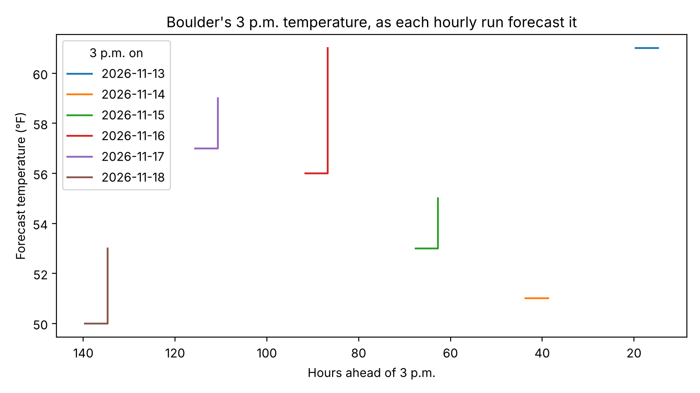

# Automating Data Collection {#sec-automation}

::: {.callout-tip}
## Learning Objectives
- Explain why one request gives you a snapshot, and what a schedule of requests can show that a snapshot can't
- Find a place's forecast in the National Weather Service's API with two requests, and read when the forecast was made from its fields and its response headers
- Turn notebook code into a script that appends to a CSV file, stops on an HTTP error, and stops collecting after a set date
- Schedule a script with cron on your own computer, and with a GitHub Actions workflow that commits what it collects back to its repository
- Load a collected series and measure how often the source changed and how a forecast for one hour changed as the hour approached
- Tell failures that stop a run from failures that let it finish with bad data, and write a check for the second kind
- Weigh what a schedule costs the server you ask, and choose where to run it
:::

::: {.callout-tip}
## Companion Notebook
Run this chapter's code as you read: open the [companion notebook](https://github.com/cuinfoscience/Web-Data-Science-Book/blob/main/notebooks/ch-14-automation.ipynb) (see @sec-appendix-notebooks for all of them).
:::


## Why Schedule a Collector

Every request in the book so far has answered one question at one moment. Chapter 12's follower counts were the counts on November 2, 2026, and chapter 11's median income was the Census Bureau's estimate as published when you asked. That is often what a research question needs. Some questions, though, are about change: how a number moves, how often a page is edited, when a policy appeared. @sec-archives answered some of those from the Wayback Machine, which had been visiting pages for years before you asked. When nobody has been visiting the page you care about, the only way to have a record later is to start making one now, on a schedule, and keep it running.

This chapter builds that kind of collector around a source that changes on its own: the National Weather Service's hourly forecast for Boulder. A forecast is a prediction about the coming days, and the NWS revises it as new observations come in. A single request shows you the forecast as it stood at that moment, with no record of the forecasts before it. To see how the prediction for Saturday afternoon changed between Monday and Saturday, someone has to ask on Monday, again on Tuesday, and so on, and save each answer. The forecast's API needs no key, answers in JSON, and says in its own fields when the forecast was last updated, which makes it a good case for learning what scheduled collection involves, from the first request to a week of saved rows.

The chapter's code goes in three stages. You start in a notebook, with one request by hand, as in every earlier chapter. Then you turn that code into a script, `collector.py`, which runs without you and adds what it finds to a CSV file. Then you hand the script to a scheduler: cron on your own computer, or GitHub Actions on GitHub's computers, which runs it every hour and commits each new batch of rows back to a repository. The course has been running the same script every hour since November 13, 2026, and the last part of the chapter reads what it collected.

::: {.callout-tip}
## Missing Manual Reference
For turning notebook code into a script you run from the terminal, see *Missing Manual* [Chapter 17: Scripting](https://cuinfoscience.github.io/INFO-Missing-Manual/chapters/scripting.html). For cron, launchd, Task Scheduler, and GitHub Actions in general, see [Chapter 33: Automation](https://cuinfoscience.github.io/INFO-Missing-Manual/chapters/automation.html), and for commits, pushes, and repositories, [Chapter 31: Version Control](https://cuinfoscience.github.io/INFO-Missing-Manual/chapters/version-control.html).
:::

## A Tour: From the Forecast Page to the API

As in @sec-government and @sec-social, start with the page a person reads. Open the NWS forecast page for Boulder, [forecast.weather.gov/MapClick.php?lat=40.015&lon=-105.2705](https://forecast.weather.gov/MapClick.php?lat=40.015&lon=-105.2705), which takes a latitude and a longitude (@fig-nws-forecast-page).

{#fig-nws-forecast-page .lightbox fig-alt="Two parts of the NWS forecast page, stacked. Top: Extended Forecast for Boulder CO, six periods from Tonight to Sunday, from Tonight's low of 41 °F, mostly clear, and Friday's high of 63, partly sunny, to Saturday's high of 52 with a 20% slight chance of showers. Bottom: About This Forecast. Point Forecast: Boulder CO, 40.02°N 105.28°W, elevation 5400 ft. Last Update: 11:46 am MST Nov 12, 2026. Forecast Valid: 7pm MST Nov 12 to 6pm MST Nov 19, 2026."}

Two things on this page matter for a collector. The first is the point the forecast is for, "Boulder CO 40.02°N 105.28°W." Each NWS forecast office makes its forecasts on its own grid, "at a resolution of about 2.5km x 2.5km" ([NWS API documentation](https://www.weather.gov/documentation/services-web-api)), and the page shows the forecast for the square that holds the point. The second is "Last Update." The page in @fig-nws-forecast-page was loaded at about 7:50 p.m. on November 12, but the forecast it showed had last been updated at 11:46 that morning, eight hours earlier. Anyone who loaded the page in between saw the same forecast. Every number on the page comes from the NWS's API at `api.weather.gov`, and each part of the page has a request behind it:

| On the page | In the API | Where this chapter uses it |
|---|---|---|
| The point the forecast is for, and the forecast office (Denver-Boulder) | `/points/40.015,-105.2705`: `gridId`, `gridX`, `gridY`, `relativeLocation` | Once, to find the forecast's address |
| The seven-day forecast, in 12-hour periods | The point's `forecast` address | Not collected; a Recommended Exercise uses it |
| The "Hourly Weather Forecast" link | The point's `forecastHourly` address: 156 hours, one period each | Every run of the collector |
| "Last Update" | The forecast's `updateTime` | Saved with every row |
| Nothing: the page doesn't show it | The forecast's `generatedAt`, and the response's headers | How often a collector needs to ask |

The NWS asks one thing of programs that use the API. Its [documentation](https://www.weather.gov/documentation/services-web-api) says that "a User Agent is required to identify your application," and that if you include contact information, "we can contact you if your string is associated to a security event" (checked 2026-11-13). The same page says the information "is intended to be open data, free to use for any purpose," with no fee, and with "reasonable rate limits in place to prevent abuse," whose numbers it doesn't publish. This chapter's User-Agent is the one every chapter has used.

## One Request by Hand

### Finding the Grid: `/points`

The API's forecasts are filed by grid square, so the first request turns a latitude and longitude into the square that holds them. Boulder's are 40.015 and −105.2705. Give at most four decimal places: the API answers a longer one with a redirect to the point rounded to four (on 2026-11-13, `40.01499,-105.27055` was redirected to `40.015,-105.2706`), which `requests` follows on its own.

```{python}
import requests
import pandas as pd
import matplotlib.pyplot as plt

# Every request in this chapter says who is asking, as chapter 1's did; put your own address here
HEADERS = {"User-Agent": "WebDataScience/1.0 (your-email@colorado.edu)"}

# The point: Boulder's latitude, then its longitude
point_url = "https://api.weather.gov/points/40.015,-105.2705"
response = requests.get(point_url, headers=HEADERS, timeout=30)
response.raise_for_status()
point = response.json()["properties"]
print(point["gridId"], point["gridX"], point["gridY"])
print(point["relativeLocation"]["properties"]["city"], point["relativeLocation"]["properties"]["state"])
print(point["forecastHourly"])
# BOU 54 75
# Boulder CO
# https://api.weather.gov/gridpoints/BOU/54,75/forecast/hourly
```

The answer names the forecast office, `BOU` (Denver-Boulder), and the square's column and row on that office's grid, 54 and 75 (@fig-nws-points-json). It also gives, in `forecastHourly`, the whole address of the hourly forecast, so your code doesn't have to build it. You need this request once, not on every run. The NWS's documentation says that a point's grid square, "and even the office," may occasionally change, and asks programs to come back to `/points` "periodically" for the latest mapping; a collector that runs every hour can keep the address as a constant and check it by hand now and then.

{#fig-nws-points-json .lightbox fig-alt="JSON in Chrome, starting at properties. Lines include cwa BOU, type land, and forecastOffice https://api.weather.gov/offices/BOU. Marker 1, a brace: gridId BOU, gridX 54, gridY 75. Below them, forecast is https://api.weather.gov/gridpoints/BOU/54,75/forecast, and marker 2 is forecastHourly, the same address ending in /forecast/hourly. Under relativeLocation, then properties, marker 3 is city Boulder, above state CO."}

### The Hourly Forecast

The second request asks for the address that the first one gave:

```{python}
# The address the /points answer gave for the hourly forecast
hourly_url = point["forecastHourly"]
response = requests.get(hourly_url, headers=HEADERS, timeout=30)
response.raise_for_status()
forecast = response.json()["properties"]
print(len(forecast["periods"]), "periods")
print(forecast["periods"][0])
# 156 periods
# {'number': 1, 'name': '', 'startTime': '2026-11-12T19:00:00-07:00', 'endTime': '2026-11-12T20:00:00-07:00', 'isDaytime': False, 'temperature': 49, 'temperatureUnit': 'F', 'temperatureTrend': None, 'probabilityOfPrecipitation': {'unitCode': 'wmoUnit:percent', 'value': 0}, 'dewpoint': {'unitCode': 'wmoUnit:degC', 'value': -2.2222222222222223}, 'relativeHumidity': {'unitCode': 'wmoUnit:percent', 'value': 44}, 'windSpeed': '5 mph', 'windDirection': 'W', 'icon': 'https://api.weather.gov/icons/land/night/skc?size=small', 'shortForecast': 'Clear', 'detailedForecast': ''}
```

The forecast is a list of `periods`, one for each hour, starting with the hour under way. Each period has a `startTime` in Mountain time, with its offset from UTC (`-07:00` in November), a temperature in °F, and a `probabilityOfPrecipitation` whose `value` is a percent. Some fields are plain numbers and some are objects with a `unitCode` and a `value`; the wind's speed is a string, such as `"5 mph"`. A collector saves what it needs and leaves the rest, and this chapter's saves eight columns: when the run asked, when the forecast was updated, and six fields of each period.

### When Was This Forecast Made?

The forecast carries two times of its own, and they disagree:

```{python}
print("updateTime: ", forecast["updateTime"])
print("generatedAt:", forecast["generatedAt"])
# updateTime:  2026-11-12T18:46:17+00:00
# generatedAt: 2026-11-13T02:04:16+00:00
```

`updateTime` is when the NWS's forecasters last changed the forecast for this grid square: the "Last Update" on the forecast page. `generatedAt` is when the API built this JSON document from it, more than seven hours later. The response's headers, which `requests` keeps in `response.headers` (@sec-protocols), add a third and a fourth time:

```{python}
# Three of the response's headers: the time of the answer, and how long a copy of it may be reused
for name in ["Date", "Last-Modified", "Cache-Control"]:
    print(f"{name}: {response.headers[name]}")
# Date: Fri, 13 Nov 2026 02:55:11 GMT
# Last-Modified: Fri, 13 Nov 2026 02:00:00 GMT
# Cache-Control: public, max-age=545, s-maxage=3600
```

`Last-Modified` is 2:00 UTC, the top of the hour in which the document was built, four minutes before its `generatedAt`. `Cache-Control` is addressed to the caches between you and the NWS, your browser's among them. `s-maxage=3600` lets a shared cache, such as the network of servers in front of the API, keep an answer for an hour, and `max-age=545` lets your own computer reuse this one for another 545 seconds: until 03:04:16, one hour after `generatedAt`. None of the four times says when the forecast itself last changed; only `updateTime` does.

Put those together and you have the first design decision for a collector. Asking more often than once an hour can only get you a copy a cache was allowed to keep. Asking every hour gets a newly built document, but most of them hold the forecast the previous hour's did, because the forecasters update a grid square only a few times a day. The course's collector asks every hour anyway, and saves `update_time` on every row, so that "Reading What It Collected" can count how many of its runs found a forecast it already had.

## From a Notebook to a Script

A notebook is the right place to work out what to collect, because you can look at each answer as it comes. It is the wrong place to collect every hour, because a notebook runs only while you are there to press Shift+Enter. A scheduler needs a program it can start on its own: a **script**, a `.py` file that does its whole job from top to bottom when you type `python collector.py`, and then stops. This section builds the course's script, `collector.py`, a piece at a time in the notebook, and then shows it whole.

### One Row per Hour

The collector's first job is to turn one answer into rows: one row for each forecast hour, each carrying the two times that say when it was collected and which version of the forecast it came from.

```{python}
from datetime import datetime, timezone

# When this run asked, in UTC, to the second; every row of the run gets the same time
collected_at = datetime.now(timezone.utc).isoformat(timespec="seconds")

# One dictionary per forecast hour, with the eight columns the collector saves
rows = []
for period in forecast["periods"]:
    rows.append({
        "collected_at": collected_at,
        "update_time": forecast["updateTime"],
        "start_time": period["startTime"],
        "temperature": period["temperature"],
        "precip_chance": period["probabilityOfPrecipitation"]["value"],
        "wind_speed": period["windSpeed"],
        "wind_direction": period["windDirection"],
        "short_forecast": period["shortForecast"],
    })
print(len(rows), "rows; the first:")
print(rows[0])
# 156 rows; the first:
# {'collected_at': '2026-11-13T02:55:11+00:00', 'update_time': '2026-11-12T18:46:17+00:00', 'start_time': '2026-11-12T19:00:00-07:00', 'temperature': 49, 'precip_chance': 0, 'wind_speed': '5 mph', 'wind_direction': 'W', 'short_forecast': 'Clear'}
```

Times are stored in UTC, the way GitHub, the NWS's `updateTime`, and most servers keep them, so that runs on different computers line up. The forecast's own `startTime` keeps its Mountain-time offset, because a reader of the CSV will want to know that a row is about 3 p.m. in Boulder, and the offset makes it unambiguous.

### Appending to a CSV File

Each run has to add its rows to what earlier runs saved, never replace them. Python's `open()` with mode `"a"`, for *append*, writes at the end of a file and creates the file if it doesn't exist. The CSV's header line, the column names, must be written exactly once, by the first run; after that, every run adds rows only. `csv.DictWriter` writes dictionaries as CSV rows, in the order of a list of field names:

```{python}
import csv
import os

# A test file, so this demonstration doesn't mix with a real collector's forecasts.csv
TEST_FILE = "forecasts-test.csv"
FIELDS = ["collected_at", "update_time", "start_time", "temperature",
          "precip_chance", "wind_speed", "wind_direction", "short_forecast"]

def save_rows(rows, file):
    """Append rows to a CSV file, writing the header only if the file is new."""
    new_file = not os.path.exists(file)
    with open(file, "a", newline="", encoding="utf-8") as f:
        writer = csv.DictWriter(f, fieldnames=FIELDS)
        if new_file:
            writer.writeheader()
        writer.writerows(rows)

# Save the same rows twice, as two runs would, then read the file back
save_rows(rows, TEST_FILE)
save_rows(rows, TEST_FILE)
saved = pd.read_csv(TEST_FILE)
print(len(saved), "rows, with columns", list(saved.columns))
# 312 rows, with columns ['collected_at', 'update_time', 'start_time', 'temperature', 'precip_chance', 'wind_speed', 'wind_direction', 'short_forecast']
```

Two runs of 156 rows give 312 rows under one header. If the header had been written by every run, `read_csv()` would have found the column names again in the middle of the data, and `temperature` would have come back as text. `newline=""` is what the `csv` module asks for, so that Windows doesn't add a blank line after every row. Run the cell again and the count goes up by 312, which is what you want from a collector and the reason the demonstration writes to its own test file.

### Stopping Loudly on an Error

A collector that runs while you sleep has to fail in a way you will notice in the morning. Suppose the address had a typo:

```{python}
# A mistyped address: "hourli" for "hourly"
bad = requests.get("https://api.weather.gov/gridpoints/BOU/54,75/forecast/hourli", headers=HEADERS, timeout=30)
print(bad.status_code)
bad.raise_for_status()
# 404
# requests.exceptions.HTTPError: 404 Client Error: Not Found for url: https://api.weather.gov/gridpoints/BOU/54,75/forecast/hourli
```

The server answered 404, Not Found, and `requests` would have gone on happily: a 404 is an answer, and only `raise_for_status()` turns it into an error that stops the program (@sec-protocols). Without it, the next line, `response.json()["properties"]`, would fail with a `KeyError` that says nothing about a missing page, or, with a server that answered an error page in JSON, the script could save an error message as if it were data. In a script, an error that stops the program also sets its **exit status**, the number a program hands back to whatever started it: 0 for success, anything else for failure. A scheduler reads that number, and GitHub marks the run with a red X.

### A Function, a Guard, and a Last Day

Three more pieces make the notebook code a script. The code goes into a function, `main()`, which the last two lines of the file call:

```python
if __name__ == "__main__":
    main()
```

Python sets `__name__` to `"__main__"` when a file is run as a program, and to the file's name when another file imports it. The guard runs `main()` in the first case only, so that a notebook can `import collector` to borrow its constants without asking the NWS for anything.

The third piece is a last day. A collector left running keeps asking a server for data nobody reads, and on GitHub it can run for months after its author has moved on. The course's collector checks the date at the start of every run and does nothing after December 11, 2026, the last day of the semester's classes:

```{python}
from datetime import date

LAST_DAY = date(2026, 12, 11)
# Compare dates in UTC, as the collector does
today = datetime.now(timezone.utc).date()
print(today, "is after the last day:", today > LAST_DAY)
# 2026-11-13 is after the last day: False
```

### `collector.py`, Whole

Here is the script, as the course hands it out in `labs/week-14/template/` of its repository. Save it as `collector.py` in a folder of its own, with your own address in place of `your-email@colorado.edu`:

```python
"""Save the National Weather Service's hourly forecast for Boulder, Colorado.

Each run adds one row per forecast hour to forecasts.csv: about 156 rows,
covering the next six and a half days. Run it by hand with
    python collector.py
or on a schedule with the GitHub Actions workflow in .github/workflows/.
"""

import csv
import os
from datetime import date, datetime, timezone

import requests

# The hourly forecast for the 2.5 km grid square over Boulder. Its address
# came from https://api.weather.gov/points/40.015,-105.2705 ("forecastHourly").
URL = "https://api.weather.gov/gridpoints/BOU/54,75/forecast/hourly"

# The NWS asks every program to name itself and give a way to reach its owner.
HEADERS = {"User-Agent": "WebDataScience/1.0 (your-email@colorado.edu)"}

# Where the rows go, and the columns each row has, in order.
FILE = "forecasts.csv"
FIELDS = ["collected_at", "update_time", "start_time", "temperature",
          "precip_chance", "wind_speed", "wind_direction", "short_forecast"]

# The last day to collect. After it, a run does nothing, so a copy left
# running doesn't keep asking the NWS for a forecast nobody reads.
LAST_DAY = date(2026, 12, 11)


def main():
    if datetime.now(timezone.utc).date() > LAST_DAY:
        print("Collection ended on", LAST_DAY)
        return

    # Ask for the forecast. raise_for_status() stops the script with an error
    # if the NWS didn't answer 200, so the workflow's run shows as failed.
    response = requests.get(URL, headers=HEADERS, timeout=30)
    response.raise_for_status()
    forecast = response.json()["properties"]

    # When we collected it, and when the NWS last updated it.
    collected_at = datetime.now(timezone.utc).isoformat(timespec="seconds")
    update_time = forecast["updateTime"]

    # Write the header only if the file doesn't exist yet; then add the rows.
    new_file = not os.path.exists(FILE)
    with open(FILE, "a", newline="", encoding="utf-8") as f:
        writer = csv.DictWriter(f, fieldnames=FIELDS)
        if new_file:
            writer.writeheader()
        for period in forecast["periods"]:
            writer.writerow({
                "collected_at": collected_at,
                "update_time": update_time,
                "start_time": period["startTime"],
                "temperature": period["temperature"],
                "precip_chance": period["probabilityOfPrecipitation"]["value"],
                "wind_speed": period["windSpeed"],
                "wind_direction": period["windDirection"],
                "short_forecast": period["shortForecast"],
            })
    print(collected_at, "saved", len(forecast["periods"]), "hours, updated", update_time)


if __name__ == "__main__":
    main()
```

Everything in it has appeared above. The constants come first, in capital letters, so that the things you would change for another place or another end date are at the top and nowhere else. The two `datetime.now()` calls are a second apart at most; the first decides whether to run at all, and the second is the time saved with the rows. The last `print()` is for the scheduler's log: one line per run, which is what you will read when you check that the collector is working.

### Running It

Open a terminal in the folder, with the `webdata` environment active (@sec-introduction), and run the script twice:

```bash
python collector.py
# 2026-11-13T02:55:13+00:00 saved 156 hours, updated 2026-11-12T18:46:17+00:00
python collector.py
# 2026-11-13T02:55:14+00:00 saved 156 hours, updated 2026-11-12T18:46:17+00:00
wc -l forecasts.csv
# 313 forecasts.csv
```

Each run printed its line and added 156 rows, and `wc -l`, which counts a file's lines on a Mac or Linux, finds 313: one header and two runs. Both runs found the same `update_time`, the forecast the forecasters had last changed at 18:46 UTC the day before. The second run, a second after the first, added 156 rows you already had. A schedule has the same problem at a larger scale, because it runs at the times it was given, whether or not the source has changed since the last run.

## Scheduling on Your Own Computer

Every Mac and Linux computer has a scheduler, **cron**, which reads a table of jobs, the **crontab**, and starts each job at the times its line gives. You edit your own crontab by typing `crontab -e` in a terminal, which opens the table in a text editor; `crontab -l` lists it. A line has five fields for the time, then the command:

```text
# minute  hour  day-of-month  month  day-of-week   command
  17      *     *             *      *             cd /Users/you/boulder-forecast && /opt/anaconda3/envs/webdata/bin/python collector.py >> collector.log 2>&1
```

The five fields, in order, are the minute (0–59), the hour (0–23), the day of the month (1–31), the month (1–12), and the day of the week (0–6, with 0 for Sunday). A `*` means "every," so `17 * * * *` runs at 17 minutes past every hour of every day. `0 6 * * 1-5` would run at 6:00 on weekdays, and `*/15 * * * *` every 15 minutes ([POSIX's `crontab`](https://pubs.opengroup.org/onlinepubs/9699919799/utilities/crontab.html)). The command after the fields is the one you would type, with three changes for a program that runs with nobody watching. It changes to the collector's folder first (`cd`), so that `forecasts.csv` is written there and not in your home folder. It names the Python program by its whole path, because cron starts jobs with a short list of places to look for programs and doesn't activate conda environments; `which python`, typed with `webdata` active, prints the path to use. And `>> collector.log 2>&1` appends everything the run prints, its errors included, to a log file, since a cron job has no screen to print to.

A schedule on your own computer has two limits. cron reads the times in your computer's own time zone, so `17 * * * *` is 17 minutes past each hour in Boulder, and a job set for 2:30 a.m. is skipped or run twice on the nights the clocks change. And the computer has to be on. Apple's documentation for macOS says that "if the system is turned off or asleep, cron jobs do not execute; they will not run until the next designated time occurs" ([Scheduling Timed Jobs](https://developer.apple.com/library/archive/documentation/MacOSX/Conceptual/BPSystemStartup/Chapters/ScheduledJobs.html)). The same page recommends **launchd**, macOS's own scheduler, over cron, and a launchd job whose time passed while the computer slept runs when it wakes. Windows has [Task Scheduler](https://learn.microsoft.com/en-us/windows/win32/taskschd/task-scheduler-start-page), which starts a program when the conditions you set are met, such as a time of day. A laptop that sleeps in a backpack between classes makes a poor collector with any of them, and that is the gap the next section fills.

## Scheduling in the Cloud with GitHub Actions

**GitHub Actions** runs programs on GitHub's computers when something happens in a repository: a push, a pull request, a click on a button, or a time on a schedule. What it runs is written in a **workflow**, a YAML file in the repository's `.github/workflows/` folder (@sec-data-formats introduced YAML's cousins, JSON and XML). Each run gets a fresh virtual machine, the **runner**, with nothing on it but an operating system and common tools. The workflow checks out the repository, installs what the script needs, runs it, and, in this chapter, commits the new rows back, so the repository's history keeps every run's data. The runner is then thrown away.

### The Workflow File, Line by Line

This is the course template's `.github/workflows/collect.yml`:

```yaml
# Run collector.py every hour on GitHub's computers, and commit the new rows.
name: Collect Boulder's hourly forecast

on:
  schedule:
    # Minute 17 of every hour, in UTC. GitHub may start a scheduled run some
    # minutes late, and runs at minute 0 are the most often delayed.
    - cron: "17 * * * *"
  # Adds a "Run workflow" button on the Actions tab, to run it by hand.
  workflow_dispatch:

# The commit step pushes to this repository, so the workflow needs write access.
permissions:
  contents: write

jobs:
  collect:
    runs-on: ubuntu-latest
    steps:
      - name: Get this repository's files
        uses: actions/checkout@v7

      - name: Set up Python
        uses: actions/setup-python@v7
        with:
          python-version: "3.12"

      - name: Install requests
        run: pip install requests

      - name: Collect the forecast
        run: python collector.py

      - name: Commit the new rows
        run: |
          git config user.name "github-actions[bot]"
          git config user.email "41898282+github-actions[bot]@users.noreply.github.com"
          git add forecasts.csv
          git diff --staged --quiet || git commit -m "Forecast collected $(date -u +%Y-%m-%dT%H:%MZ)"
          git pull --rebase
          git push
```

Read it from the top.

`name` is what the Actions tab shows. Under `on:`, the triggers: `schedule` with one `cron` line, in the same five fields as your crontab, and `workflow_dispatch`, which adds a **Run workflow** button to the Actions tab so you can start a run by hand instead of waiting up to an hour. GitHub reads a schedule's times in UTC unless the line also gives a `timezone` ([Events that trigger workflows](https://docs.github.com/en/actions/reference/workflows-and-actions/events-that-trigger-workflows#schedule), checked 2026-11-13). Minute 17 is the same minute of every hour in any time zone, so the template doesn't need one.

`permissions: contents: write` lets the workflow push to its own repository. Each run gets a temporary credential, the `GITHUB_TOKEN`, whose permissions the `permissions` key sets, adding or removing access "so that you only allow the minimum required access" ([Workflow syntax](https://docs.github.com/en/actions/reference/workflows-and-actions/workflow-syntax#permissions)). Without this line, the token may be read-only, depending on the repository's settings, and the last step fails.

`jobs:` holds one job, `collect`, which `runs-on` GitHub's current Ubuntu Linux runner. Its `steps` run in order, and a step that fails stops the job:

| Step | What it does |
|---|---|
| `actions/checkout@v7` | Copies the repository, `collector.py` and `forecasts.csv` included, onto the runner |
| `actions/setup-python@v7` with `python-version: "3.12"` | Installs Python 3.12 |
| `pip install requests` | The one library `collector.py` imports that Python doesn't include |
| `python collector.py` | Asks the NWS, and appends 156 rows to `forecasts.csv`; a 404 or 500 stops the job here |
| The commit step | Commits `forecasts.csv` if it changed, then pushes it |

The two `uses:` steps run **actions**, programs other people publish for workflows to reuse, named by repository and version; `actions/checkout` and `actions/setup-python` are GitHub's own. `@v7` names a major version. The workflow gets that version's latest fixes without any change to your file, and never a version 8, whose inputs might differ, until you edit the line to ask for it. A major version can also grow old under you. Versions 4 and 5 of these two actions run on Node.js 20, which GitHub began retiring from its runners in September 2025: Node.js 24 became the default on June 16, 2026, and Node.js 20 was removed on September 23, 2026 ([GitHub changelog](https://github.blog/changelog/2025-09-19-deprecation-of-node-20-on-github-actions-runners/)). Version 7 of each runs on Node.js 24, so the template names `@v7`. A workflow copied from an older tutorial, with `@v4`, shows a notice that Node.js 20 is deprecated on every run.

The last step is a short shell script. It names the commit's author as GitHub's bot account, stages the file, and commits it, with the time in the message. `git diff --staged --quiet` succeeds when nothing changed, and `||` runs the commit only when it didn't, so a run that saved nothing (after December 11, say) doesn't fail for having nothing to commit. `git pull --rebase` brings in anything pushed since the checkout, such as a change you made to the README in the meantime, and `git push` sends the commit.

### Setting It Up

The lab walks through these steps in class; they are here for reference.

1. Create a new **public** repository on GitHub, under your own account. Public matters for cost, below.
2. Add `collector.py`, with your own address in its User-Agent, and `.github/workflows/collect.yml`, keeping the folder names exactly. A workflow anywhere else is a file GitHub ignores.
3. Open the repository's **Actions** tab, choose "Collect Boulder's hourly forecast," and click **Run workflow**. A run appears in the list within a few seconds; click it to see each step and its log.
4. When the run finishes with a green check, open `forecasts.csv` in the repository: it has a header and 156 rows, and the repository has a new commit from `github-actions[bot]`.

From then on, the schedule adds a commit each hour. Each commit's diff shows the rows it added, and the repository's history is the series.

### Committing Data Back: Git Scraping

Simon Willison named this pattern **git scraping** in 2020: a scheduled workflow "records the current state of a resource and records changes to that resource over time in the commit history" ([Willison, 2020](https://simonwillison.net/2020/Oct/9/git-scraping/)). His first example saved the California fire agency's incident data every 20 minutes and committed it only when it changed, so each commit was a change in the fires. This chapter's collector differs in one way: it appends, rather than replacing one file with the latest copy, so every run adds a commit even when the forecast is the one the previous run saw. Appending keeps the data in one CSV file you can load in a line; Willison's way keeps the repository small and makes the history itself the dataset, and in 2022 he released a tool, `git-history`, to analyze data collected that way. A run's 156 rows come to about 17 kilobytes, so the course's CSV grows by about 400 kilobytes a day, and reaches about 11 megabytes by December 11.

### What GitHub Promises, and What It Doesn't

A schedule on GitHub is a request, and GitHub's documentation says how it can fall short (checked 2026-11-13). Runs can start late, and some never start: "The `schedule` event can be delayed during periods of high loads of GitHub Actions workflow runs. High load times include the start of every hour. If the load is sufficiently high enough, some queued jobs may be dropped" ([Events that trigger workflows](https://docs.github.com/en/actions/reference/workflows-and-actions/events-that-trigger-workflows#schedule)). That is why the template runs at minute 17 rather than minute 0, and why `collected_at` records when a run actually asked rather than when it was scheduled. The same page sets the shortest interval at five minutes, and runs scheduled workflows only from the repository's default branch, usually `main`.

A schedule can also stop for good. "In a public repository, scheduled workflows are automatically disabled when no repository activity has occurred in 60 days" ([Disabling and enabling a workflow](https://docs.github.com/en/actions/how-tos/manage-workflow-runs/disable-and-enable-workflows)). The page doesn't define activity, so a collector meant to run for longer than two months needs someone to look in on it; the Actions tab has a button that enables a disabled workflow again.

The bot's own pushes start nothing. When a workflow pushes with the `GITHUB_TOKEN`, "a new workflow will not run even when the repository contains a workflow configured to run when `push` events occur" ([GITHUB_TOKEN](https://docs.github.com/en/actions/concepts/security/github_token)). GitHub does this to prevent a loop, a push that runs a workflow that pushes again. It also means that a second workflow written to analyze each new batch of rows won't start when the batch arrives; it needs a schedule of its own.

Last, the cost. Standard runners are free "in public repositories," which is why the template goes in a public one. A private repository on GitHub Free draws on $12 of included usage a month, priced at $0.006 a minute on a standard Linux runner, which comes to 2,000 minutes ([GitHub Actions billing](https://docs.github.com/en/billing/concepts/product-billing/github-actions)). An hourly workflow runs 720 times in a 30-day month, so in a private repository each run would have to average under three minutes to stay within it.

## Reading What It Collected

The course's repository has run `collector.py` every hour since November 13, 2026, into `labs/week-14/data/forecasts.csv`, and keeps running it until December 11. The book saved a copy of that file in `data/ch-14/`, so that this section's numbers are the ones you get; its README says when the copy was made. The course's own file keeps growing, and the Recommended Exercises read it.

<!-- TODO(Tuesday refresh): refreeze data/ch-14/forecasts.csv from the course's main branch, rerun tools/shots/renders/ch-14.py, and replace every output below, the span in the next paragraph, and the figure. -->

```{python}
# The book's copy of the course's series
data_url = "https://raw.githubusercontent.com/cuinfoscience/Web-Data-Science-Book/main/data/ch-14/forecasts.csv"
series = pd.read_csv(data_url, parse_dates=["collected_at", "update_time"])
print(len(series), "rows from", series["collected_at"].nunique(), "runs")
print("first run:", series["collected_at"].min())
print("last run: ", series["collected_at"].max())
# 156 rows from 1 runs
# first run: 2026-11-13 02:23:07+00:00
# last run:  2026-11-13 02:23:07+00:00
```

### How Often Did the Forecast Change?

Each run saved the `update_time` of the forecast it found. One row per run, then, and a count of the versions:

```{python}
# One row per run: when it asked, and which version of the forecast it found
runs = series.groupby("collected_at")["update_time"].first()
print(runs.nunique(), "versions of the forecast in", len(runs), "runs")
# How many runs found each version
print(runs.value_counts().sort_index().to_string())
# 1 versions of the forecast in 1 runs
# update_time
# 2026-11-12 18:46:17+00:00    1
```

ANALYSIS-PENDING

### When Did the Runs Actually Run?

The schedule says minute 17. `collected_at` says when each run asked:

```{python}
# How many minutes after the scheduled minute 17 each run asked
late = runs.index.minute - 17
print(pd.Series(late).describe().round(1).to_string())
# count    1.0
# mean     6.0
# std      NaN
# min      6.0
# 25%      6.0
# 50%      6.0
# 75%      6.0
# max      6.0
```

DELAY-PENDING

### One Hour, Forecast Many Times

Every hour in the series was forecast by many runs, first about six and a half days ahead and last within the hour. Choose one hour and follow its forecast as it approached:

```{python}
# The forecast for 3 p.m. Mountain time on Tuesday, November 17, from every run that forecast it
target = "2026-11-17T15:00:00-07:00"
one_hour = series[series["start_time"] == target].copy()
# How far ahead each run was: the hour forecast minus the time of the run, in hours
ahead = pd.to_datetime(one_hour["start_time"], utc=True) - one_hour["collected_at"]
one_hour["hours_ahead"] = (ahead.dt.total_seconds() / 3600).round(1)
# Keep the first run that saw each version of the forecast
changes = one_hour.drop_duplicates("update_time")
print(len(one_hour), "runs forecast this hour;", len(changes), "versions:")
print(changes[["update_time", "hours_ahead", "temperature", "precip_chance", "short_forecast"]].to_string(index=False))
# 1 runs forecast this hour; 1 versions:
#               update_time  hours_ahead  temperature  precip_chance short_forecast
# 2026-11-12 18:46:17+00:00        115.6           57              0          Sunny
```

LEAD-PENDING

A table of versions for one hour shows how that hour's forecast moved. A chart can show several hours at once. This one takes 3 p.m. on each day the series covers, and draws its forecast temperature against how far ahead it was made:

```{python}
# 3 p.m. Mountain time on each day: start times that end in T15:00:00-07:00
afternoons = series[series["start_time"].str.endswith("T15:00:00-07:00")].copy()
ahead = pd.to_datetime(afternoons["start_time"], utc=True) - afternoons["collected_at"]
afternoons["hours_ahead"] = ahead.dt.total_seconds() / 3600
fig, ax = plt.subplots(figsize=(8, 4.5))
# One stepped line per afternoon; a step holds each run's forecast until the next run's
for day, rows in afternoons.groupby(afternoons["start_time"].str[:10]):
    ax.step(rows["hours_ahead"], rows["temperature"], where="post", label=day)
ax.invert_xaxis()  # far ahead on the left, the hour itself on the right
ax.set_xlabel("Hours ahead of 3 p.m.")
ax.set_ylabel("Forecast temperature (°F)")
ax.set_title("Boulder's 3 p.m. temperature, as each hourly run forecast it")
ax.legend(title="3 p.m. on")
plt.tight_layout()
plt.show()
```

{#fig-afternoon-forecasts .lightbox fig-alt="FIGALT-PENDING"}

CHART-PENDING

## Failures and Monitoring

A scheduled collector fails in two ways. Some failures stop the run: the NWS answers 500 or 503 because a server is busy, the address is mistyped, the network times out, or the push is refused. `raise_for_status()` and Python's own errors make these loud. The run gets a red X on the Actions tab and its log ends with the traceback. GitHub sends its notices about a scheduled workflow "to the user who last modified the cron syntax in the workflow file" ([Events that trigger workflows](https://docs.github.com/en/actions/reference/workflows-and-actions/events-that-trigger-workflows#schedule)), so the person who set up the schedule hears about a failed run without having to look.

Other failures let the run finish. The script prints its line, the commit goes through, and the check is green, while the data is wrong. The most instructive one comes from a typo. Swap the grid square's column and row, 75,54 for 54,75, and the API doesn't object:

```{python}
# The grid square's column and row, swapped by mistake
wrong = requests.get("https://api.weather.gov/gridpoints/BOU/75,54/forecast/hourly", headers=HEADERS, timeout=30)
print(wrong.status_code, len(wrong.json()["properties"]["periods"]), "periods")
# The forecast's geometry is its square's outline; ask /points where the first corner is
lon, lat = wrong.json()["geometry"]["coordinates"][0][0]
where = requests.get(f"https://api.weather.gov/points/{lat:.4f},{lon:.4f}", headers=HEADERS, timeout=30).json()
print(where["properties"]["relativeLocation"]["properties"]["city"])
# 200 156 periods
# Aurora
```

The API answered 200 with 156 hours of forecast, for a grid square whose nearest city is Aurora, on the other side of Denver. `raise_for_status()` lets a 200 through, the rows look like any other run's, and a collector with this typo would have saved Aurora's weather under Boulder's name for as long as it ran. A wrong office ID does the same: `BOX` for `BOU` is the office for Boston, and its square 54,75 is nearest to Chepachet, Rhode Island (checked 2026-11-13). Only a check against something you know about the place catches it, such as the `/points` answer you started from.

A field can come back empty: `probabilityOfPrecipitation` has a `value` that can be `null`, which `csv` writes as an empty cell, and a field the NWS stopped filling would leave a column of blanks, run after run. A list can come back short, and the collector would save 12 rows as readily as 156. The forecast can stop changing: if the forecast office's updates stopped reaching the API, every run would save the same `update_time` for days, and nothing in a run would say so. And a run can fail to happen at all. A disabled workflow, or a run GitHub dropped, leaves no red X, only a gap in `collected_at`.

None of these shows up on the Actions tab. They show up in the data, if you look for them, so the looking has to be scheduled too: a check that reads the CSV and reports what is wrong with its newest run.

```{python}
def check_freshness(series, now):
    """List the problems with the newest run in series, as of the time now."""
    problems = []
    newest = series["collected_at"].max()
    last_run = series[series["collected_at"] == newest]
    # The schedule is hourly: more than two hours without a run means runs are missing
    if now - newest > pd.Timedelta(hours=2):
        problems.append(f"no run since {newest}")
    # A full forecast has about 156 hours
    if len(last_run) < 150:
        problems.append(f"the newest run saved only {len(last_run)} hours")
    # The forecasters update a few times a day; a forecast older than 12 hours is stale
    age = newest - last_run["update_time"].max()
    if age > pd.Timedelta(hours=12):
        problems.append(f"the newest run's forecast was {age} old")
    # A column that is empty in every row of the run
    for column in ["temperature", "precip_chance", "short_forecast"]:
        if last_run[column].isna().all():
            problems.append(f"{column} is empty")
    return problems

print(check_freshness(series, now=pd.Timestamp.now(tz="UTC")))
# []
```

FRESHNESS-PENDING

The same checks, applied to every run instead of the newest, describe the whole series:

```{python}
# One row per run: how many hours it saved, and how old its forecast was when it asked
per_run = series.groupby("collected_at").agg(hours=("start_time", "size"), updated=("update_time", "first"))
per_run["forecast_age"] = per_run.index - per_run["updated"]
print("hours saved per run:", per_run["hours"].value_counts().to_dict())
print("empty precip_chance cells:", series["precip_chance"].isna().sum())
print("oldest forecast any run saved:", per_run["forecast_age"].max())
# hours saved per run: {156: 1}
# empty precip_chance cells: 0
# oldest forecast any run saved: 0 days 07:36:50
```

PERRUN-PENDING

A check like this belongs on its own schedule, apart from the collector, because a collector that stopped running can't report that it stopped. It could be a second workflow that runs once a day, reads `forecasts.csv` from the repository, and fails, with a red X and an email, when the list of problems isn't empty. The second Recommended Exercise builds the function for your own collector.

## Other Places to Run a Schedule

GitHub Actions is one of many hosted schedulers, and its free minutes for public repositories make it the easiest for a class. Each of the others runs your code on a schedule on someone else's computer, and they differ in what they run, what they charge, and where they let you keep what you collect. The table gives each provider's own statement of its free tier, as its pages read on November 13, 2026; they change, so check them again before you choose.

| Service | What runs on the schedule | Free tier, in the provider's terms | What else you need |
|---|---|---|---|
| GitHub Actions ([billing](https://docs.github.com/en/billing/concepts/product-billing/github-actions)) | A workflow in a repository | Standard runners free in public repositories; private ones draw on $12 of included usage a month on GitHub Free | Nothing: data can be committed back |
| GitLab scheduled pipelines ([schedules](https://docs.gitlab.com/ci/pipelines/schedules/), [GitLab.com settings](https://docs.gitlab.com/user/gitlab_com/), [pricing](https://about.gitlab.com/pricing/)) | A pipeline in a project's `.gitlab-ci.yml` | 400 compute minutes a month on GitLab.com Free; on Free, a schedule runs at most 24 pipelines a day | Nothing: data can be committed back, as on GitHub |
| PythonAnywhere scheduled tasks ([tasks](https://help.pythonanywhere.com/pages/ScheduledTasks/), [free accounts](https://help.pythonanywhere.com/pages/FreeAccountsFeatures/), [pricing](https://www.pythonanywhere.com/pricing/)) | A Python script in your account's files | One daily task, for free accounts made before January 15, 2026 only; paid accounts, from $10 a month, run up to 20 tasks, daily or hourly | Free accounts' outbound internet access is restricted |
| Cloudflare Workers Cron Triggers ([cron triggers](https://developers.cloudflare.com/workers/configuration/cron-triggers/), [limits](https://developers.cloudflare.com/workers/platform/limits/)) | A Worker, a function in JavaScript, TypeScript, or Python | Workers Free: 5 Cron Triggers an account, 100,000 requests a day, 10 ms of CPU time a run | A place to keep data, such as Cloudflare's KV or D1 |
| Google Cloud Scheduler ([pricing](https://cloud.google.com/scheduler/pricing)) | A call to an address or a cloud function, on a cron schedule | 3 jobs a month free for each billing account, then $0.10 a job a month | A billing account, and the code to call, such as a Cloud Run function |
| Amazon EventBridge Scheduler ([pricing](https://aws.amazon.com/eventbridge/pricing/)) | A call to a target, such as an AWS Lambda function | 14 million scheduled invocations a month; Lambda's own free tier is 1 million requests a month ([Lambda pricing](https://aws.amazon.com/lambda/pricing/)) | An AWS account, and a target such as a Lambda function |
| Render cron jobs ([cron jobs](https://render.com/docs/cronjobs), [pricing](https://render.com/pricing)) | A command, in a container Render builds from your repository | None: billed by the second, with a minimum of $1 a month for each cron job | A database or other store: Render's cron jobs "can't provision or access a persistent disk" |

The first two are the only ones whose runs can commit to a repository with no setup beyond the workflow file. Google's and Amazon's schedulers start code and stop there: the code itself and the place it saves its rows are other services, each with its own free tier and its own bill past it, and Google counts its free jobs "per billing account." GitLab's free tier allows an hourly collector and nothing more frequent; if each run took a minute, 24 runs a day for a 30-day month would use 720 minutes, more than the 400 included. A Worker's 10 milliseconds count only the time its code computes: "waiting on network requests (such as `fetch()` calls, KV reads, or database queries) does **not** count toward CPU time" ([limits](https://developers.cloudflare.com/workers/platform/limits/)). And a computer of your own that stays on and never sleeps, such as a small single-board computer running cron in a closet, needs none of these accounts.

## Recommended Exercises

This guided exercise is the chapter's take-home assignment. Work through it in the companion notebook, filling in each empty code cell, and submit the completed notebook. The steps build on one another, so do them in order; everything you need appears in this chapter or an earlier one.

You will plan a collector for another place, or another of the NWS's products, and check the course's series as its monitor would. Choose a place in the United States other than Boulder: your hometown, or a Colorado town with weather unlike Boulder's, such as Grand Junction or Leadville.

**Step 1 — Find your grid square.** Define your `HEADERS` with your own email, and request `/points` for your place's latitude and longitude, to four decimal places. Print the forecast office, the grid column and row, the nearest city, and the `forecastHourly` and `forecast` addresses.

```{python}
# Step 1: Request /points for your place; print gridId, gridX, gridY, the nearest city, and the two forecast addresses
# Your code here
```

**Step 2 — One request, read closely.** Request your place's hourly forecast. Print the number of periods, `updateTime`, `generatedAt`, and the `Last-Modified` and `Cache-Control` headers. Then request the `forecast` address, the 12-hour periods of the forecast page, and print its number of periods and its `updateTime`. In a comment, say whether the two products were updated at the same time, and what that suggests about how they are made.

```{python}
# Step 2: Request the hourly forecast and the 12-hour forecast; print their periods, times, and headers
# Your code here
```

**Step 3 — Adapt the collector.** Copy `collector.py`'s constants and `main()` into this cell, change `URL` to your place's hourly forecast and `FILE` to a name of your own, and add one column the course's collector leaves out, such as the period's relative humidity (`period["relativeHumidity"]["value"]`). Call `main()` twice, then load your file with `pd.read_csv()` and show that it has one header, two runs, and your new column.

```{python}
# Step 3: Adapt collector.py for your place, with one more column; run main() twice and check the file
# Your code here
```

**Step 4 — Check the course's series.** Load the course's growing series from `https://raw.githubusercontent.com/cuinfoscience/INFO4617-Fall2026/main/labs/week-14/data/forecasts.csv`. Write a `check_series()` function that returns a list of problems, building on `check_freshness()`: a gap of more than two hours between consecutive runs anywhere in the series, a run with fewer than 150 rows, and a run whose forecast was more than 12 hours old. Run it on the series, then on a copy you break on purpose (drop a run's rows, or set a column to empty), and show that it catches what you broke.

```{python}
# Step 4: Load the course's series, write check_series(), and run it on the series and on a broken copy
# Your code here
```

**Step 5 — Write a workflow.** Write a workflow file for your collector as a Python string, and save it to `collect.yml` with `open()` and `write()`. Schedule it every three hours, at a minute other than 0, and give each line of the `cron` expression's meaning in a YAML comment (YAML comments start with `#`). Keep `workflow_dispatch` and the commit step. Print the file back. You don't need to run it, though you may, in a public repository of your own.

```{python}
# Step 5: Write your collect.yml as a string, save it, and print it back
# Your code here
```

**Step 6 — Interpret.** In four to six sentences: in the course's series, how many runs found a forecast the previous run had already saved? How many requests would your three-hour schedule save the NWS in a semester, compared with an hourly one, and what would it miss? What can no collector of this forecast record, however often it runs?

```{python}
# Step 6: Write your answer here as comments, or convert this cell to Markdown.
```

## Additional Exercises

These are open-ended extensions, with no scaffold and no fixed path.

1. **Forecast and observation.** The API also reports what happened. `/stations/KBDU/observations` gives the observations at Boulder Municipal Airport, the station named on the forecast page. Collect a week of them alongside the course's forecasts, and measure how far each run's forecast temperature was from the observed one, by how many hours ahead it was made. Does the error shrink as the hour approaches, and by how much?

2. **Collect the alerts.** `https://api.weather.gov/alerts/active?area=CO` lists the weather alerts in force for Colorado. Write a collector that runs every 15 minutes and saves each alert once, keyed by its `id`, rather than appending every alert on every run. Run it for a week, in a repository of your own, and report how many alerts it saw and how long each stayed active.

3. **Ask only when it changed.** HTTP lets a client ask for a document only if it changed since a time it gives, with the `If-Modified-Since` header; the NWS's API answers such a request with `304 Not Modified` and no body when nothing changed. Change `collector.py` to send the `Last-Modified` of its previous run and to save nothing on a 304. Run both versions side by side for three days, and compare the bytes each downloaded and the rows each saved.

4. **Another scheduler.** Run the collector for a week on one of the services in "Other Places to Run a Schedule" other than GitHub Actions, within its free tier. Report what you had to set up beyond the script, where the data lived, how many scheduled runs were late or missing, and what it would cost to run for a year.

5. **Graduate extension (INFO 5617).** Read @thelwall2006crawling and @brown2025scraping. Then write a collection plan, and run it for at least two weeks, for a public source of your own whose content changes on a schedule you don't control. Justify the collection interval with evidence about how often the source changes, gathered from the source itself (its timestamps or headers) before you start; estimate the requests and bytes your plan costs the source's operator over its lifetime; and set a last day. At the end, report how many of your runs found nothing new, how many scheduled runs were late or missing, and how you would change the interval knowing what you know now.

## Social History and Public Interest

Simon Willison's 2020 post on git scraping took its first example from California's wildfires. His scraper saved the state fire agency's incident data every 20 minutes, and one of its commits recorded that overnight the Zogg Fire's containment rose from 90% to 92% while the personnel assigned to it fell from 968 to 798; he later presented the technique as a lightning talk at NICAR 2021, a data journalism conference ([Willison, 2020](https://simonwillison.net/2020/Oct/9/git-scraping/)). Newsrooms took it up. In 2022 the *Los Angeles Times*' data and graphics desk wrote that it used "GitHub Actions for almost all of our scrapers that run on a schedule," feeding its Coronavirus Tracker, its State Elections Money Tracker, and its Drought Tracker. The desk noted that the history of each scrape stays in the repository, and that Actions costs nothing in a public repository, "why we have made many of our scrapers public" ([Lee, 2022](https://source.opennews.org/articles/github-actions-scrapers/)).

The forecast in this chapter is a public good of an older kind. The NWS calls its API's contents "open data, free to use for any purpose" ([NWS API documentation](https://www.weather.gov/documentation/services-web-api)), and the agency's disclaimer places the information on its web pages "in the public domain, unless specifically noted otherwise" ([NWS disclaimer](https://www.weather.gov/disclaimer)). A national survey of more than 1,500 adults found that the average American adult gets a forecast 115 times a month, from one source or another, which comes to more than 300 billion forecasts a year [@lazo2009billion]. The NWS's openness has been contested. In April 2005, a bill introduced in the Senate, the National Weather Services Duties Act, would have barred the Secretary of Commerce from providing any product or service, apart from severe-weather forecasts and warnings, "that is or could be provided by the private sector" ([S. 786, 109th Congress](https://www.govinfo.gov/app/details/BILLS-109s786is)). It was referred to committee, and its record lists no action after April 21, 2005 ([bill status](https://www.govinfo.gov/bulkdata/BILLSTATUS/109/s/BILLSTATUS-109s786.xml)).

The data's supply depends on people, and in 2025 there were fewer of them. On March 20, 2025, the NWS suspended weather balloon launches at Omaha and Rapid City "due to a lack of Weather Forecast Office (WFO) staffing," and cut six other sites, Grand Junction, Colorado, among them, to one launch a day instead of two ([PNS 25-17](https://www.weather.gov/media/notification/pdf_2025/pns25-17_Suspension_RAOB_Launches_OAX-UNR.pdf); [PNS 25-18](https://www.weather.gov/media/notification/pdf_2025/pns25-18_Reduction_RAOB_Launches_ABR_GJT_GRB_APX_LBF_RIW.pdf)). The instruments the balloons carry "send back a wide range of upper atmospheric data to support weather forecasts," in the notices' words. A month later, a further notice said that launches "may" be reduced or suspended at selected sites "due to staffing limitations or operational priorities" ([SCN 25-36](https://weather.gov/media/notification/pdf_2025/scn25-36_suspension_of_raob_launches.pdf)). The Associated Press found that 55 of the NWS's 122 forecast offices had vacancy rates of 20% or more in March 2025, and that the agency's overall rate had risen from 9.3% in March 2015 to 19% ([Borenstein, 2025](https://www.pbs.org/newshour/politics/nearly-half-of-national-weather-service-offices-are-critically-understaffed-experts-warn)). In August, NOAA received permission to fill 450 positions at the NWS ([Cain, 2025](https://www.nbcnews.com/science/science-news/nws-rehire-workers-deep-doge-cuts-rcna223684)). The cuts reached published datasets too. On May 8, 2025, NOAA announced that its Billion Dollar Weather and Climate Disasters product "will be retired, with no updates beyond calendar year 2024" ([NESDIS, 2025](https://www.nesdis.noaa.gov/news/billion-dollar-weather-and-climate-disasters)); a NOAA spokesperson put the change down to "evolving priorities, statutory mandates, and staffing changes" ([St. John, 2025](https://www.ksat.com/news/national/2025/05/08/us-retires-database-tracking-billions-of-dollars-of-climate-change-fueled-weather-damage/)). A collector can keep a copy of what an agency publishes. It can't keep a measurement the agency stopped making, and a series like the course's would show a staffing cut, if at all, only as forecasts updated less often.

Every collector also has a cost on the other end of the request, and the **oversight** value from @sec-post-api applies to the collector as much as to the source. @thelwall2006crawling argued that a crawler's owner should weigh what the crawl costs the sites it visits against what the research gains, which requires finding out what the crawl costs them. The NWS's headers give part of that answer for this chapter's collector: the API rebuilds the hourly forecast about once an hour, and lets caches reuse each copy for an hour, while the forecasters update it a few times a day. A collector that asks every hour gets most of its answers from a cache and saves mostly what it saved already. The cost is small for one collector and grows with each copy: a class of 40 students, each running the template every hour for four weeks, sends the NWS about 27,000 requests for a forecast that changed perhaps a hundred times. At a larger scale, the Wikimedia Foundation reported in 2025 that bots made about 35% of its pageviews and at least 65% of its most expensive traffic, the requests for pages no nearby cache held, which travel to its core datacenters ([Mueller, Danis and Lavagetto, 2025](https://diff.wikimedia.org/2025/04/01/how-crawlers-impact-the-operations-of-the-wikimedia-projects/)). The course's collector stops itself on December 11 for that reason. When you write your own, give it a last day, ask no more often than the source changes, and put your address in its User-Agent, so the people who run the server can reach you before they block you.

## Common Issues to Debug

- **The workflow never appears on the Actions tab.** The file isn't in `.github/workflows/` on the default branch, or its name doesn't end in `.yml` or `.yaml`. A folder named `github` (no dot) or `workflow` (no s) is a folder GitHub ignores. macOS's Finder and Windows' File Explorer can hide a folder whose name starts with a dot, so a `.github` folder is easy to leave behind when you drag files into the website; check the path in the repository.
- **The scheduled runs don't start.** Scheduled runs can be late, especially near the top of the hour. Start one with **Run workflow** to test everything but the schedule. A repository forked from another starts with its scheduled workflows disabled, and a public repository with no activity for 60 days has them disabled; the Actions tab shows a button to enable them.
- **The push step fails with `403` or "Permission denied."** The workflow's token can't write. Check that `permissions: contents: write` is in the file, at the top level, spelled exactly; an organization can also restrict the token's write access for every repository it owns.
- **The push fails because the remote has changes you don't have.** Something was pushed between the checkout and the push, such as an edit you made on the website. `git pull --rebase` before `git push` handles it; if it fails with a conflict, someone edited `forecasts.csv` itself by hand.
- **YAML errors, such as "mapping values are not allowed here."** YAML reads indentation as structure: indent with spaces, never tabs, keep each step's keys lined up, and quote the cron expression, since a value starting with `*` means something else in YAML.
- **`ModuleNotFoundError: No module named 'requests'` on the runner, or under cron.** The runner has only what the workflow installs; cron runs a different Python than your terminal unless you give its full path.
- **The CSV has a header in the middle, or numbers read as text.** The file was started by a version of the script that wrote its header every run, or by a run with different `FIELDS`. Start a new file whenever you change the columns.
- **`collected_at` and `start_time` don't line up.** One is UTC and the other is Mountain time with its offset. Parse both with `utc=True` before you subtract them.
- **The NWS answers `500` or `503` for a run or two.** A server error is the service's, not your code's, and the next run usually gets through. Many in a row are worth a look at your URL, and at whether the forecast page itself loads.
- **The NWS answers `403` with an "Access Denied" page in HTML.** The request had no User-Agent: on 2026-11-13, a request with an empty one got that page, while `requests`' own default, `python-requests/2.34.2`, got the forecast. The NWS doesn't enforce the form of the string, but it asks for one that names you.
- **A forecast for the wrong place, with no error.** A swapped column and row, or another office's ID, is a different grid square, and the API answers it. Check the URL against `/points` once, and keep it in one constant.
- **A file you just pushed reads as the old version.** `raw.githubusercontent.com` lets caches keep a file for five minutes (`Cache-Control: max-age=300`), so a series read within minutes of a run can lack its rows.

## Key Takeaways

A request shows a source at one moment, and a scheduled collector is how you keep the moments a source doesn't keep for you. The NWS's hourly forecast for Boulder takes two requests to find and one to collect, and its `updateTime` says which version of the forecast each run saved. Turning notebook code into `collector.py` meant appending with the header written once, stopping on any HTTP error, guarding `main()`, and setting a last day. cron runs the script on your own computer while it is awake; GitHub Actions runs it on GitHub's computers on a schedule GitHub may delay, commits each run's rows back to the repository, and stops a public repository's schedule after 60 days without activity. In the course's series, SUMMARY-PENDING. Errors that stop a run reach you through a red X; empty fields, short lists, stale forecasts, and runs that never happened don't, so a separate check has to read the data. And every schedule costs the server it asks: ask no more often than the source changes, say who you are, and stop when the project does.

## Further Reading

- National Weather Service API documentation: <https://www.weather.gov/documentation/services-web-api>
- The API's specification, with every endpoint: <https://api.weather.gov/openapi.json>
- GitHub Actions, events that trigger workflows (the `schedule` section): <https://docs.github.com/en/actions/reference/workflows-and-actions/events-that-trigger-workflows#schedule>
- GitHub Actions, workflow syntax: <https://docs.github.com/en/actions/reference/workflows-and-actions/workflow-syntax>
- Simon Willison, "Git scraping: track changes over time by scraping to a Git repository": <https://simonwillison.net/2020/Oct/9/git-scraping/>
- Iris Lee, "Running scrapers on GitHub to simplify your workflow," on the *Los Angeles Times*' scrapers: <https://source.opennews.org/articles/github-actions-scrapers/>
- POSIX's definition of `crontab`: <https://pubs.opengroup.org/onlinepubs/9699919799/utilities/crontab.html>
- @thelwall2006crawling — the costs a crawler puts on the sites it visits
- @brown2025scraping — legal, ethical, institutional, and scientific considerations for research scraping
- @lazo2009billion — how often, and how, the U.S. public uses weather forecasts
